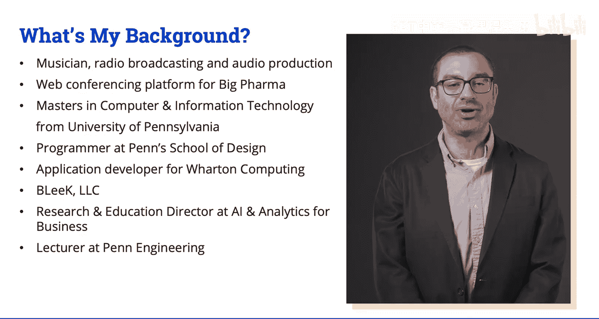

# 第二三部分 47：讲师简介 🧑‍🏫

在本节中，我们将了解本课程的讲师背景、个人经历以及本课程的目标受众。

大家好，我是布兰登·克劳斯基，是这门“如何运用数据”课程的讲师。关于我的背景，我最初是一名音乐家，随后在广播、播音和音频制作领域工作。我的编程经验始于Adobe Flash，我曾用这个工具为一家大型制药公司开发了一个实时网络会议平台。

大约在2009年，我获得了宾夕法尼亚大学的计算机与信息技术硕士学位。之后，我在宾夕法尼亚大学设计学院担任程序员。

随后，我在沃顿商学院计算部门担任应用程序开发员，与教职员工合作开发技术以推进学生项目。在此期间，我创办了自己的公司Bleak LLC，为多家公司提供编程和自由职业应用程序开发服务。

我后来转型进入数据与分析领域，并成为“商业人工智能与分析”部门的研究与教育总监。2018年，我成为宾夕法尼亚大学工程学院的讲师。

更多关于我的信息：我是一名贝斯手，弹奏贝斯已有多年。我演奏多种风格的音乐，但更偏爱放克风格的音乐。我最近大幅减少了咖啡摄入量，并学会了花更多时间冥想。最重要的是，我是一个重视家庭的人。

## 课程目标受众 🎯

本课程面向对数据、数据处理或数据分析知识或经验极少甚至为零的学生和专业人士。虽然本课程要求具备编程经验，但**不要求**有任何数据分析、数据科学或数据可视化的背景。

总的来说，对于那些希望了解数据运作机制、通过执行数据分析获得洞察、应用数据科学技术进行预测以及应用数据分析来解答问题和解决有趣的商业问题的人来说，本课程是一个极佳的入门介绍。

---

本节课中，我们一起了解了讲师布兰登·克劳斯基从音乐到编程再到数据分析的多元背景，并明确了本课程是为具备基础编程能力但缺乏数据分析经验的学习者设计的入门指南。