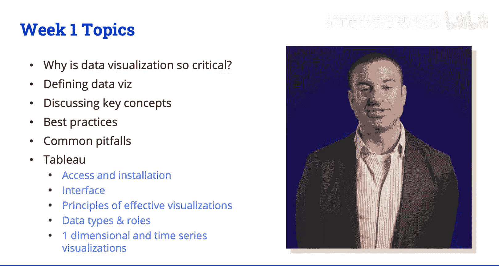

# 第二三部分 48：数据可视化与Tableau

在本节课中，我们将要学习数据可视化的基础知识，并了解如何使用行业领先的工具Tableau来实现它。我们将探讨数据可视化的重要性、核心概念、最佳实践，并开始动手使用Tableau。

## 为什么数据可视化至关重要

在当今数据驱动的决策过程中，数据可视化扮演着关键角色。它能够将复杂的数据集转化为直观的图形，帮助人们快速识别模式、趋势和异常值，从而做出更明智的判断。

上一节我们介绍了课程的整体目标，本节中我们来看看数据可视化的具体定义和核心概念。

## 什么是数据可视化

数据可视化是指通过图形化手段（如图表、图形和地图）来呈现数据信息的过程。其核心目标是清晰、有效地传达数据背后的故事。

以下是数据可视化的几个关键概念：

*   **编码**：将数据属性（如数值、类别）映射到视觉属性（如位置、长度、颜色、形状）的过程。公式可以表示为：`视觉元素 = f(数据属性)`。
*   **视觉感知**：利用人类视觉系统对颜色、大小、形状和运动的敏感度来高效传递信息。
*   **叙事性**：通过可视化的序列和重点突出，引导观众理解数据背后的洞察和结论。

## 数据可视化工具与最佳实践

市面上有众多数据可视化工具可供选择，从编程库（如Python的Matplotlib、Seaborn）到商业智能软件（如Tableau、Power BI）。本课程将重点介绍Tableau。

在创建可视化时，遵循最佳实践并避免常见陷阱至关重要。

以下是创建有效可视化的一些核心原则：

*   **明确目标**：在开始设计前，明确你希望通过可视化回答什么问题或传达什么信息。
*   **选择合适的图表**：根据数据的类型和你要展示的关系（如比较、分布、构成、关联）选择最有效的图表类型。
*   **简化与聚焦**：避免图表垃圾，去除所有不必要的装饰和元素，确保观众注意力集中在数据上。
*   **准确使用颜色**：使用颜色来突出重要信息或区分类别，但需注意色盲友好性，避免使用过多颜色。
*   **提供上下文**：确保图表包含清晰的标题、坐标轴标签和图例，让观众能够理解他们所看到的内容。

## Tableau入门指南

Tableau是一款强大的数据可视化和商业智能工具，以其拖拽式的简易操作和强大的交互功能著称。接下来，我们将引导你如何开始使用它。

首先，你需要访问Tableau的官方网站获取软件。Tableau提供公开版（Tableau Public，免费）和桌面版（Tableau Desktop，付费试用）等版本。对于初学者，Tableau Public是一个很好的起点。

安装完成后，打开Tableau，你会看到起始页和工作簿界面。主要区域包括：
*   **数据窗格**：连接和查看数据源的地方。
*   **工作表**：创建和设计可视化图表的主要画布。
*   **标记卡和行列功能区**：通过拖拽字段到这里来构建视图的核心区域。
*   **筛选器**：用于对视图中的数据进行筛选。

## 创建你的第一个可视化

理解了界面后，我们就可以开始创建可视化了。我们将从一维数据（单个度量或维度）和时序数据的可视化开始。

上一节我们熟悉了Tableau的界面，本节中我们来看看如何构建基础图表。

连接到数据源后，你可以将字段拖拽到“行”或“列”功能区来创建轴，并将其他字段拖到“标记”卡上的“颜色”、“大小”等属性上以添加更多维度。

例如，要创建一个展示不同类别销售额的条形图，你可以：
1.  将“类别”字段拖到“列”功能区。
2.  将“销售额”字段拖到“行”功能区。
3.  Tableau会自动生成一个条形图。你可以在“标记”卡中将“销售额”拖到“标签”上，以在条形上显示具体数值。

对于时间序列数据（如每月销售额趋势），你可以：
1.  将“订单日期”字段拖到“列”功能区（Tableau通常会自动将其识别为日期并聚合到“年”）。
2.  点击该字段的下拉菜单，选择更精细的时间级别，如“月”。
3.  将“销售额”拖到“行”功能区，即可生成折线图或面积图来展示趋势。

本节课中我们一起学习了数据可视化的基础概念、核心原则以及如何使用Tableau软件创建基本的一维和时序数据可视化。你已经掌握了将原始数据转化为直观图表的第一步，为后续学习更复杂的多维数据分析和交互式仪表板制作打下了坚实基础。