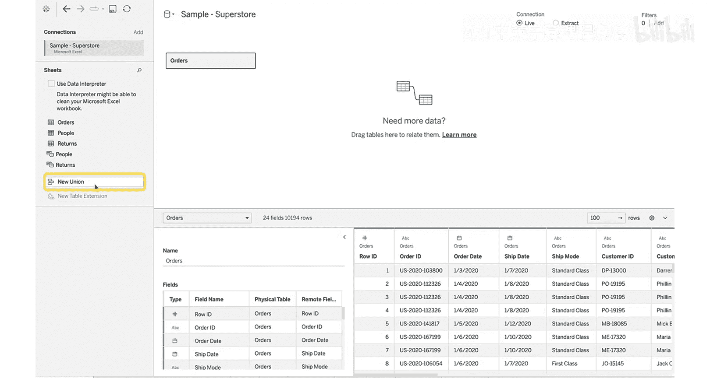
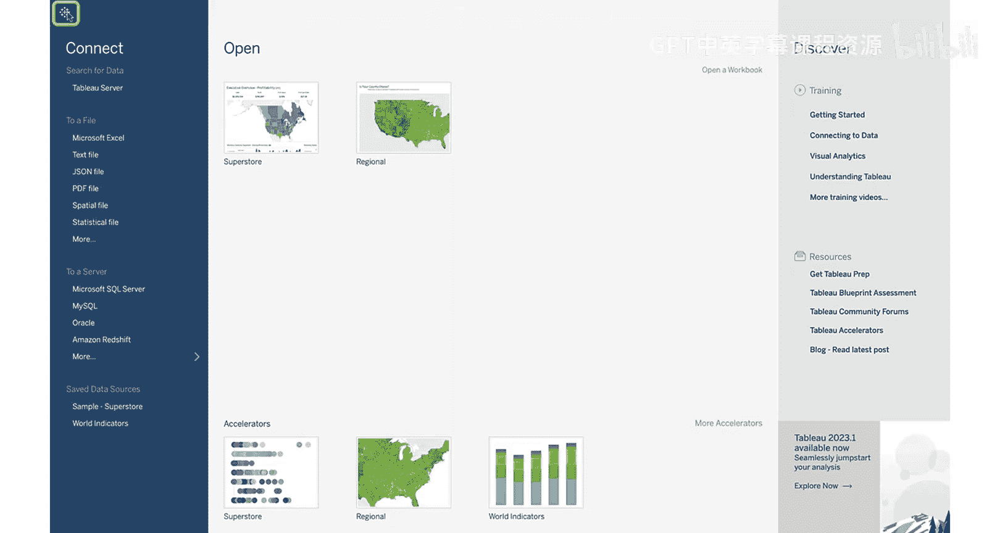
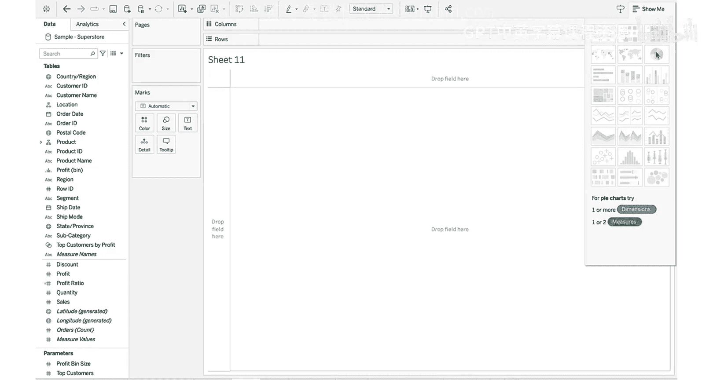

# 第二三部分 50：Tableau界面导览 🧭

在本节课程中，我们将学习Tableau软件的基本界面布局和核心功能区域。通过本次导览，你将熟悉Tableau的工作环境，了解如何加载数据、创建基础图表以及使用各种工具面板。

Tableau的界面设计直观，主要分为数据连接区、工作表视图区和多个功能面板。掌握这些区域的用途是进行有效数据可视化的第一步。

## 数据连接与加载

首先，启动Tableau Public软件，你将看到默认的初始界面。Tableau提供了多种加载和访问数据的方式。

在界面左侧是 **“连接”** 面板，其中包含了连接各种数据源的选项。你的数据集可以是文件，例如 **`Excel`**、**`JSON`**、**`PDF`** 或其他格式文件。你也可以连接到服务器，如 **`MySQL`**、**`Athena`** 等多种选项。

在本系列演示中，我们将频繁使用“示例-超市”数据集，因为官方文档也围绕此数据集展开。要访问该数据集，我们已在Coursera平台内提供了可下载的Excel文件。

以下是加载数据的步骤：
1.  将数据文件下载到本地计算机。
2.  在Tableau的“连接”窗格中，点击 **“Microsoft Excel”**。
3.  找到并选中下载的Excel文件，点击 **“打开”**。

此操作将在下方的“数据源”视图中打开数据。你可以将左侧窗格中的单个工作表拖放到工作区。首先拖入“订单”表，然后将其它工作表（如“人员”表、“退回”表）拖到“订单”表附近以建立关联。Tableau会自动将它们关联到“订单”表。

完成数据准备后，点击左下角的第一个工作表标签（例如“Sheet1”），即可进入主要的工作表视图。

## 工作表界面详解

进入工作表视图后，你将在此处完成大部分的可视化创建工作。这个界面包含多个核心功能区域。

整个右侧区域是 **“数据”窗格**。它包含了**维度**、**度量**以及已创建的**参数**。我们将在课程中详细讨论这些概念。

点击 **“分析”** 按钮，会显示**分析窗格**。其中提供了汇总、模型和其他自定义分析选项。

此外，我们还有 **“标记”卡**。上面有颜色、大小、文本等选项。当我们需要对可视化进行格式设置或其他操作时，会使用到标记卡。

**“筛选器”架**也位于此。如果你想从可视化中筛选掉某些数据，只需将字段拖放到此处，即可进行筛选条件的自定义。

**“页面”架**我们暂时不会过多使用。然后是 **“列”架**和 **“行”架**。如果将某个字段拖到列架上，它将构成图表的列；拖到行架上，则构成行。两者共同决定可视化的结构。

中间的白色区域是 **“可视化”视图**，用于呈现图表。例如，将“细分市场”维度拖到列架，将“销售额”度量拖到行架，即可在此视图中看到一个基础的条形图。

底部的**状态栏**会显示当前视图中的标记数量。例如，在细分市场图表中，状态栏会显示“3个标记”，分别对应消费者、公司、家庭办公室这三个类别。

## 工具栏与视图控制

界面顶部是工具栏，提供了快速控制视图的按钮。

你可以使用排序按钮将数据按**升序**或**降序**排列。例如，点击降序按钮 `▼` 或升序按钮 `▲`。

交换行列按钮可以一键交换行和列的位置。点击后，原来的行会变成列，列变成行。

**显示标记标签**按钮（T字形图标）非常实用。点击后，可以在图表中的条形上方显示具体的销售额数值。

如果你想清除整个视图，只需点击 **“清除工作表”** 按钮。点击后，列架、行架和标记卡上的所有内容都会被清空，视图恢复空白。

菜单栏位于最顶部，提供了更多高级选项。例如，进行格式设置既可以通过标记卡，也可以通过菜单栏的“格式”选项，后者通常功能更强大。

## 数据管理与视图切换

你可以随时查看当前连接的数据源。在数据窗格中右键点击数据源名称，选择 **“查看数据”**，即可浏览整个数据集的所有行和列。点击“查看数据”按钮也能达到同样效果。

点击 **“数据源”** 按钮可以返回到数据源管理界面。这里显示我们连接的“示例-超市”数据集，以及其中的工作表（订单、人员、退回）。我们之前已将“订单”表拖入工作区，Tableau默认以此为主表建立关联。

默认情况下，我们使用的是**实时连接**。你可以点击按钮创建**数据提取**。实时连接与数据提取的区别将在后续课程中讨论。

如果数据源有更新，可以点击 **“刷新”** 按钮，Tableau会同步最新数据。你还可以在此界面创建数据联合，这部分内容我们将单独讲解。

点击 **“新建工作表”** 按钮可以创建空白工作表。**“新建仪表板”** 和 **“新建故事”** 按钮则用于创建更复杂的展示视图。

界面左下角的 **“ShowMe”** 面板非常重要。它展示了可以创建的各种可视化图表类型（如饼图），并明确提示创建该类型图表所需的维度和度量数量。这对于初学者理清图表构建逻辑非常有帮助。

## 课程总结

本节课我们一起学习了Tableau软件的基础界面。我们介绍了如何连接并加载Excel数据，熟悉了工作表视图中的各个核心区域，包括数据窗格、标记卡、筛选器架、行列架以及可视化视图。我们还探索了工具栏的常用功能，如排序、交换行列、显示标签等，并了解了如何管理数据源和切换不同视图。

掌握界面导航是使用Tableau进行数据分析与可视化的基石。在接下来的课程中，我们将深入探讨各种图表类型的创建、高级分析功能以及如何构建交互式仪表板和故事报告。