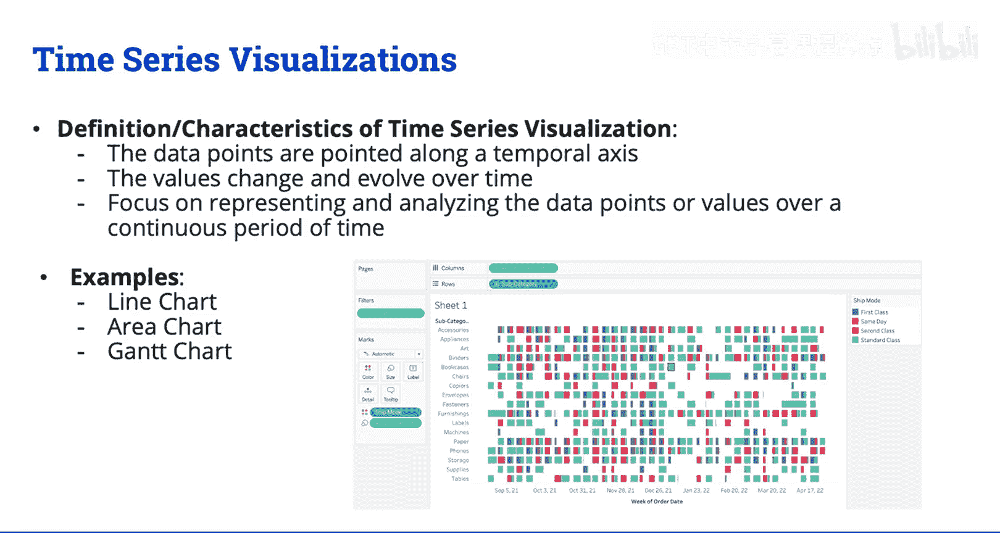

# 第二三部分 52：单维与时间序列可视化 📊

在本节课中，我们将学习两种基础的数据可视化类型：单维可视化和时间序列可视化。我们将了解它们各自的特点、适用场景以及常见的图表形式。

## 单维可视化 📈

上一节我们介绍了可视化的基本概念，本节中我们来看看单维可视化。对于单维可视化，数据通常沿单一坐标轴表示，数值沿该轴绘制或显示。视觉元素（如条形或线条）的长度、高度或位置代表了数据点的大小或数值。

以下是几种常见的单维可视化图表：

*   **条形图**：这是最常见的数据可视化形式之一。你可以用它来比较不同类别间的数据。例如，在下方的可视化图表中，我们看到的是不同细分市场的总利润。
    

*   **折线图**：折线图将多个离散的数据点连接起来，呈现为连续的演变过程。你可以用折线图来查看数据趋势，通常用于展示随时间的变化。例如，这个图表显示了每年的订单总量。

*   **直方图**：直方图展示数据在不同组间的分布情况。它将你的数据分组到特定的类别或区间（称为“箱”），然后为每个类别分配一个与该类别中记录数量成比例的条形。例如，这个直方图显示了不同利润额区间内的利润计数。

*   **饼图**：饼图非常适合为其他可视化图表添加细节，有助于深入分析其他信息。这些示例饼图展示了特定产品类别的细分情况。

## 时间序列可视化 ⏳

理解了静态的单维数据展示后，我们接下来看看如何展示数据随时间的变化。对于时间序列可视化，数据点沿时间轴绘制，其数值随时间变化和演变。这类可视化侧重于表示和分析连续时间段内的数据点或数值。

以下是几种常见的时间序列可视化图表：

*   **折线图**：再次提到折线图，在这个例子中，我们看到的是每年的订单总量。

*   **面积图**：面积图是一种折线图，其中线条与坐标轴之间的区域用颜色填充。这类图表通常用于表示随时间累积的总量。此示例显示了每季度的总销售额。

*   **甘特图**：甘特图通常用于显示项目进度或展示活动随时间的变化。这张甘特图显示了不同产品子类别的运输方式随时间的变化情况。
    

## 总结

本节课中，我们一起学习了单维可视化和时间序列可视化的核心概念。单维可视化（如条形图、直方图、饼图）侧重于在单一维度上展示和比较数据点的数值。而时间序列可视化（如折线图、面积图、甘特图）则专注于揭示数据随时间变化的趋势和模式。理解这些基础图表类型及其适用场景，是进行有效数据分析和故事叙述的第一步。