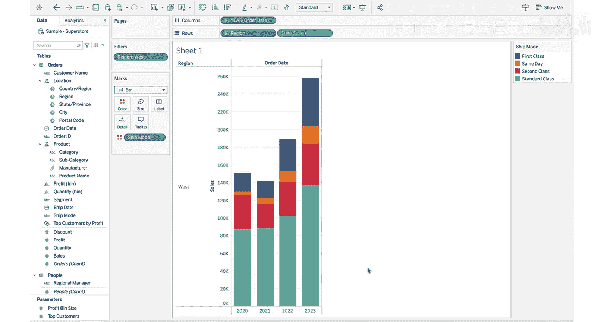

# 第二三部分 53：编程演示：单维可视化之条形图 📊

在本节课中，我们将学习如何使用 Tableau 创建条形图。条形图是用于比较不同类别数据之间差异的有效工具。我们将通过一个具体的例子，使用 Tableau 自带的“示例-超市”数据源，一步步构建一个展示四年间销售总额的条形图。

## 概述与准备工作

本节包含一系列循序渐进的练习，指导你使用真实数据构建不同类型的图表。你将使用 Tableau Desktop 自带的“示例-超市”数据源。请注意，这里提供的示例只是 Tableau 所能创建的众多数据视图中的一小部分。

首先，我们来介绍条形图。条形图用于比较不同类别之间的数据。创建条形图的方法是将一个维度放在“行”功能区，将一个度量放在“列”功能区，或者反过来。

## 创建基础条形图

我们将创建一个条形图来展示四年期间的销售总额。请遵循以下步骤。

首先，确保你已连接到“示例-超市”数据源。

1.  将“订单日期”维度拖放到“列”功能区。
2.  将“销售额”度量拖放到“行”功能区。

此时，数据会按年份聚合，并显示列标题。销售额度量被聚合为总和，并创建了一个垂直轴，而列标题则移动到了视图底部。由于添加了日期维度，Tableau 默认使用了“线”标记类型。

接下来，在“标记”卡上，从下拉列表中选择“条形图”。视图随即变为条形图。此时的标记（即条形）是垂直的，因为轴是垂直的。每个条形的长度代表该年份的销售总额之和。

**注意**：演示中看到的实际数字可能与你可视化中看到的数字不匹配，因为示例数据会不时更新。

## 丰富与筛选条形图

为了让图表展示更多信息，我们可以添加颜色维度。

将“装运模式”维度拖放到“标记”卡上的“颜色”按钮上。视图现在显示了不同运输模式随时间推移对销售额的贡献。从逐年数据看，比例似乎保持一致。

你还可以向功能区添加更多字段。例如，将“地区”维度拖放到“行”功能区，并放在“销售额”的左侧。这样会为每个地区的销售额生成多个轴。

如果只想查看“西部”地区的数据，可以过滤掉其他地区。操作方法是：再次从数据窗格中拖动“地区”维度，这次将其放到“筛选器”功能区。在弹出的筛选器对话框中，取消选中“中部”、“东部”和“南部”复选框，然后点击“确定”。

这个视图能让你深入洞察数据，例如，了解在这四年期间，西部地区的运输模式发生了怎样的变化。

## 总结

本节课我们一起学习了如何在 Tableau 中创建和定制条形图。我们从构建一个基础的年度销售额条形图开始，然后通过添加“颜色”编码来区分不同的运输模式，丰富了图表的信息层次。最后，我们通过添加“地区”维度和应用筛选器，实现了对特定区域数据的聚焦分析。这个过程展示了条形图在跨类别数据比较和细分分析中的强大能力。