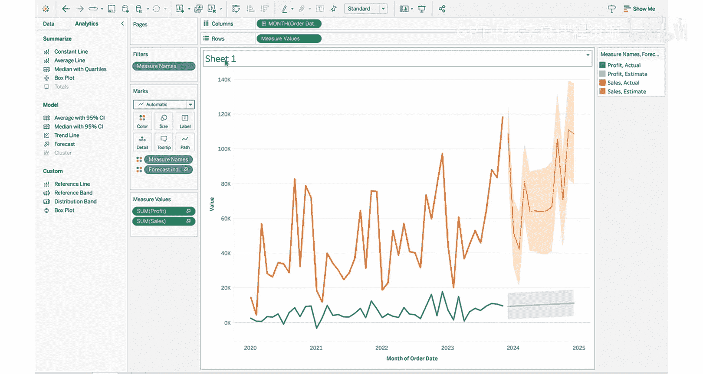

# 第二三部分 54：编程演示：单维可视化之折线图 📈

在本节课中，我们将学习如何使用Tableau创建折线图。折线图通过线条连接数据点，非常适合展示数据随时间变化的趋势或对未来进行预测。

## 创建基础折线图

上一节我们介绍了折线图的基本概念，本节中我们来看看如何一步步构建它。

以下是创建基础折线图的步骤：
1.  将“订单日期”维度拖拽到“列”功能区。Tableau会自动按年份聚合日期并创建列标题。
2.  将“销售额”度量拖拽到“行”功能区。Tableau会将销售额聚合为总和，并显示一个简单的折线图。

## 添加并合并多个度量轴

现在，我们已经在视图中添加了销售额的趋势线。接下来，我们添加另一个度量“利润”，并学习如何处理多个度量轴。

将“利润”度量拖拽到“行”功能区，并放置在“销售额”度量的右侧。Tableau会为销售额和利润分别创建独立的纵轴。

请注意，两个轴的刻度不同。销售额轴的刻度范围是0到70万美元，而利润轴的刻度范围是0到10万美元。这可能导致用户难以直观比较，因为销售额值远大于利润值。

当在折线图中显示多个度量时，可以对齐或合并坐标轴，以便用户更容易比较数值。将“利润总和”字段从“行”功能区拖拽到销售额轴上，以创建一个混合轴。释放鼠标按钮时，两个浅绿色的平行条表示利润和销售额将使用混合轴。

视图更新后，效果如下。由于我们查看的是按年份汇总的值，视图看起来比较稀疏。

## 细化时间粒度与启用预测

目前视图显示的是年度汇总数据。为了看到更连续的变化趋势，我们需要调整时间粒度。

点击“列”功能区上“年(订单日期)”字段的下拉箭头，在上下文菜单的下半部分选择“月”。这样，我们就能看到四年期间更连续的值范围。

生成的视图比原始视图详细得多。注意，数值似乎在每年年底前会大幅上升。这种模式被称为季节性。如果我们开启视图中的预测功能，就能判断这种明显的季节性趋势在未来是否会持续。

要在视图中添加预测，请在“分析”窗格中，将“预测模型”拖拽到视图上，然后将其放置在“预测”区域。

随后我们可以看到，根据Tableau的预测，季节性趋势确实会延续到未来。

## 总结

本节课中我们一起学习了折线图的创建与应用。我们首先构建了展示销售额趋势的基础折线图，然后添加了利润度量并合并了坐标轴以便比较。接着，我们将时间粒度从“年”细化到“月”，以观察更详细的数据波动和季节性模式。最后，我们启用了预测功能，验证了季节性趋势在未来会持续。折线图是观察趋势和进行预测的强大工具。