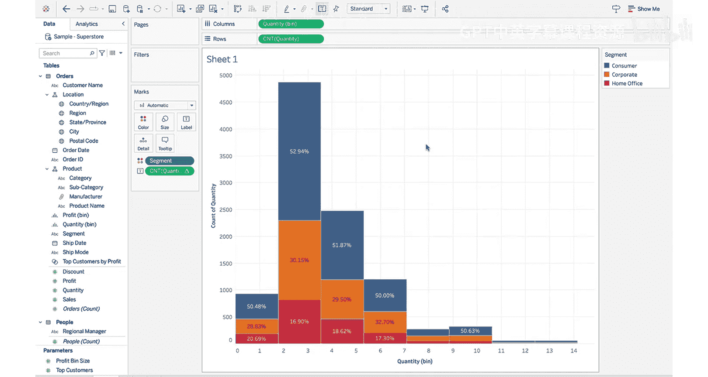

# 第二三部分 55：单维可视化之直方图 📊

在本节课中，我们将要学习一种重要的数据可视化工具——直方图。我们将了解它的定义、作用，并通过一个在Tableau软件中的实际操作演示，来掌握如何创建和解读直方图。

## 什么是直方图？

上一节我们介绍了条形图，本节中我们来看看直方图。直方图是一种特殊的条形图。它用于展示一组数据点的分布形状。与展示单个类别的条形图不同，直方图将数据点分组到不同的范围中，这些范围被称为“箱”或“组距”。

因此，如果你想观察数值是如何分布的，并感受数据的整体分布形态，直方图是一个理想的选择。

## 在Tableau中创建直方图

理解了直方图的基本概念后，我们来看看如何在Tableau软件中实际创建一个直方图。

以下是创建直方图的核心步骤：
1.  将“数量”字段拖拽到“列”功能区。
2.  点击工具栏上的“智能显示”按钮。
3.  从图表类型中选择直方图图标。

请注意，只有当视图中包含一个度量字段且没有任何维度字段时，直方图图表类型才会在“智能显示”中可用。

## 解读直方图视图

点击直方图图标后，视图会发生三个主要变化：
*   视图变为显示垂直条形，X轴（0到14）和Y轴（0到5000）都是连续的。
*   原本放置在“列”功能区、以“总和”方式聚合的“数量”度量，被一个连续的“数量（箱）”维度所取代。“列”功能区上字段的绿色表示该字段是连续的。
*   “数量”度量移动到“行”功能区，并且其聚合方式从“总和”变为“计数”。

在这个例子中，“数量”度量记录的是每个订单中的商品数量。生成的直方图显示：
*   第一个条形（约4800个订单）包含2件商品。
*   第二个条形（约2400个订单）包含4件商品，依此类推。

## 为直方图添加更多维度

为了进行更深入的分析，我们可以尝试添加更多维度。让我们将“客户细分”字段（消费者、公司、家庭办公室）添加到颜色上，以探索客户细分与每单商品数量之间是否存在关系。

将“细分”字段拖拽到“标记”卡的颜色上。然而，仅凭颜色可能无法清晰显示趋势。

为了更清晰地观察，我们可以显示每个条形中各个颜色部分所占的百分比。操作步骤如下：
1.  按住Ctrl键（在Mac上是Command键），将“行”功能区上的“数量计数”字段拖拽到“标记”卡的标签上。这会在不移动原字段的情况下复制一个副本。
2.  右键单击“标记”卡上的“数量计数”字段，选择“快速表计算” -> “总额百分比”。
3.  此时，每个条形中的彩色部分会显示其占总数量的百分比。但我们需要的是每个条形内部的百分比。
4.  再次右键单击“标记”卡上的“数量计数”字段，选择“编辑表计算”。
5.  在表计算对话框中，将“计算依据”的值更改为“区”（即按每个条形独立计算）。

完成这些步骤后，我们得到了想要的视图。分析结果显示，随着订单中商品数量的增加，不同客户细分所占的百分比并未显示出明显的趋势。

## 总结

本节课中我们一起学习了直方图。我们了解到直方图是一种用于展示数据分布形状的条形图，它通过将数据分组到“箱”中来工作。我们通过Tableau的演示，逐步学会了如何创建直方图、如何解读其展示的信息，以及如何通过添加颜色和百分比表计算来深化分析，探索不同维度间的关系。