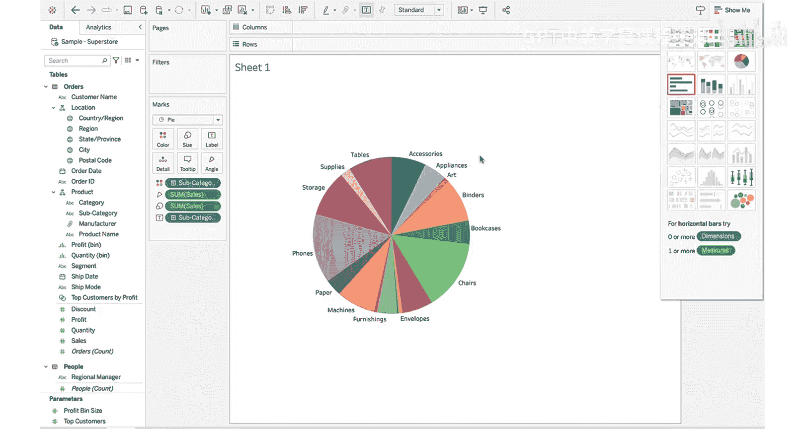

# 第二三部分 56：单维可视化之饼图 🥧

在本节课中，我们将学习如何在Tableau中创建饼图，以直观展示不同产品子类别对总销售额的贡献比例。

上一节我们介绍了条形图等基础图表，本节中我们来看看另一种常见的图表类型——饼图。

## 创建基础饼图

饼图用于显示一个整体中各组成部分的比例关系。在Tableau中创建饼图，需要遵循特定的数据字段要求。

以下是创建基础饼图的步骤列表：

1.  将度量“销售额”拖放至“列”功能区。
2.  将维度“子类别”拖放至“行”功能区。
3.  此时，Tableau默认将“销售额”聚合为总和，并生成一个条形图。
4.  点击工具栏上的“智能显示”按钮。
5.  在弹出的图表类型中，选择“饼图”。

> **核心概念**：饼图要求至少一个或多个维度和一个或两个度量。像“利润率”这样的聚合字段不计入此要求。

## 调整图表与添加标签

初始生成的饼图可能尺寸较小，且缺乏具体数据标签，我们需要对其进行调整以增强可读性。

为了使图表尺寸变大，请按住 `Ctrl` + `Shift`（在Mac上是 `Shift` + `Z`）并多次按 `B` 键。

接下来为饼图添加标签。以下是具体操作：

1.  从“数据”窗格中，将“子类别”维度拖放至“标记”卡上的“标签”区域。
2.  如果添加后未立即显示标签，请按 `Ctrl` + `Shift` + `B`（在Mac上是 `Shift` + `Z` + `B`）以确保大部分单独的标签可见。

本节课中我们一起学习了如何在Tableau中创建和美化饼图。我们掌握了构建饼图所需的数据字段组合、调整图表大小的方法以及为扇区添加清晰标签的技巧，从而能够有效地展示数据的部分与整体关系。