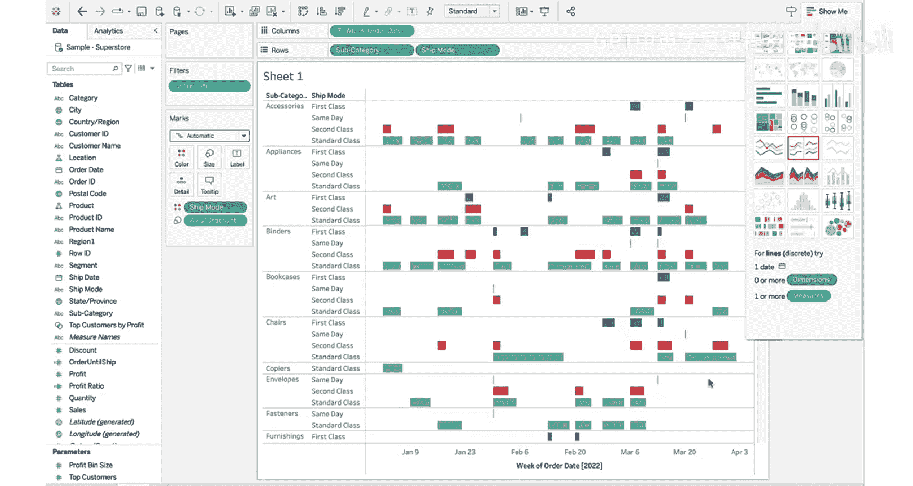

# 第二三部分 58：时间序列可视化之甘特图 📊

在本节课中，我们将学习如何使用甘特图进行时间序列可视化。甘特图是一种用于展示事件或活动持续时间的图表，其中每个独立的标记（通常是一个条形）代表一个时间段。我们将通过一个具体的例子——展示订单日期与发货日期之间的平均间隔天数——来掌握在Tableau中创建甘特图的完整步骤。

## 概述

甘特图的核心是展示持续时间。例如，你可以用它来显示一系列产品的平均交付时间。本节我们将创建一个甘特图，来可视化订单日期与发货日期之间平均间隔的天数。

## 创建甘特图步骤

以下是创建甘特图的具体操作流程。

**第一步：设置时间轴**
将“订单日期”维度拖拽到“列”功能区。Tableau会自动按年份聚合日期，并创建带有年份标签的列标题。接着，在“列”功能区上，点击“年(订单日期)”的下拉箭头，选择“周数”。此时，列标题会变为以周为单位，并以刻度线表示各个周。由于四年跨度有208周，数量过多，视图将不会显示所有周的标签。

**第二步：构建行层级**
将“子类别”和“发货模式”维度拖拽到“行”功能区。请将“发货模式”放在“子类别”的右侧。这样就在左侧轴上构建了一个两级嵌套的维度层次结构。

**第三步：计算时间间隔并应用于标记大小**
我们需要根据订单日期和发货日期之间的间隔长度来调整标记的大小。为此，需要创建一个计算字段来捕获这个时间间隔。
1.  在工具栏菜单中，点击“分析” -> “创建计算字段”。你也可以在数据窗格中的任何字段上右键单击（Mac上为Control+单击），然后选择“创建计算字段”。
2.  在计算对话框中，将计算字段命名为“订单到发货间隔”。
3.  在公式框中输入以下公式，然后点击“确定”：
    `DATEDIFF('day', [订单日期], [发货日期])`
    这个公式创建了一个自定义度量，用于计算订单日期和发货日期之间相差的天数。
4.  将“订单到发货间隔”度量拖拽到“标记”卡上的“大小”中。该度量的默认聚合方式是“总和”，但在此场景下，使用“平均值”更为合理。
5.  右键单击（Mac上为Control+单击）“标记”卡上的“总和(订单到发货间隔)”字段，然后选择“度量” -> “平均值”。

**第四步：应用筛选器以聚焦视图**
目前视图中的标记过于密集。按住Ctrl键（Mac上为Option键），将“周(订单日期)”字段从“列”功能区拖拽到“筛选器”功能区。这个操作会复制该字段到新位置，而不会将其从原位置移除。
1.  在筛选器字段对话框中，选择“日期范围”，然后点击“下一步”。
2.  将范围设置为一个三个月的时间间隔，例如“2013年1月1日”到“2013年3月31日”，然后点击“确定”。使用滑块可能难以精确选择日期，更简便的方法是直接在日期框中输入数字，或使用日历选择日期。

**第五步：按发货模式着色**
将“发货模式”维度拖拽到“标记”卡上的“颜色”中。现在，你的视图就清晰地展示了关于订单时间与发货时间之间延迟的各种信息。

## 甘特图分析解读

通过最终的甘特图，你可以分析出多种信息。例如，可以观察哪些发货模式更容易出现较长的延迟时间；延迟时间是否因产品类别不同而变化；以及延迟时间是否随时间保持稳定。

## 时间序列分析核心概念

上一节我们完成了甘特图的创建，本节中我们来深入了解一下时间序列分析的基础概念。

时间序列分析是一种分析**在一段时间内收集的数据点序列**的特定方法。在时间序列可视化中，分析师**在设定的时间段内以一致的间隔记录数据点**，而不是间歇性或随机地记录。

然而，需要明确的是，这种分析不仅仅是随时间收集数据的行为，更重要的是**展示数据如何随着数据点进行调整以及最终的结果**。它提供了额外的信息源，并揭示了数据之间的一套依赖顺序。

时间序列分析通常需要**大量的数据点**来确保一致性和可靠性。一个广泛的数据集能保证你拥有具有代表性的样本量，并且分析能够穿透噪声数据。它还能确保所发现的任何趋势或模式不是异常值，并且能够解释季节性变化。

此外，时间序列数据可以用于**预测**，即**基于历史数据预测未来数据**。

## 总结

本节课中，我们一起学习了如何使用Tableau创建甘特图来进行时间序列可视化。我们从设置时间轴和行层级开始，通过创建计算字段来量化时间间隔，并利用筛选器聚焦视图，最后通过颜色编码增强信息的可读性。我们还探讨了时间序列分析的核心价值，包括其对于揭示数据趋势、依赖关系以及进行未来预测的重要性。掌握甘特图将帮助你有效地展示和分析与时间相关的持续过程。