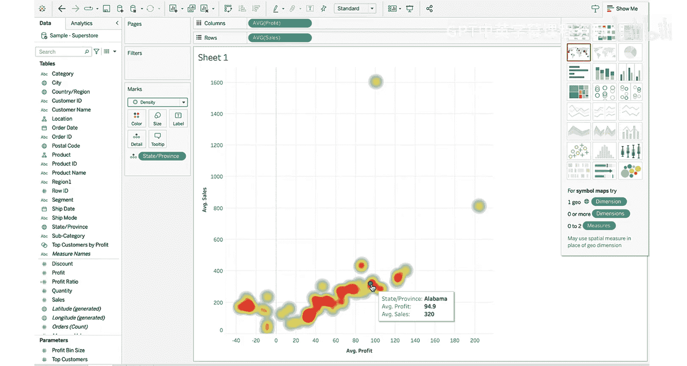

# 第二三部分 62：多维可视化之热力图 🔥

在本节课中，我们将要学习一种名为“热力图”的数据可视化技术。热力图通过颜色编码来展示数据的密度或强度分布，特别适用于处理数据点密集、相互重叠的情况，能够帮助我们直观地发现数据中的模式和趋势。

## 什么是热力图？

上一节我们介绍了多种图表类型，本节中我们来看看热力图。热力图使用密度图表来可视化密集数据中的模式或趋势，这些数据通常包含大量重叠的标记。其核心原理是：将重叠的标记进行分组，并根据每组中标记的数量进行颜色编码。

在Tableau等工具中，密度图可以帮助你识别数据点数量更多或更少的区域。

## 如何创建热力图？

理解了热力图的概念后，我们来看看它的具体创建步骤。以下是使用Tableau创建热力图的基本流程：

1.  **放置字段**：在“列”功能区上放置至少一个连续度量，并在“行”功能区上放置至少一个维度或度量（反之亦可）。
2.  **添加细节**：将一个字段添加到“标记”卡中的“详细信息”上，以定义数据点的分组。
3.  **选择标记类型**：在“标记”卡中，将标记类型从默认的“自动”或“圆”更改为“密度”。

## 实战演练：创建销售利润热力图

为了展示热力图如何帮助理解Tableau中重叠的标记，我们将从一个包含大量标记的散点图开始，并将其重新创建为密度图（即热力图）。

我们将使用热力图来按地理位置比较订单销售额与利润。

**第一步：构建基础坐标轴**
首先，将度量“利润”添加到列功能区。我们选择聚合类型为“平均值”（AVG），即字段值的平均值。然后，将度量“销售额”拖到行功能区，同样将聚合类型设置为“平均值”。现在，你可以看到一个带有两个坐标轴的空白图表。

**第二步：添加维度以生成数据点**
接下来，我们添加一个维度字段。将“州/省”维度拖到“标记”区域中的“详细信息”卡上。这将在图表上添加一组代表不同州的圆点，显示每个州的平均销售额和平均利润。

**第三步：转换为热力图**
现在，选择“密度”标记。通过将形状选择为“密度”，我们将此图表转换为密度热力图。这将把数据点的形状从圆点更改为密度点。也就是说，数据点的配色方案将遵循密度梯度。

**第四步：自定义颜色与样式**
要选择你喜欢的配色方案，请右键单击“颜色”卡并浏览选项。从这里，我们还可以基于热力图的这些设置来调整强度、不透明度和其他边框效果。

对于这个热力图，数据点最多或最密集的区域将显示为红橙色，而数据点较少、较分散的区域则显示为蓝绿色调。

## 解读与交互

通过这种方式，我们在Tableau中创建了一个热力图或密度热力图，以查看地图中数据点的更多细节。为了查看具体信息，请将光标悬停在密度点上。我们可以在文本标签上看到所有相关的详细信息。

## 总结

本节课中我们一起学习了热力图的原理与创建方法。我们了解到，热力图是一种通过颜色深浅展示数据密度分布的有效工具，尤其擅长处理重叠数据点，揭示其下的整体趋势和集中区域。通过Tableau的简单几步操作——放置度量、添加维度、选择密度标记并自定义颜色——我们就能将散乱的散点图转化为一目了然的热力图，从而更直观地进行数据比较和分析。