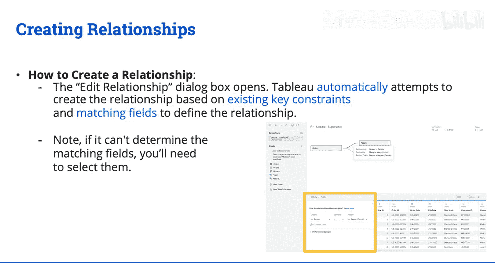

# 第二三部分 63：关系（Relationships）与数据模型

在本节课中，我们将学习 Tableau 中一个强大且动态的多表数据组合方式——关系（Relationships）。我们将了解关系与传统的连接（Join）有何不同，如何创建关系，以及使用关系时的注意事项。

## 关系（Relationships）的概念

上一节我们介绍了数据连接的基础知识，本节中我们来看看一种更灵活的多表组合方式：关系。

关系是 Tableau 中一种新颖且动态的、用于组合多表数据进行分析的方法。关系简单地定义了两个表之间如何关联，但不会像连接那样将它们合并在一起。连接会生成一个新表，并且不允许我们单独查询原始表。

可以将关系想象成两个表之间的一份“合同”。各个表保持独立，并维护其自身的详细级别。这些详细级别也被称为 LOD 表达式，它们允许您在数据源级别和可视化级别计算值。

基于您拖入视图的字段，Tableau 会在运行时决定最合适的连接方式。

## 创建关系的要求

在创建关系之前，了解其前提条件非常重要。以下是使用关系的一些要求：

*   **字段数据类型**：定义关系的字段必须具有相同的数据类型。
*   **地理字段限制**：不能基于地理字段定义关系。
*   **不支持循环关系**：数据模型中不支持循环关系。数据模型指的是您在数据源视图的画布中添加的表的整体结构。
*   **已发布数据源**：不能在已发布的数据源之间定义关系。已发布数据源是指已发布到 Tableau Server 并共享的数据源，如文件或数据库。

## 如何创建关系

了解了基本概念和要求后，现在我们来实践如何创建关系。您可以在 Tableau 数据源视图的默认逻辑层中创建关系。以下是具体步骤：

1.  将一个表拖到画布上。
2.  将另一个表拖到画布上。当您看到两个表之间出现连接线时，松开该表。
3.  “编辑关系”对话框将打开。
4.  Tableau 会自动尝试基于现有的键约束和匹配字段来创建关系。如果 Tableau 无法确定匹配字段，您需要手动选择它们。

---

本节课中，我们一起学习了 Tableau 中的关系功能。我们明确了关系与连接的区别，理解了关系就像表之间的动态“合同”，能够保持表的独立性。我们还掌握了创建关系的步骤以及必须遵守的几项关键要求，例如字段数据类型需一致、不支持地理字段和循环关系等。掌握关系的使用，能让您的多表分析更加灵活和高效。