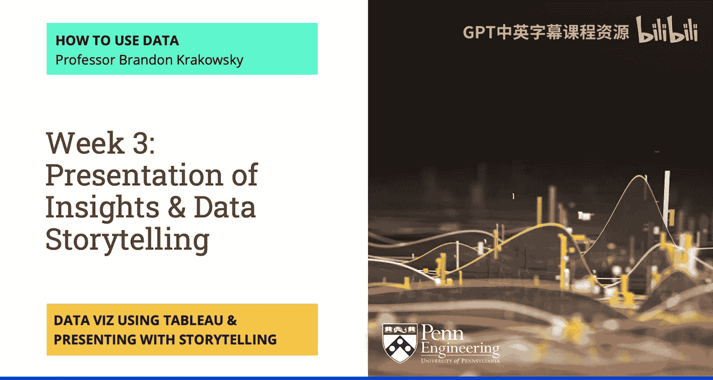

# 第二三部分 65：洞见呈现与数据叙事 🎯

在本模块中，我们将学习如何有效地呈现数据分析结果，并运用数据叙事技巧，使你的发现更具说服力和行动力。我们将探讨构建信息、设计幻灯片以及讲好数据故事的核心方法。

---

上一节我们介绍了本模块的核心目标，本节中我们来看看数据呈现与叙事的重要性。

仅仅分析数据是不够的。将你的发现以一种对利益相关者而言既引人入胜又可付诸行动的方式进行沟通，这一点至关重要。

---

接下来，你将学习创建有效数据分析演示文稿的要点。

以下是三个核心要点：

*   **构建你的信息**：清晰、有逻辑地组织你的发现。
*   **设计你的幻灯片**：运用视觉元素，使数据易于理解。
*   **运用叙事技巧**：通过讲故事，让你的数据生动起来。

---

本模块包含关于数据呈现和叙事最佳实践的案例研究。

这些案例将展示如何有效地分析、解读和呈现数据洞见。

---

最终，本模块将以一个真实世界的项目演示作为 culmination。

通过这些真实案例，你将确保你的听众不仅能理解你的发现，还能被激励并据此采取行动。

---

## 总结

在本节课中，我们一起学习了数据呈现与叙事的艺术。到本模块结束时，你将掌握在当今信息丰富的环境中进行数据驱动型演示的关键技能。