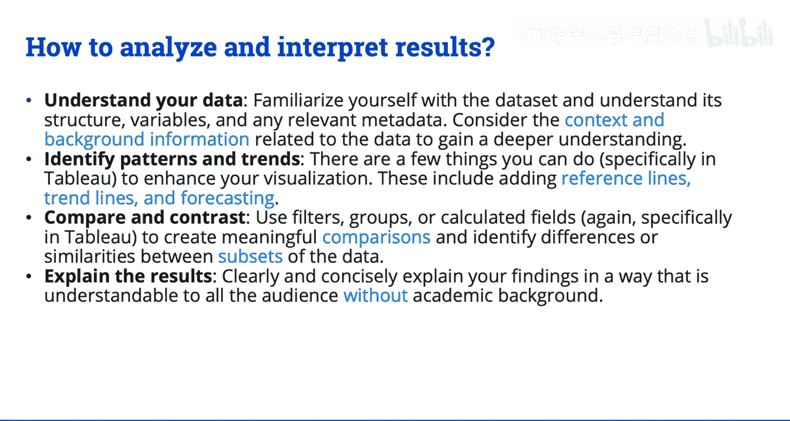

# 第二三部分 67：分析与结果解读 📊

在本节课中，我们将学习数据分析流程的最后一步：如何分析和解读你的结果。这一步骤是将数据转化为洞察力的关键，确保你的发现能够被清晰理解并用于指导决策。

---

## 理解你的数据

在开始解读之前，你必须确保自己充分理解数据。这包括熟悉整个数据集，理解其结构、变量以及任何相关的元数据。

例如，你需要知道数据集中包含哪些列，每列代表什么含义，以及数据是如何收集和处理的。

---

## 考虑背景信息

为了获得更深层次的理解，你需要考虑与数据相关的背景信息。这包括数据产生的业务场景、历史因素或任何可能影响结果的限制条件。

背景信息能帮助你判断一个趋势是正常的业务波动，还是需要特别关注的异常信号。

---

## 识别模式与趋势

上一节我们强调了理解数据本身，本节中我们来看看如何从中提取信息。在Tableau等工具中，你可以通过几种具体方法来增强可视化效果，从而更好地识别模式与趋势。

以下是几种有效的方法：
*   **添加参考线**：例如，添加一条表示平均值的线，可以快速看出哪些数据点高于或低于平均水平。
*   **添加趋势线**：通过统计模型（如线性回归）展示数据的整体走向。公式可以表示为 `y = mx + b`，其中 `m` 是斜率，`b` 是截距。
*   **进行预测**：基于历史数据，使用工具内置的预测功能来推断未来的可能趋势。

---

## 比较与对比数据

识别趋势后，下一步是进行深入的比较。通过比较不同的数据子集，可以发现差异或相似之处。

在Tableau中，你可以利用以下功能创建有意义的比较：
*   **使用筛选器**：聚焦于特定的数据范围，例如只看某个地区的销售数据。
*   **使用分组**：将数据按类别（如产品类型、客户分段）进行聚合比较。
*   **使用计算字段**：创建新的指标进行对比，例如计算利润率 `利润率 = (利润 / 销售额) * 100`。

---

## 解释结果

分析完成后，你需要将发现清晰地传达给受众。你的解释应当简洁明了，即使是没有学术背景的听众也能理解。

这意味着避免使用晦涩的专业术语，用平实的语言说明图表显示了什么，以及为什么它很重要。

---

## 提供洞察与建议

最后，基于你的分析结果和相关的可视化图表，提供有意义的建议。这是整个分析过程的价值所在。

你需要完成以下两点：
*   **解释发现的含义**：说明你的分析结果意味着什么。
*   **为决策提供信息**：阐述这些发现如何能够影响当前的决策，或解答最初的研究问题。

---

本节课中我们一起学习了数据分析的收尾工作：从**理解数据**和**背景**出发，到**识别趋势**、**进行比较**，最后**清晰地解释结果**并**提供可操作的洞察与建议**。记住，分析的最终目标是将数据转化为能够驱动行动的知识。