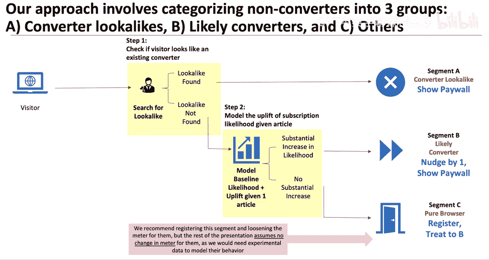

# 第二三部分 73：将未转化用户分类为类转化者、潜在转化者与浏览者 🎯

在本节课中，我们将学习一种基于用户行为数据，将网站访问者进行分类的策略。我们将探讨如何识别出“类转化者”、“潜在转化者”和“浏览者”，并为不同类别的用户制定相应的互动策略，以优化整体转化率和收益。

---

## 策略概述与流程

我们的策略始于一位访客进入网站。核心目标是根据他们的行为特征，将其分配到最合适的类别，并采取相应的行动。

以下是整个分类与处理流程的步骤分解：

**第一步：识别类转化者**
首先，我们会检查访客是否看起来像一个“转化者”。这基于一个特定的**距离阈值**（例如，行为特征与历史转化用户的相似度）。如果访客的行为特征符合这个阈值，我们将其分类到 **A 类**，即“类转化者”。对于这类用户，我们的行动是直接向他们展示付费墙，因为我们判断他们很可能已经准备转化。

**第二步：评估潜在转化者**
如果访客不符合“类转化者”的标准，我们将进入下一步：评估向他们**多提供一篇文章**可能带来的效果。这意味着我们需要理解他们的**基线转化可能性**，以及多提供一篇文章所带来的**转化概率提升值**。如果这个提升值足够显著，我们将其分类到 **B 类**，即“潜在转化者”。对于这类用户，我们会提供那篇额外的文章，然后展示付费墙。

**第三步：处理浏览者**
经过以上两步，剩下的用户将被归入 **C 类**。这类用户既不像转化者，其转化可能性也不会因为多获得一篇文章而有显著提升。我们可以称他们为“浏览者”。对于这类用户，我们建议采取不同的策略，例如引导他们注册，并展示大量文章。这样，我们或许可以通过其他途径（如广告收入）从他们身上获得收益。经过一段时间的免费文章“培养”后，他们的转化可能性可能会增加，从而有机会升级到 B 类。

---

## 数据基础与模型假设

我们用于构建此策略的历史数据，是基于文章数量较少的情况（因为当时的付费墙设置较为严格）。这使得我们能够相对准确地建模 A 类和 B 类用户的行为。

然而，对于 C 类用户（他们将获得大量免费文章），我们需要通过 **A/B 测试** 来收集数据并建模其行为。在当前的模型中，我们暂时假设 C 类用户的付费墙设置保持不变（即保持宽松）。这个假设允许我们专注于评估调整 A 类和 B 类用户付费墙策略所带来的收益。

理解这个整体方法及其背后的监控机制非常重要。

---

## 策略扩展与收益机会

对于 C 类用户（浏览者），存在寻找替代货币化途径的机会。例如，可以尝试向他们展示更多与商业购物相关的文章，以期通过销售佣金从这部分用户中获取价值。也可以为他们部署不同的广告版位图，以提供更多的广告变现机会。这为针对不同用户群体设计差异化的处理方案提供了丰富的可能性。

---

本节课中，我们一起学习了如何通过三步流程对未转化用户进行精细分类：**识别类转化者、评估潜在转化者、处理浏览者**。我们了解了基于行为阈值和转化提升评估的分类逻辑，以及针对不同类别用户的差异化互动策略（如直接展示付费墙、提供额外内容、探索替代变现途径）。最后，我们还讨论了该策略的数据基础、模型假设及其未来的扩展可能性。掌握这一框架，有助于更科学地制定用户转化策略，提升整体运营效率。