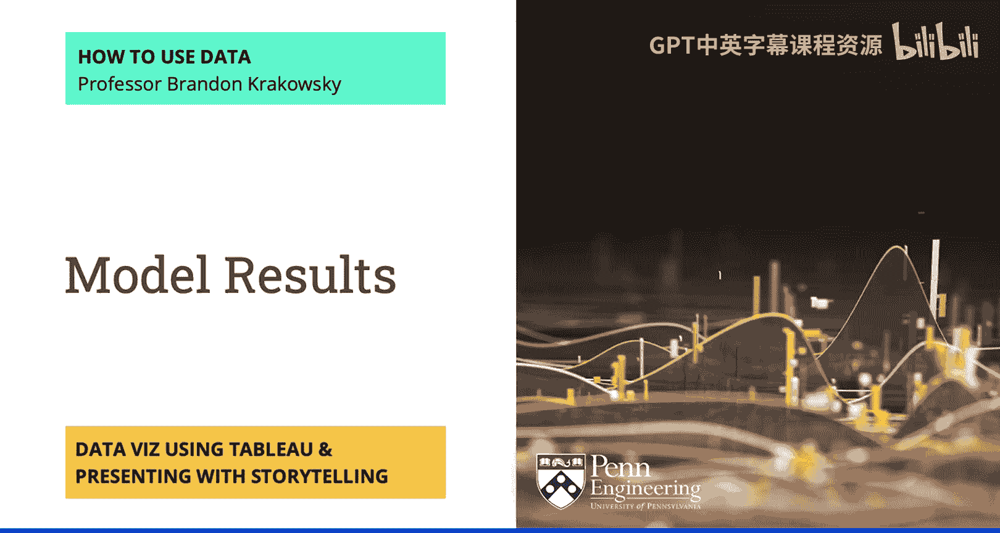
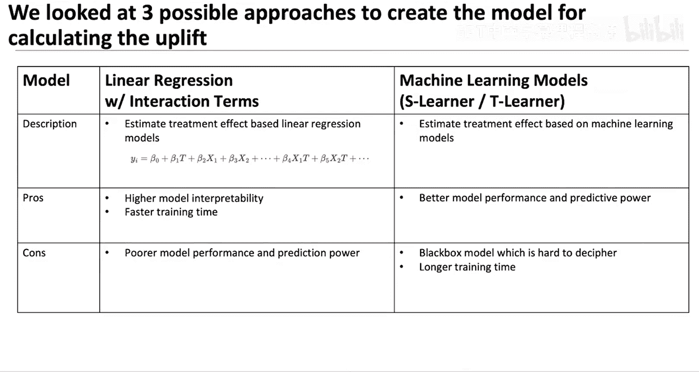
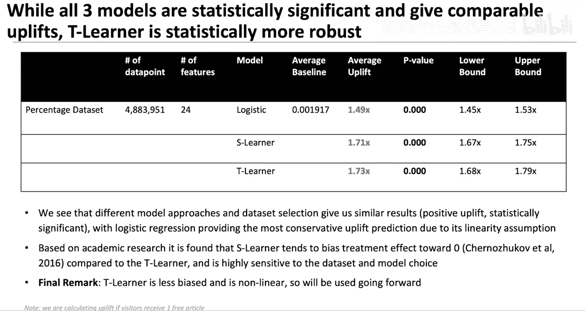
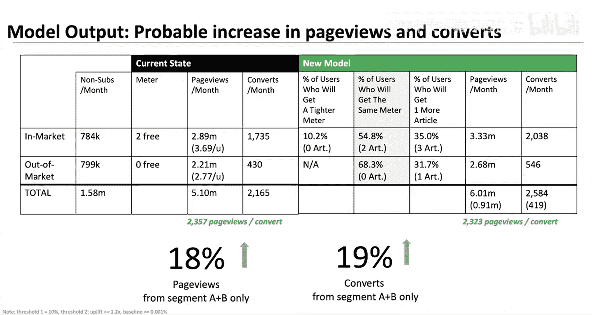

# 第二三部分 74：模型结果解读 🧮

在本节课中，我们将详细解读一个预测模型的构建过程与最终结果。我们将从理解数据异质性开始，逐步介绍特征选择、模型评估、提升度计算，并最终展示模型带来的业务影响。

## 理解用户异质性

在构建动态计量模型之前，首要步骤是理解“转化者”与“非转化者”之间的异质性。

我们通过将转化者和非转化者各分为五个集群，并在一些关键维度上进行映射分析来实现这一点。核心发现是，不同类型的转化者与非转化者之间存在相当程度的重叠。这一重叠使我们有可能为大量非转化者找到相似的“局部近邻”。

## 构建模型：寻找局部近邻

上一节我们介绍了用户群体的异质性，本节中我们来看看模型构建的第一步：寻找局部近邻并将用户分类到A细分群体。

我们采用的方法是设定一个距离阈值，该阈值定义了用户与其他转化者之间的相似距离。

以下是不同距离阈值下的分类结果：
*   当距离阈值设为 **0.138** 时，有 **10%** 的用户被归类为局部近邻（A细分）。
*   当距离阈值降低到 **0.1** 时，被归类为A细分（转化者近邻）的用户数量显著下降。
*   当距离阈值增加到 **0.15** 时，用户数量并未显著增加。

这表明在10%的局部近邻比例附近存在一个拐点。如果我们希望标准更严格，可以提高距离阈值，从而将大约 **18% 到 20%** 的用户分类进来。

## 预测转化概率与提升度

模型的第二部分旨在计算转化概率以及额外增加一次曝光带来的提升度。

我们从所有数据中发现，整体的基准转化概率为 **0.02%**。而为用户额外增加一篇文章曝光，能使其转化概率相比基准提升 **1.7倍**。

我们的行动是设定基准概率和提升度的特定阈值，并最终将 **33%** 的用户分类到B细分群体（即在排除局部近邻后，具有较高转化倾向的用户）。

综合来看，这 **10%** 的A细分用户和 **33%** 的B细分用户，预计能为保护页面浏览量和转化量带来 **15% 到 20%** 的增长。

## 特征选择与模型评估

为了预测非转化者转变为转化者的概率并找出关键驱动因素，我们将数据聚合到用户层面，并确保每个特征都具有预测价值。

首先，我们需要剔除高度相关的特征，以避免信息冗余。我们最初有 **67** 个原始特征，通过筛选最终将 **24** 个特征作为模型输入。

接下来，我们需要决定使用哪种模型。我们使用 **AUPRC** 这个统计量来评估不同模型。完美模型的AUPRC值为1，而我们的 **XGBoost** 模型取得了 **0.7198** 的分数，最为接近，因此被选为最终预测模型。

最后，我们分析了模型中哪些特征对预测用户是否转化最为重要。

以下是关键预测特征：
*   来自新闻通讯的页面访问百分比
*   总页面访问量
*   来自桌面端的页面访问百分比
*   访问近期度
*   访问频率

我们注意到，部分发现与最初的探索性数据分析结果一致，这验证了模型的有效性。同时，我们也发现了一些新特征，如“来自桌面端的页面访问百分比”和“近期度与频率”，这些是建模后获得的新洞察。

## 计算提升度：模型比较

为了实际计算提升效果，我们比较了三种方法的性能。

我们评估了以下三种模型：
1.  **线性回归模型**：性能尚可，但预测能力有限。
2.  **S-Learner**：来自机器学习领域，具有更高且更稳健的性能。
3.  **T-Learner**：同样来自机器学习领域，性能高且稳健。

观察这三种方法的结果，我们发现不同的模型方法和数据选择给出了相似的结论：都显示出正向的提升效果，且统计显著性提升约为 **1.5倍**。

然而，在深入研究学术文献后，我们发现 **T-Learner** 可能是最稳健的模型。因为线性回归模型依赖于许多线性假设，而T-Learner能更好地处理处理效应估计的偏差问题。因此，我们最终决定采用 **T-Learner** 的结果。

## 最终结果与业务影响

现在，我们来看最终填充了结果的数据，这是当前我们所处的状态。

在现有策略下（市场内用户获得2-3篇文章，市场外用户获得0-3篇文章），我们每月总共获得 **510万** 页面浏览量和 **21,651** 次转化。

在新的策略下：
*   **A细分**（获得更严格计量）用户占比一定百分比。
*   **B细分**（获得额外一篇文章）用户占比一定百分比。
*   剩余用户归入 **C细分**。

经过计算，我们发现A细分用户受到的限制会比当前更严格，其页面浏览量和订阅倾向甚至会略有下降。但B细分用户因处理效应带来的增长将完全弥补这部分损失。

总体而言，新策略预计每月能带来 **601万** 页面浏览量和 **25,841** 次转化。这意味着页面浏览量增长 **18%**，转化量增长 **19%**。

需要强调的是，这仅仅是针对A和B细分用户进行干预的初步结果。我们还需要对C细分用户进行测试以观察额外影响。而且，这只是一个市场（休斯顿）一个月的预测。当我们开始考虑在整个赫斯特网络全年推广此策略时，其带来的机遇将非常令人振奋。

---

本节课中我们一起学习了从数据理解、特征工程、模型选择与评估，到最终业务影响测算的完整预测分析流程。我们看到了如何通过严谨的建模步骤，将数据转化为可执行的业务洞察，并量化其潜在价值。