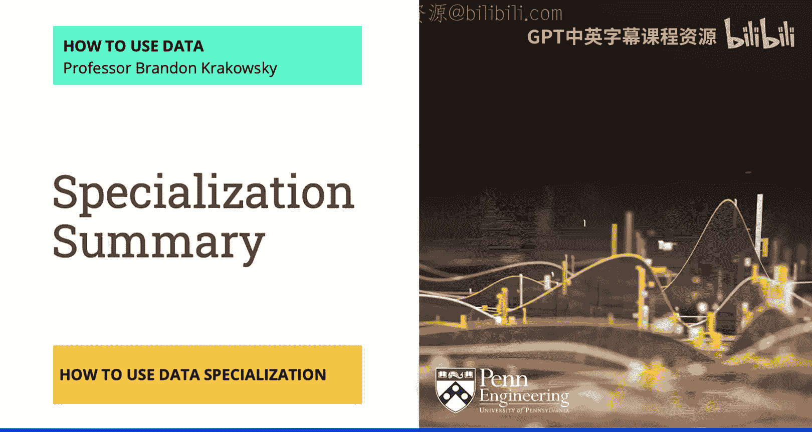
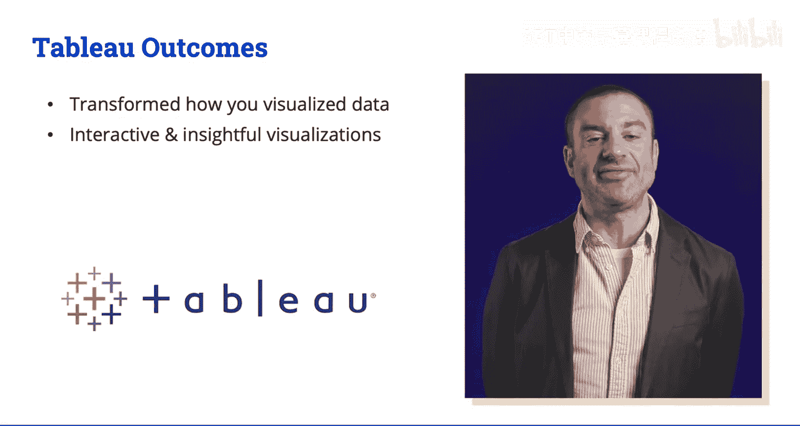

# 第二三部分 75：课程结语

在本节课中，我们将回顾整个“如何运用数据”专项课程所涵盖的核心内容与技能发展历程。

---

## 课程回顾与技能总结

带着对数据的好奇心，或许还有一丝忐忑，你开启了一段全面的数据分析世界之旅。

你掌握了用于数据整理的SQL，用于数据分析和预测分析的Python，并利用Tableau进行数据可视化，通过精湛的数据叙事技巧让你的发现变得生动。

在过去的数周里，你不仅学习了各种技术和工具，并且积极地应用了它们。

以下是你在SQL学习中的主要收获：

*   你掌握了数据存储的复杂性。
*   你学会了高效地查询数据库。
*   你理解了构建和连接数据结构的重要性。

上一节我们回顾了数据处理的基础，本节中我们来看看你在Python方面的进展。Python学习不仅仅是编写代码，更是将其作为探索性数据分析的工具，用于清洗、转换复杂数据集并从中获取有意义的见解。

你的Python技能进一步延伸到了机器学习领域。

以下是你在机器学习中应用的主要模型与技术：

*   你应用了**线性回归**和**逻辑回归**等模型。
*   你甚至探索了**决策树**、**随机森林**和**K均值聚类**等高级技术。

在专项课程的最后阶段，Tableau改变了你可视化数据的方式。你超越了基础图表，开始创建具有交互性和深刻洞察力的可视化作品，学会了用数据讲述故事。

## 展望未来

这门专项课程是一个起点，为你在广阔且不断发展的数据和数据分析领域持续学习奠定了基础。

感谢你在此专项课程中付出的努力和做出的独特贡献。展望未来，希望你继续保持对数据的好奇心，运用这些技能来提升你的专业和学术追求。

---

本节课中我们一起回顾了整个“如何运用数据”专项课程的学习旅程，总结了在SQL数据处理、Python分析与机器学习以及Tableau可视化叙事三大核心模块中获得的关键技能，并展望了持续学习和应用这些能力的未来方向。