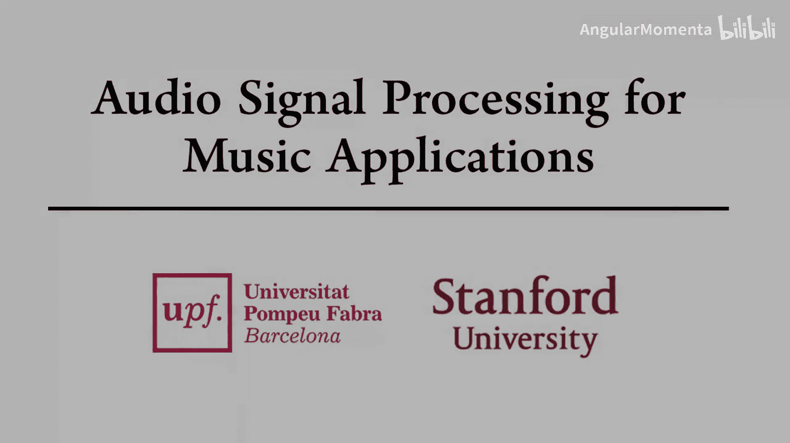

# 001：课程预告片 🎵

在本节课中，我们将简要了解《音乐应用中的音频信号处理》这门课程的核心内容、教学团队以及你将学习到的令人兴奋的技术。

音乐不仅可以聆听和欣赏，也可以从工程学的角度进行研究。

我叫Jerra，教授音频处理课程已超过25年。我曾在斯坦福大学为不同背景的学生举办过多次暑期研讨会，学员包括音乐家、工程师以及人文学科背景的人士。目前，我在巴塞罗那庞培法布拉大学为计算机科学和电气工程专业的学生授课。通过这门《音乐应用中的音频信号处理》课程，我尝试将所有这些经验带入大规模开放在线课程这个迷人的新世界。

大家好，我叫Julia Smith，我在计算机音乐与声学研究中心（我们称之为CCRMA）教授信号处理课程。我的课程旨在从信号处理的角度理解音乐技术的工作原理，这涉及一些数学、一些软件，并希望带来很多乐趣。我们期待在课程中见到你。

接下来，让我展示一个我们在课程中将学习到的更具实践性的例子。

这是一个我演奏大提琴声音的频谱图，让我们听一下这个声音。

从频谱中，我们可以识别出声音的**基频**，其公式可表示为 `f0`。然后可以将其合成为一个正弦波，我们也来听一下。

我们还可以检测出该基频的**谐波**。但声音中不止有这些谐波。

我们可以从原始信号中减去谐波，得到剩余的频谱，并听听这个剩余部分是什么。

这个残差频谱图可以用我们所谓的**随机模型**来近似。然后，我们可以将谐波模型和随机模型组合起来。这种表示方法非常有用且强大，我们可以用它做很多事情。

例如，我们可以在重新合成声音时，改变我演奏的一些音符。让我们听听看。

或者，我们可以通过任意改变谐波和时间拉伸声音来生成一些奇怪的声音，就像这样，让我们听听看。

可能的变换方式是无限的，实际上只受限于你自己的创造力。

对我们来说，准备这门课程是一次迷人的经历。我希望它对你们许多人都有用。如果你热爱音乐和技术，这就是为你准备的课程。你将学到很多东西，并在此过程中获得乐趣。所以，我期待在课堂上见到你。

---

本节课中，我们一起了解了《音乐应用中的音频信号处理》课程的概貌、讲师背景以及一个核心应用示例：通过分析声音的**谐波**与**随机**成分，并利用`f0`（基频）等概念，我们可以对声音进行分解、建模和创造性的再合成。这为后续深入学习音频信号处理技术开启了大门。