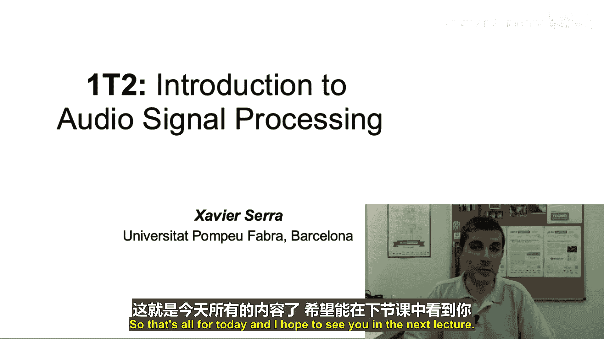

# 002：课程介绍与概览 🎵

在本节课中，我们将学习这门课程的基本信息、目标、结构以及所需资源。课程旨在为对音乐声音分析与处理感兴趣的学员提供信号处理与编程技术的入门知识。

## 课程团队介绍 👥

上一节我们介绍了课程的基本定位，本节中我们来认识一下教学团队。

课程由两位主讲教师和两位助教共同负责。

*   **朱利叶斯·史密斯教授**：来自斯坦福大学音乐与声学计算机研究中心（CCRMA），是本课程主讲教师的博士生导师，也是音频信号处理领域知识的首要来源。
*   **哈维尔·塞拉教授**：来自巴塞罗那庞培法布拉大学，领导一个音乐技术研究小组，是本课程的主讲教师。
*   **J·斯里尼瓦萨穆尔蒂与桑·卡布卢拉蒂**：两位助教，目前均在巴塞罗那在哈维尔·塞拉教授的指导下攻读博士学位，研究方向为音乐与音频技术。

尽管展示了一些表演照片，但教学团队并非专业演奏家。团队的核心驱动力是对音乐的热爱，以及致力于开发对音乐有实际意义的工程工具。

## 课程内容与目标 🎯

认识了教学团队后，我们来看看这门课程具体教授什么以及适合谁学习。

课程主要涵盖三个核心领域：**信号处理**、**音频音乐**以及相关的**编程技术**，最终目标是帮助学员理解并创造声音。

本课程适合任何有兴趣学习如何分析与处理音乐声音的人。但学员需要具备一定的技术背景，能够理解数学公式、使用一门编程语言以及操作声音处理软件。学员不一定必须是工程专业学生。

## 课程结构与评估方式 📚

了解了课程目标，接下来我们详细说明课程是如何组织的。

课程为期10周，每周聚焦一个特定主题，并通过三种视角进行阐述：

1.  **理论讲座**：从数学和信号处理的角度进行讲解。
2.  **编程讲座**：从应用角度出发，教授如何实现相关算法。
3.  **演示讲座**：展示这些技术的实际应用及其对声音和音乐的意义。

此外，每周还会提供一些高级主题和参考资料，以便学员探索相关领域。

以下是每周的评估方式：

*   **每周测验**：计5分。
*   **每周编程作业**：计10分。
*   **两次问卷调查**（课程开始与结束时各一次）：各计1分，共计2分。我们非常鼓励学员填写。

## 开放资源与许可 📄

明确了学习路径后，我们必须了解课程所使用的全部资源。

本课程遵循开放共享原则，所有材料均采用开放许可。

*   **课程材料**：所有视频、幻灯片及其他创建的材料均在**知识共享署名-非商业性使用-相同方式共享（CC BY-NC-SA）** 许可下提供。
*   **软件**：课程中开发和使用的所有软件均基于**GNU通用公共许可证（GPL）** 免费提供。
*   **参考资料**：大部分非原创参考资料来自维基百科等开放资源库。
*   **音频素材**：所有使用的声音样本均来自采用知识共享许可的网站 **freesound.org**。

## 总结与下节预告 ✅

本节课中，我们一起学习了《音乐应用中的音频信号处理》课程的概况。我们介绍了教学团队，明确了课程的内容、目标与受众，梳理了以周为单位、多视角结合的教学结构与评估方式，并强调了课程所采用的开放资源原则。

在深入课程具体内容之前，请务必访问课程网站以获取更详细的信息，确保充分了解课程背景与运行方式。

本节内容到此结束，我们下节课再见。