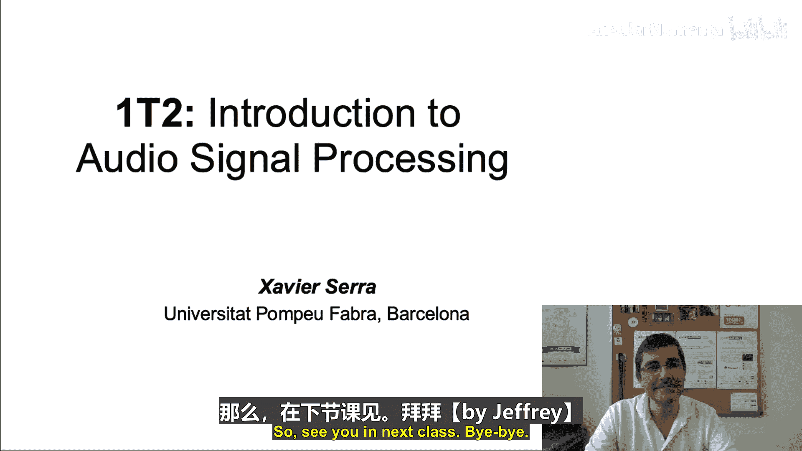

# 003：音频信号处理导论 🎵


在本节课中，我们将学习音频信号处理的基本概念，并概览其在音乐领域的常见应用。我们将介绍音频信号处理是什么，并探讨其在存储、压缩、效果变换、合成以及音频描述等方面的具体应用。


## 什么是音频信号处理？ 🎛️

音频信号处理是一个工程领域，专注于通过计算方法有意地改变声音。我们可以用一个系统框图来表示这个概念：一个音频信号处理系统能够接收一个音频信号作为输入，然后通过一些控制（可以是人工控制或自动控制），生成另一个信号。这个输出信号可以是另一个音频信号，也可以是其他类型的信息。

由于音频信号（声音）可以用数字或模拟格式进行电子表示，因此信号处理可以在任一领域进行。模拟处理器直接对电信号进行操作，而数字处理器则对信号的二进制表示进行数学运算。

## 模拟信号与数字信号 📊

模拟声音通常是电信号，其电压水平代表了声音的空气压力波形。它是一个连续函数，如上图顶部所示。另一方面，数字表示将压力波形表达为二进制数字，因此是一个离散函数，如下图底部所示。

数字表示允许使用微处理器和计算机。尽管从模拟到数字的转换可能存在损失，但大多数现代音频系统都采用这种方法，因为数字信号处理技术比基于模拟的技术更强大、更高效。


## 音频信号处理的应用领域

上一节我们介绍了音频信号处理的基本定义和信号类型。本节中，我们来看看它在音乐领域的一些核心应用。


### 声音存储 💾

音频信号处理的一个应用是声音的存储，即录音与回放。声波（如人声、环境声音或音乐）的数字表示可以作为电或机械记录存储在介质中，并可以从这些记录中重新创建。例如，CD光盘可以编码、记录音频信号的数字表示。

### 数据压缩 📉

另一个信号处理应用是数据压缩，也称为音频编码。其目标是减少数字音频流的带宽需求和音频文件的存储大小。


压缩技术有两种类型：无损压缩（不丢失任何信息）和有损压缩（会丢失一些信息，但希望丢失的信息在感知上不相关）。

以下是一个感知音频编码器的例子：
```python
# 伪代码示例：将WAV文件转换为MP3
input_file = "audio.wav"  # 未压缩的原始数字音频文件
output_file = "audio.mp3" # 经过感知编码压缩后的文件
audio_coder.encode(input_file, output_file, format="mp3")
```
它接收一个WAV格式的文件（这是声音在数字域的直接表示，未经压缩），通过一个感知音频编码器，能够将该文件转换为更小的MP3格式文件。MP3是一种基于声音感知特性的高度压缩格式。本课程将涵盖的许多基本技术正是这类音频压缩系统的基础。

### 声音效果与变换 🎚️


一大类应用涉及执行声音变换。这类应用用于后期制作和音乐创作。

例如，Audacity应用程序包含多个插件，可以进行多种音频信号变换。左边是一个动态压缩器，右边是一个混响器。这是两种可以通过音频信号处理技术实现的变换，但还有很多其他类型，包括均衡器、镶边器、相位器、合唱、变速、时间拉伸、人声效果、3D音频效果、变形等等。本课程将针对其中一些应用进行讲解，所解释的大多数方法在这一领域都有广泛的应用潜力。

### 声音合成 🎹

信号处理的传统用途之一与声音合成有关，其目的是通过模仿现有声音或创造新的音色来生成声音。

以下是三种不同合成技术的框图：
*   **减法合成**：从一个丰富的声音开始，通过滤除该声音的某些成分来创造另一个声音。
*   **调频合成**：基于一个振荡器调制另一个振荡器，调制振荡器的频率，从而利用这种技术获得非常多样的声音。
*   **加法合成**：也许是最直观的合成类型，因为它基于将一些正弦波（振荡器）相加，从而通过简单声音的叠加来创造复杂声音。


当然，多年来还开发了许多其他合成技术，包括粒子合成、物理建模、波表合成、采样或频谱合成等。我们将在课程中开发和使用其中一些技术，特别是加法合成和减法合成。

### 声音描述与分析 🔍

我想提到的最后一组应用与声音描述有关。这些技术用于分析音频信号，目的是描述和建模声音的有意义的特征。

这是一个在过去几年中极大扩展的领域，在信息检索或音乐信息检索领域非常重要。例如，这里展示了一个算法的框图，该算法能够从音频信号中提取一些有意义的音乐概念，特别是乐曲的调性（这与乐曲片段的和谐或和弦有关）。它从一个音频信号开始，执行不同的分析步骤，最终能够识别出乐曲的调性。

当我们谈论描述时，可以对一个特定的音频录音进行多种类型的描述。通常我们指的是不同层次的描述：
*   **低层描述符**：例如响度、音色、音高，这些很大程度上直接来自音频信号。
*   **中层描述符**：更具音乐意义，涉及节奏、和声、旋律等概念。
*   **高层描述符**：更接近我们对音乐的感知，可能涉及流派、乐曲情感或相似性等概念。

声音的自动描述将是本课程所涵盖主题的一个重要应用。我们虽然不会深入讲解中高层特征的提取，但我们在低层特征分析上的讨论，是整个声音和音乐描述主题的基础。

## 参考资料与软件工具 📚


关于音频信号处理的概述和信息有很多。维基百科的“音频信号处理”词条是一个很好的概述参考。

我们在课堂上将使用的所有软件都是开源的，例如我展示过截图的Audacity程序，可以从其官网下载。

最后，本课程中我们将使用的所有幻灯片和代码也以开放许可提供。幻灯片和文档采用知识共享“署名-非商业性使用-相同方式共享”许可，我们将使用的代码采用GNU通用公共许可证。所有代码和幻灯片都可以从指定的GitHub账户获取。


## 总结 📝



本节课中，我们一起学习了音频信号处理的基本定义，了解了模拟与数字信号的区别，并概览了其在音乐存储、数据压缩、效果变换、声音合成以及音频描述与分析等多个关键领域的应用。希望这次概述能激发你继续学习本课程的兴趣，并让你相信为此付出的努力是值得的。我们下节课再见。