# 004：课程大纲 📚

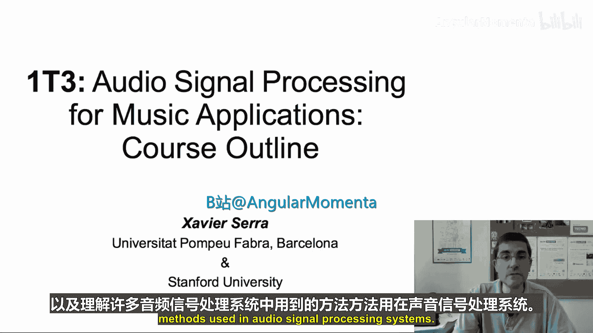

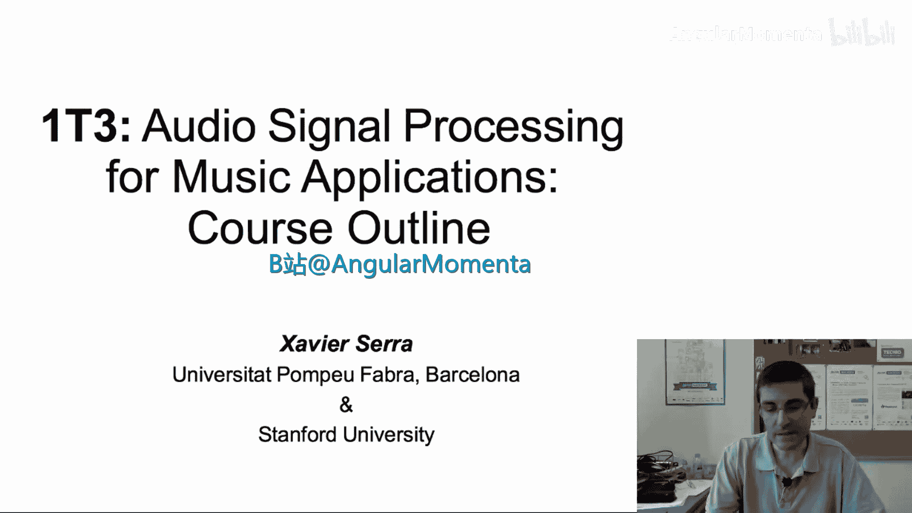

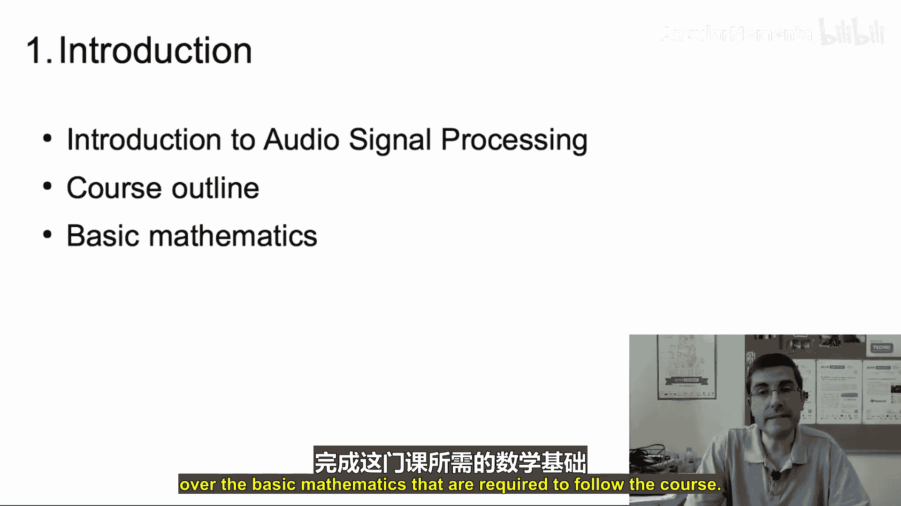

在本节课中，我们将概述整个课程将要学习的核心主题。尽管这些内容仅覆盖音频信号处理领域的很小一部分，但它们对于理解音频处理中的关键概念和方法，尤其是在音乐应用中的系统，至关重要。

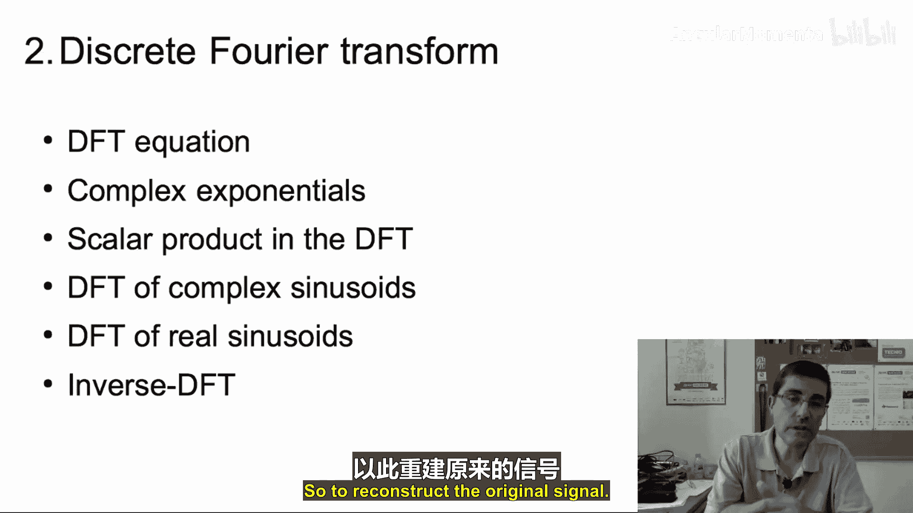

上一节我们介绍了音频信号处理领域的概况，作为课程的引入和动机。本节中，我们将具体勾勒出课程将涵盖的主题。

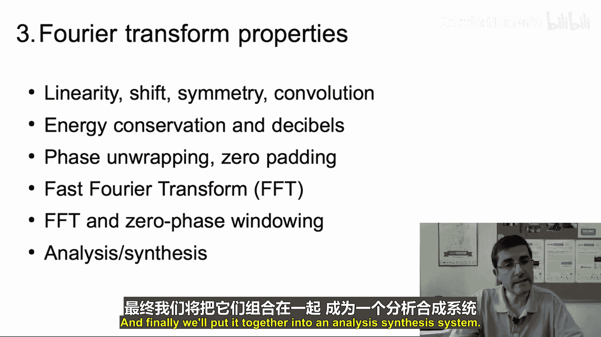

以下是本课程十周内容的具体安排：

## 第一周：课程介绍与数学基础
本周我们将介绍音频信号处理领域的背景，概述课程大纲，并在下一节课中回顾学习本课程所需的基础数学知识。

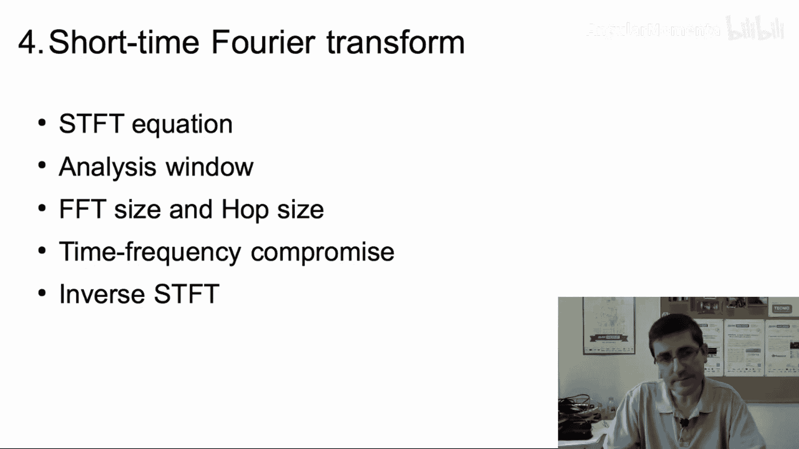

## 第二周：离散傅里叶变换
我们将从介绍**离散傅里叶变换**开始。这个变换是我们后续所有工作的基础。我们将深入理解其每一个组成部分：
*   **DFT方程**：`X[k] = Σ_{n=0}^{N-1} x[n] * e^{-j2πkn/N}`
*   复指数
*   DFT中的标量积
*   复正弦波和实正弦波的DFT
*   **逆DFT**：`x[n] = (1/N) Σ_{k=0}^{N-1} X[k] * e^{j2πkn/N}`

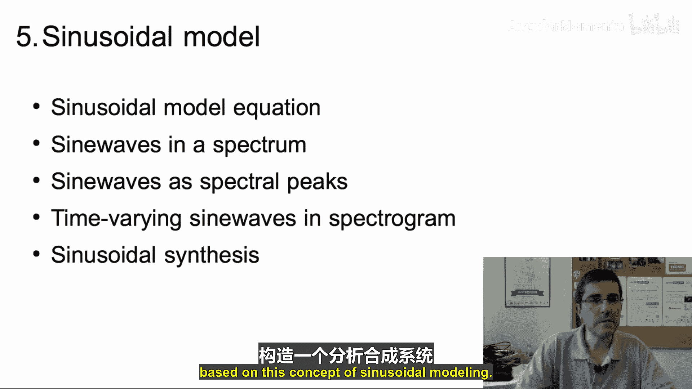

## 第三周：傅里叶变换的性质与实现
为了更好地理解DFT，我们将学习傅里叶变换的基本定理和性质：
*   线性、移位、对称和卷积
*   能量守恒与分贝
*   相位、卷绕与零填充
*   **快速傅里叶变换**：实现DFT的算法
*   结合零相位窗的FFT
*   构建一个完整的分析-合成系统

## 第四周：短时傅里叶变换
我们将学习**短时傅里叶变换**，这是第一个可用于分析随时间变化的真实声音的傅里叶变换版本。我们将介绍本课程第一个具有实际用途的完整分析-合成系统：
*   STFT方程
*   分析窗
*   FFT大小与跳跃大小
*   理解STFT的核心：**时频权衡**
*   逆短时傅里叶变换

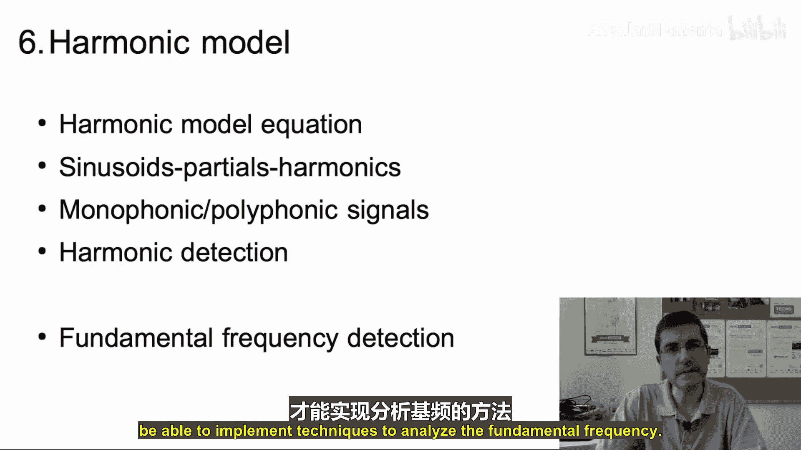

## 第五周：正弦模型
在STFT的基础上，我们将构建**正弦模型**：
*   正弦模型方程
*   从频域/频谱视角看正弦波
*   如何寻找正弦波：**谱峰**的概念
*   在时变频谱（谱图）中分析时变正弦波
*   基于正弦建模的分析-合成系统

## 第六周：谐波模型
我们将假设声音是谐波的，从而发展出更强大的**谐波模型**，即在正弦模型上增加所有正弦波都是基频整数倍的约束：
*   谐波模型方程
*   区分三个易混淆的概念：正弦波、分音、谐波
*   单音与复音信号
*   如何检测谐波：**基频检测**

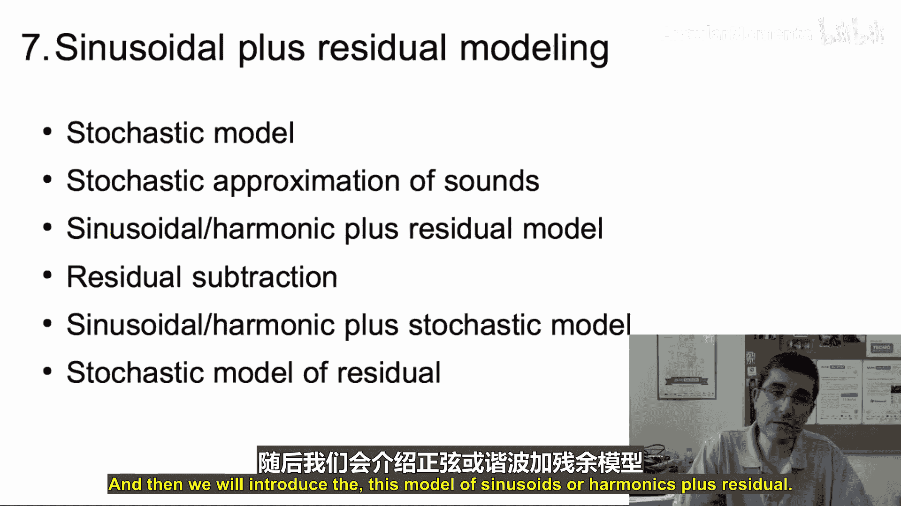

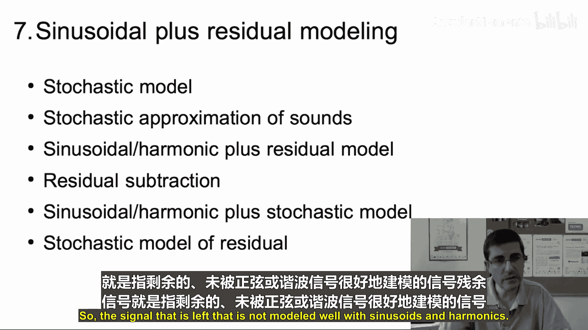

## 第七周：正弦+残差模型
许多声音无法用纯正弦波或谐波很好地建模，因此我们需要处理起振、非线性、噪声等部分。为此，我们引入**正弦+残差**的建模思想：
*   用正弦波加残差来建模声音
*   **随机模型**：如何使用随机信号的概念建模
*   如何用随机模型近似声音
*   构建正弦/谐波 + 残差模型
*   如何用随机信号的概念对残差进行建模

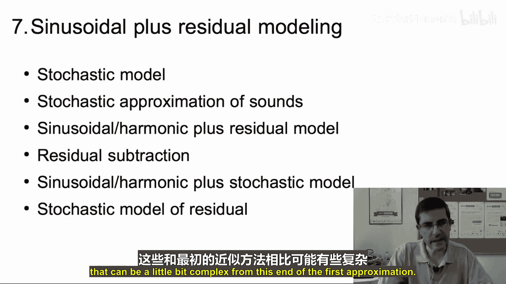

## 第八周：应用一：声音变换
本课程聚焦两类应用，本周介绍第一类：**声音变换**。我们将回顾已介绍的模型，并展示利用它们可能实现的变换类型：
*   **短时傅里叶变换**：滤波、变形
*   **正弦模型**：时间与频率缩放
*   **谐波+残差模型**：音高移调
*   **谐波+随机模型**：时间拉伸与变形

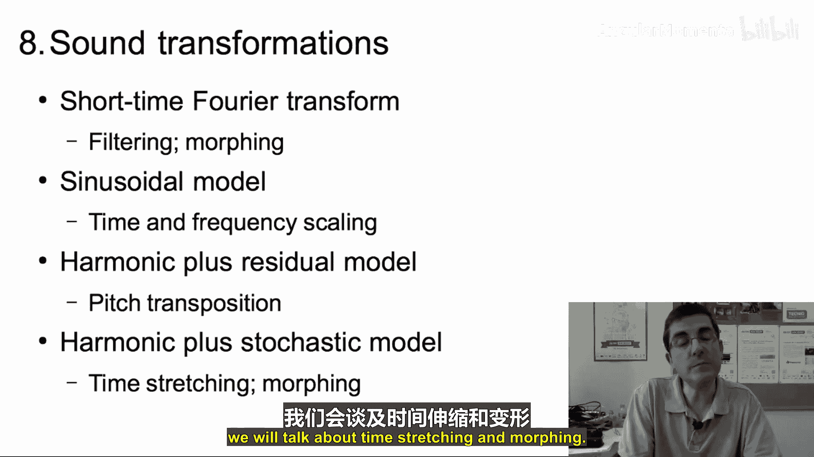

## 第九周：应用二：声音描述
本周介绍第二个核心应用：**声音描述**。利用已学技术，我们可以提取与描述声音相关的特征：
*   从频谱分析中获取音频特征
*   如何使用这类技术描述更复杂的音乐或信号
*   处理声音集合（而非单个声音）的分析概念

## 第十周：课程回顾与拓展
在最后一周，我们将：
*   回顾所有模型
*   概述课程中未涵盖的相关主题
*   介绍其他音频声音模型及非音频模型
*   总结并展望音乐音频信号处理之外的领域

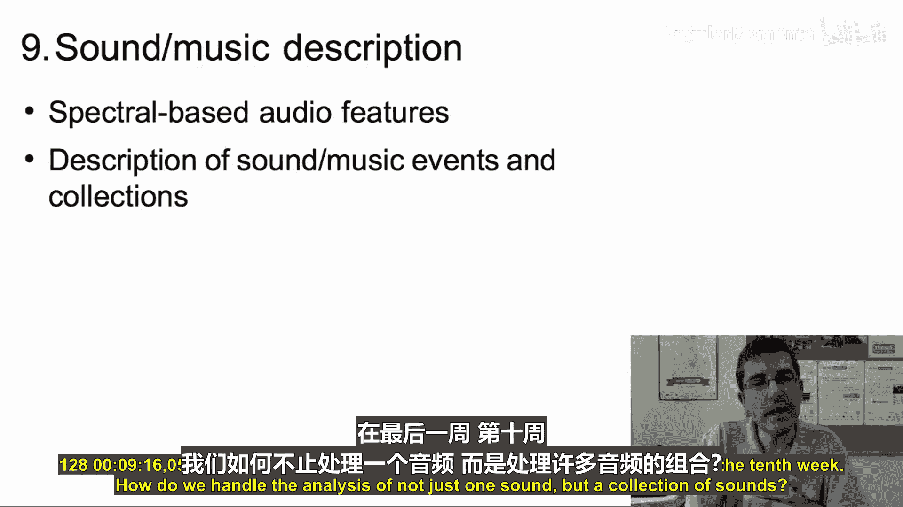

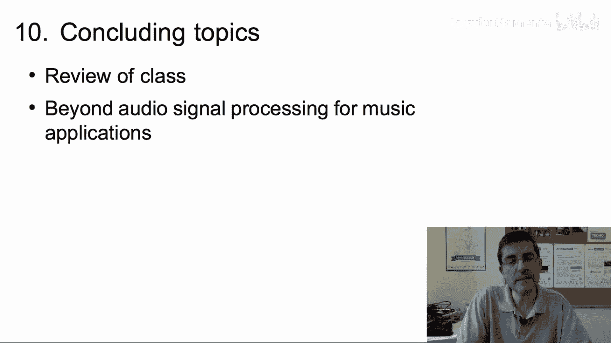

所有课程内容均可在线上获取，并采用开放许可，请随时查阅。

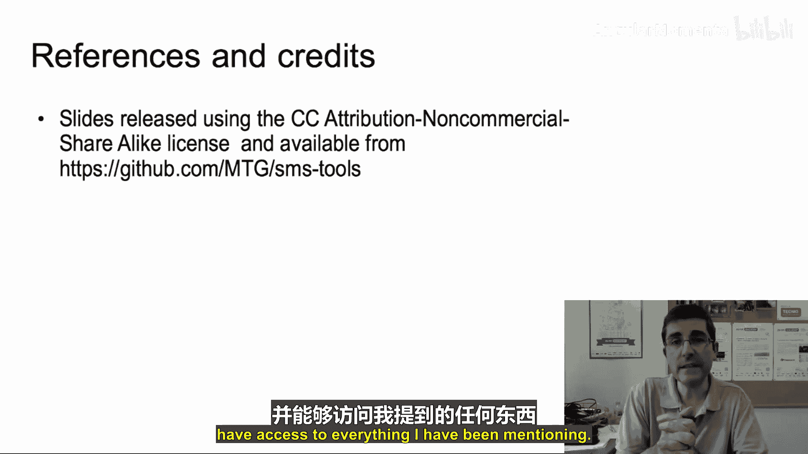

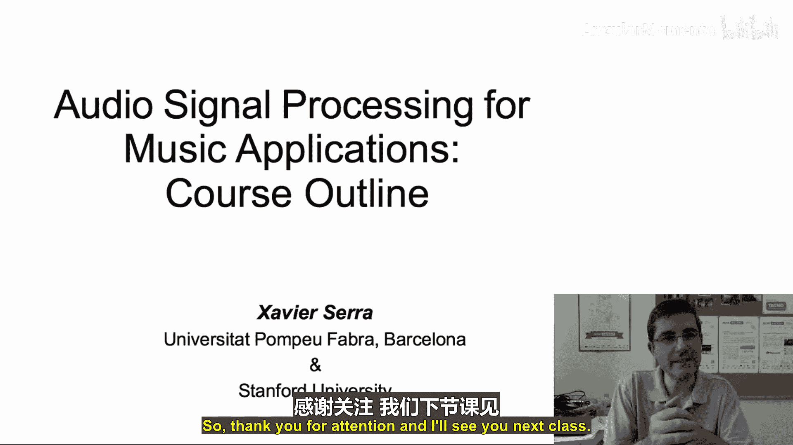

本节课中，我们一起快速浏览了课程大纲，概述了将要学习的理论主题。从下一节课开始，我们将正式深入音频信号处理的精彩世界。感谢关注，我们下节课再见。