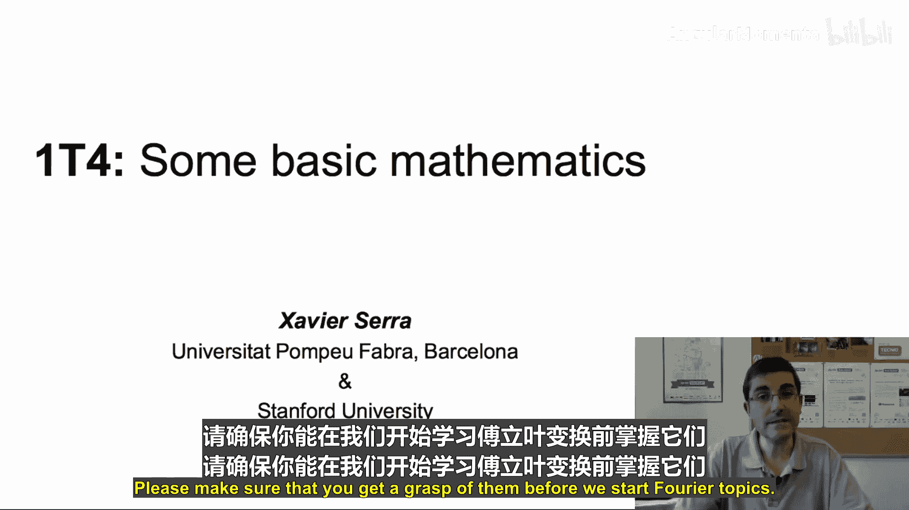

# 005：基础数学 📐

在本节课中，我们将学习理解后续课程内容所必需的基础数学概念。这些概念包括正弦波、复数、欧拉公式、复正弦波、序列的点积、奇偶函数以及卷积。掌握这些知识将为深入学习音频信号处理打下坚实基础。

---

## 正弦波 📈

我们的第一个基本概念是正弦波。正弦函数或正弦波是一种描述平滑、重复振荡的数学曲线。它在物理学、工程学等许多领域经常出现。


正弦波的方程如下：

**x(n) = A * cos(ωnT + φ)**

其中：
*   **A** 是正弦波的振幅。
*   **ω** 是角频率，单位为弧度。
*   **nT** 是时间，`n` 是时间索引，`T` 是采样周期。
*   **φ** 是初始相位，单位也是弧度。

频率也可以用赫兹表示。要将角频率 `ω` 转换为赫兹频率 `f`，使用公式：**f = ω / (2π)**。


正弦波最常见的视觉表示是振幅随时间变化的波形图。例如，我们可以用Python代码生成一个频率为1000赫兹的正弦波：

```python
import numpy as np

A = 0.8  # 振幅
f = 1000  # 频率 (Hz)
phi = 0  # 初始相位
Fs = 44100  # 采样率

# 生成时间数组
t = np.arange(-0.002, 0.002, 1/Fs)
# 生成正弦波
x = A * np.cos(2 * np.pi * f * t + phi)
```

---

## 复数 🔢

接下来是复数的概念。复数由两部分构成：实部和虚部。


一个复数 `z` 可以表示为：**z = a + jb**

其中：
*   **a** 是实部。
*   **b** 是虚部。
*   **j** 是虚数单位，定义为 `j² = -1`。

复数通常在复平面上表示，其中横轴是实部，纵轴是虚部。模为1的所有复数构成的圆称为**单位圆**。


---

## 复数的两种形式

复数有两种表达形式：直角坐标形式和极坐标形式。

*   **直角坐标形式**：直接给出实部 `a` 和虚部 `b`，即 `z = a + jb`。
*   **极坐标形式**：将复数视为一个从原点出发的向量，用模 `A` 和角度 `θ` 表示。


两种形式可以互相转换：
*   模 **A = √(a² + b²)**
*   角度 **θ = arctan(b / a)**
*   实部 **a = A * cos(θ)**
*   虚部 **b = A * sin(θ)**

极坐标形式在进行复数的加法和乘法运算时更为直观，我们将在课程中频繁使用。

---

## 欧拉公式与复正弦波 🔄

现在，让我们把正弦函数和复数结合起来。**欧拉公式**建立了复数直角坐标和极坐标之间一个非常有用的关系。

公式如下：**e^(jφ) = cos(φ) + j sin(φ)**

这个公式表明，一个模为1的复指数 `e^(jφ)` 可以分解为实部 `cos(φ)` 和虚部 `j sin(φ)`。这个公式是理解离散傅里叶变换的基础。

利用正弦函数、复数和欧拉公式，我们可以引入**复正弦波**。

一个复正弦波函数 `x̄(n)` 可以表示为：**x̄(n) = A * e^(j(ωn + φ))**

根据欧拉公式，它等价于：**A * [cos(ωn + φ) + j sin(ωn + φ)]**

我们通常处理的是实信号（实正弦波），但傅里叶变换处理的是复正弦波。一个关键的数学技巧是：**一个实正弦波可以由两个复正弦波相加得到**。

具体公式为：**A * cos(ωn + φ) = (A/2) * e^(j(ωn + φ)) + (A/2) * e^(-j(ωn + φ))**

这样，两个复正弦波的虚部相互抵消，只留下我们感兴趣的实部。

由于复正弦波需要三维空间才能完整绘制，通常的替代方法是将其**实部**和**虚部**作为两个独立的函数画出。

---

## 序列的点积（标量积）⚖️

另一个需要熟悉的概念是序列的**点积**（或标量积）。这是一种在两个等长序列之间进行的代数运算，结果是一个**单一数值**。

代数定义如下：给定两个序列 `x(n)` 和 `y(n)`，它们的点积为：
**<x, y> = Σ [x(n) * y*(n)]**
其中 `y*(n)` 表示 `y(n)` 的复共轭。

点积的一个重要性质是：当两个序列**正交**时，它们的点积为 **0**。即，如果 **<x, y> = 0**，则 `x` 与 `y` 正交。

从几何角度看，点积可以理解为将一个序列投影到另一个序列上。这个操作是离散傅里叶变换的核心运算之一。

---

## 奇函数与偶函数 ⚖️

在信号分析中，我们还会遇到**奇函数**和**偶函数**的概念。

*   **偶函数**：满足 `f(-n) = f(n)`。图形关于Y轴对称。**余弦函数 `cos(ωn)` 是一个典型的偶函数**。
*   **奇函数**：满足 `f(-n) = -f(n)`。图形关于原点对称。**正弦函数 `sin(ωn)` 是一个典型的奇函数**。

理解函数的奇偶性对于分析信号的对称性很有帮助。

---

## 序列的卷积 🌀

最后要提到的概念是序列的**卷积**。卷积是一种对两个序列进行的数学运算，产生第三个序列，可以将其视为对原始序列之一的修改版本。

卷积的方程如下（离散形式）：
**(x₁ * x₂)(n) = Σ [x₁(k) * x₂(n - k)]**

卷积运算与互相关类似，常用于实现声音的**滤波**。理解卷积也有助于理解傅里叶变换的许多性质。


从图形上看，两个序列卷积的结果通常是一个比原始序列更平滑的函数。

---

## 参考资料与总结 📚


本节课所强调的概念在许多教科书和在线资源中都有详细阐述。常用的参考资料包括维基百科的相关条目，以及Julius O. Smith III关于离散傅里叶变换数学基础的网站，后者非常推荐大家阅读。



**总结**：在本节课中，我们一起回顾了贯穿本课程所需的基础数学概念，包括正弦波、复数及其运算、欧拉公式、复正弦波、序列的点积、函数的奇偶性以及卷积。请确保在开始傅里叶变换等核心主题之前，对这些概念有基本的把握。扎实的数学基础将使我们后续的学习之路更加顺畅。