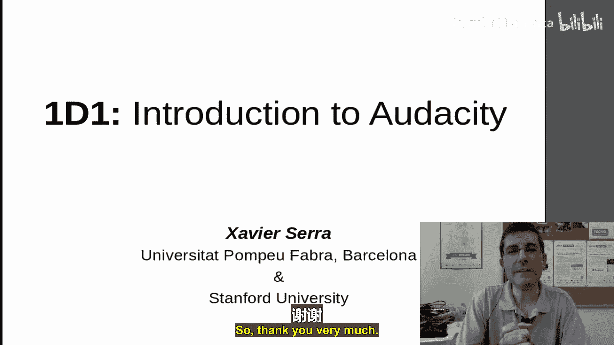

# 006：Audacity入门教程 🎧

在本节课中，我们将学习如何使用Audacity，这是一款免费、开源的音频编辑软件。我们将介绍其基本界面、如何打开和播放音频文件、如何进行波形和频谱图的可视化，以及如何应用简单的音频效果。

## 概述

Audacity是一款跨平台的音频软件，由志愿者团队维护。它功能强大且易于使用，非常适合用于音频编辑和基础分析。本节课将引导你完成软件的安装、基本操作和核心功能。

## 下载与安装

首先，你需要下载并安装Audacity。

*   访问Audacity官方网站或通过搜索引擎找到其SourceForge页面。
*   在下载页面选择适合你操作系统的版本进行下载和安装。
*   本课程演示使用的是Ubuntu（Linux发行版）环境。

## 界面与基本操作

现在，让我们打开Audacity并熟悉其界面。

### 打开音频文件

1.  启动Audacity后，点击菜单栏的 **文件** -> **打开**。
2.  浏览并选择一个音频文件（例如课程提供的 `piano_Do_W.wav` 文件）。
3.  软件会询问是否创建副本，建议选择“**制作副本**”，以便在不影响原文件的情况下进行操作。

打开文件后，主界面会显示该音频的**波形**。界面底部会显示该文件的格式信息，例如：
*   **声道**：单声道 (Mono)
*   **采样率**：44100 Hz
*   **位深度**：32位浮点数 (Audacity内部处理格式)

### 播放与导航

*   **播放**：点击工具栏的播放按钮即可播放整个音频。若要播放特定片段，先用鼠标在波形图上拖拽选中区域，再点击播放。
*   **缩放与移动**：使用工具栏的放大镜工具或快捷键可以缩放波形视图，方便查看细节。

### 时间显示

精确的时间信息对音频处理至关重要。

*   波形图横轴以秒为单位。
*   选中一个片段后，可以在界面左下方的状态栏看到更精确的**起始时间**和**选区长度**。
*   建议将时间显示格式设置为“**毫秒**”，以获得最精确的读数。例如，一个选区可能起始于 `402毫秒`，长度为 `220毫秒`。

## 音频可视化

除了波形图，Audacity还提供了强大的频谱图功能，帮助我们分析声音的频率成分。

### 使用频谱图

1.  在波形图左侧的下拉菜单中，将显示模式从“波形”切换为“**频谱图**”。
2.  频谱图以颜色深浅表示不同频率的强度，横轴是时间，纵轴是频率。
3.  通过频谱图，我们可以清晰地看到声音的谐波结构以及音符的起始位置，这比单纯看波形更直观。

### 调整频谱图参数

频谱图的分析效果可以通过参数进行调整。

1.  点击菜单 **编辑** -> **首选项**。
2.  在“频谱图”部分，可以修改如**窗口大小**、**最大频率**等参数。
3.  例如，将最大频率设置为 `1500 Hz`，频谱图将只显示该频率以下的部分，这有助于聚焦观察低频内容。

## 音频效果处理

Audacity内置了多种音频效果，并支持通过插件扩展更多功能。效果菜单位于菜单栏的“**效果**”下。

### 应用均衡器效果

让我们尝试一个简单的效果——均衡器（EQ）。

1.  选中一段音频或整个音轨。
2.  点击 **效果** -> **均衡器**。
3.  均衡器界面提供了多种预设曲线。例如，选择“**电话**”预设，它会模拟电话线的频响特性，衰减低频和高频。
4.  点击“应用”后，音频即被处理。在波形图上变化可能不明显，但切换到频谱图视图，可以清晰地看到高频部分（以及调整视图后的低频部分）的强度已被衰减。

## 总结与资源

本节课我们一起学习了Audacity的基础操作。我们介绍了如何：
*   下载和安装软件。
*   打开、播放和导航音频文件。
*   使用波形图和频谱图进行音频可视化。
*   应用简单的音频效果（如均衡器）。

Audacity的功能远不止于此，你可以通过其官方文档探索更多编辑功能，如剪切、粘贴、混音等。

**课程使用的钢琴等音频样本**可以从 `freesound.org` 等网站获取。

希望你能够下载并使用Audacity，通过简单的编辑练习为后续课程做好准备。