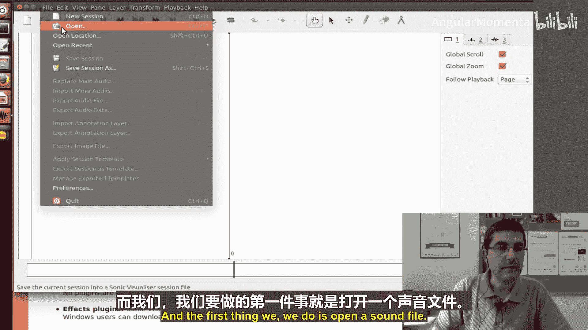
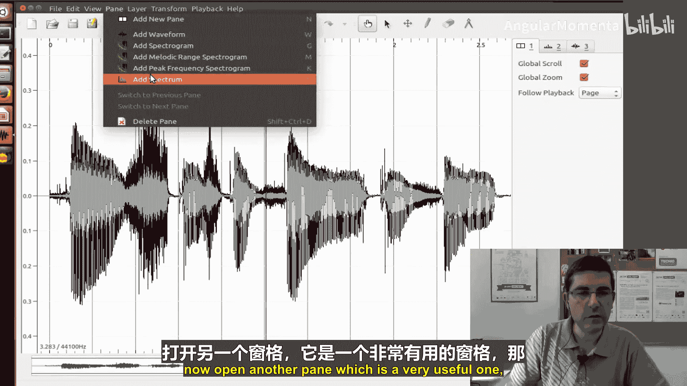
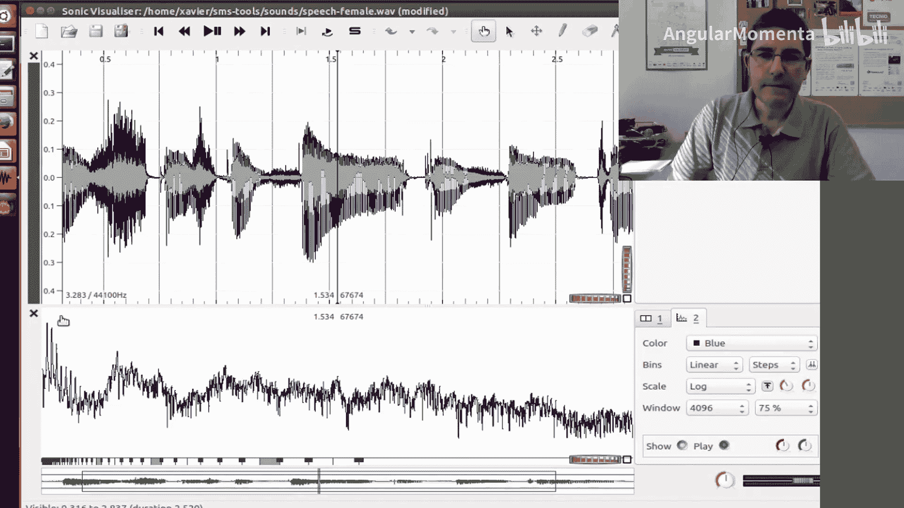
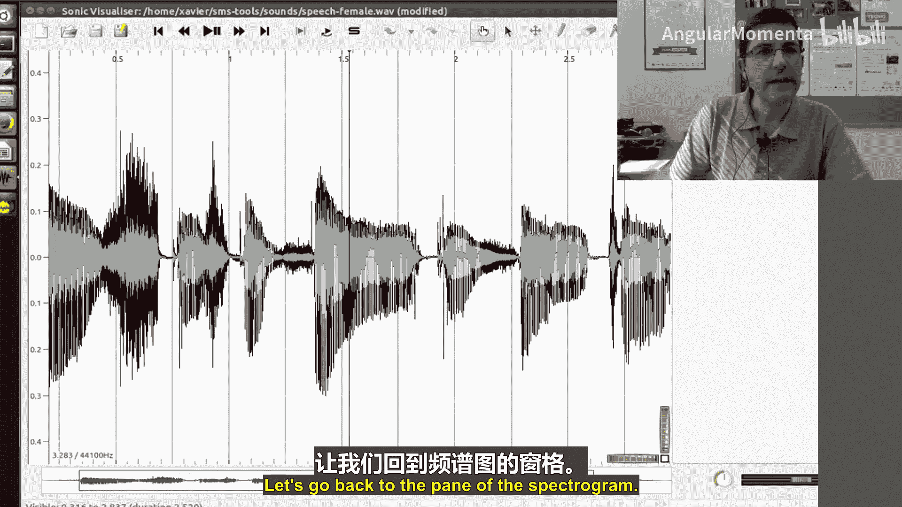
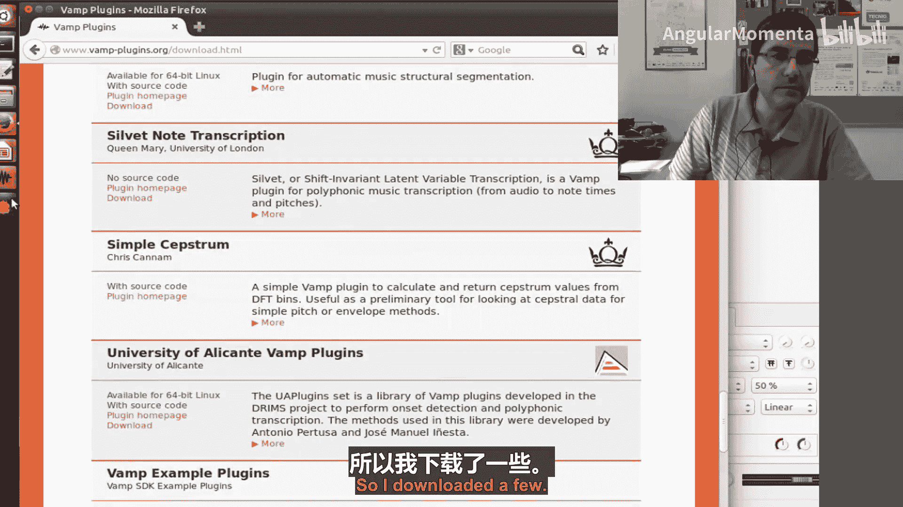
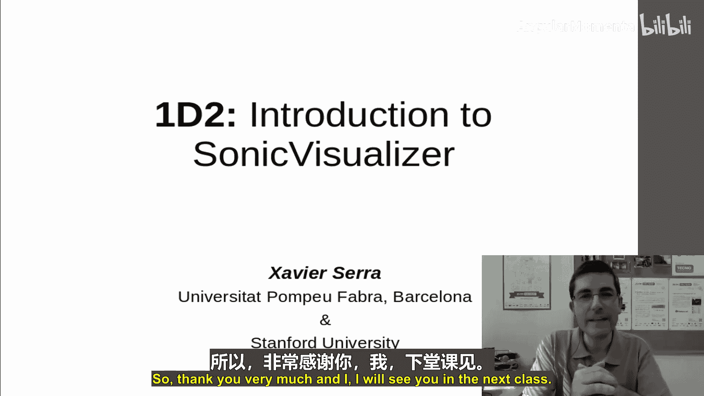

# 007：声波可视化分析入门 🎵

在本节课中，我们将要学习一款名为 Sonic Visualizer 的音频分析与可视化工具。这款工具与之前介绍的 Audacity 形成互补，更侧重于研究和分析声音的高级特性。

上一节我们介绍了 Audacity，它是一款非常适合进行简单编辑和声音可视化的声音编辑器。本节中，我们来看看另一款声音工具——Sonic Visualizer。

## 获取与安装 Sonic Visualizer

Sonic Visualizer 由伦敦玛丽女王大学开发，支持所有主流平台，并以非常开放的 GNU 通用公共许可证发布。这是一个非常优秀的工具，强烈建议你安装并使用它，这对本课程的学习将大有裨益。

首先，我们来看看如何获取它。

如果你在谷歌搜索 “Sonic Visualizer”，会找到其官方网站 `sonicvisualiser.org`。网站上提供了大量相关信息、使用该工具的项目，以及一个重要的插件系统——Vamp 插件系统。许多开发者利用这个系统为 Sonic Visualizer 开发了各种分析工具，因此我们可以使用大量声音分析算法和工具。

在下载页面，你可以获取适用于各个平台的版本。本课程使用 Ubuntu 系统，因此我们下载 Ubuntu 版本。我已经完成了下载，让我们直接进入程序。

## 主界面与基本操作

这是 Sonic Visualizer 的主界面。我们要做的第一件事是打开一个声音文件。

我打开了存放课程所有文件的目录。例如，让我们使用这个 `speech_female` 声音文件。

这是波形图。当然，你可以进行缩放。它有两个声道，这很好。我们可以播放它。这是 “Venera” 的发音。

导航功能相当出色和强大。我们可以浏览整个声音，并放大到想要分析的特定部分。

## 窗格与图层概念

Sonic Visualizer 的一个基本概念是窗格和图层。窗格基本上就是这些窗口，例如，我们现在显示波形的就是一个窗格。

让我们打开另一个窗格，例如我们之前在 Audacity 中也提到过的频谱图。

在这里，分析参数的控制稍微容易一些，我们在右侧面板就可以调整。例如，我们可以增加窗口大小，然后可以更容易地放大，看到这个人声的谐波。我们还能看到静音区域，以及波形中颜色较深、对应此处频谱图中较暗区域的辅音部分。

这相当不错。例如，我们可以关闭这个窗格，然后打开另一个非常有用的窗格——频谱窗格，它本质上是频谱图的一个切片。

如果我们移动波形中的光标，频谱图会随之变化。默认情况下，水平刻度（称为 bins）是对数刻度。我个人更喜欢使用线性刻度。这就是频谱的线性刻度。通常，你会希望以优化整个显示范围的方式缩放或显示频谱，这是一种很好的显示方式。

这非常直观，有助于我们理解声音的特性。例如，在这里，处于声音的元音部分，我们可以看到谐波的峰值，这里看到的形状大致是声音的共振峰。这很好。

当然，我们可以非常容易地更改参数。

## 插件系统

让我们回到频谱图窗格。

现在，我们想谈谈它提供的插件系统。在这里，我们以一种相当合适的方式显示频谱图。

我已经安装了几个插件。首先，我们可以访问 Sonic Visualizer 的插件页面，那里描述了其插件系统的工作原理，甚至包括如何为其开发插件，并提供了一个使用该系统开发的插件列表，数量相当多。

我下载了一些。回到 Sonic Visualizer 程序，在 “变换” 菜单下，可以看到我已安装的所有插件列表。

例如，让我们使用这个 “音频音高检测器” 插件。点击它，会出现分析界面。这个插件由 Poziier 开发，由 Chris Cannam 移植。它使用了一种我们将在课程中讨论的、用于检测声音基频的算法——YIN 算法。

这是一个使用快速傅里叶变换的实现。我们点击确定。

这个插件会分析整个声音，并显示基频。它会以图层的形式显示在频谱图上方。这就是我之前提到的另一个概念——图层。图层是在同一窗格上叠加显示多种信息的方式。

在这里，我们看到了频谱图，以及叠加在其上的、分析得到的音高曲线图层。如果我们放大，可以清晰地看到这条绿色的音高曲线。我们将在课程中讨论它，但可以看到它识别出了声音的第一谐波。在一些没有谐波的区域，它显然会感到困惑，但在有谐波的人声部分，它能相当容易地找到基频。如果我们增大频谱图的窗口大小，使谱线更清晰，这一点可能会更明显。

我们可以看到，音高分析在识别这个人声的基频方面做得不错。

## 总结与回顾

关于 Sonic Visualizer 我想介绍的内容就是这些。让我们回到幻灯片。

你可以访问 Sonic Visualizer 页面获取程序信息。它有一个专门的 Vamp 插件页面，可以从 Sonic Visualizer 页面访问。我们提到了将在后续课程中介绍的 YIN 音高检测算法，并有一些相关参考文献。这个音高示例声音来自 FreeSound 网站。

本节课到此结束。我们介绍了另一款声音可视化工具，它将对我们课程中将要讨论的更高级、更科学的可视化分析非常有用。

非常感谢，我们下节课再见。

---

**本节课中我们一起学习了：**
1.  Sonic Visualizer 的获取、安装与基本界面。
2.  核心概念：**窗格**（用于显示不同视图的窗口）和**图层**（在同一窗格上叠加信息）。
3.  基本操作：打开文件、查看波形、频谱图和瞬时频谱。
4.  强大的插件系统（Vamp 插件），并以音高检测插件为例进行了演示。
5.  该工具在高级音频分析与研究中的应用潜力。