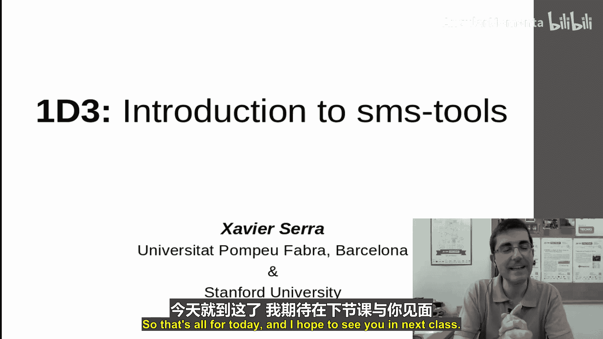

# 008：SMS工具简介

在本节课中，我们将学习专门为本课程开发的一套音频处理工具——SMS工具。这套工具基于Python编写，将在后续的编程课程和演示中被深入使用。我们将了解如何获取、运行这些工具，并通过几个简单的例子来体验其核心功能。

## 工具获取与运行环境


上一节我们介绍了Audacity和Sonic Visualizer，本节中我们来看看专为本课程设计的SMS工具。

这套工具托管在一个GitHub代码仓库中。我建议您下载最新的版本，因为我会持续更新和修复其中的问题。您可以下载一个压缩包文件，并按照说明进行编译。在Ubuntu系统下，这个过程并不复杂，具体的细节我们会在编程课程中详细讨论。

SMS工具是一套命令行工具，没有可以直接点击的图标。您需要通过终端来访问它们。以下是如何进入工具目录并运行主界面的基本步骤：


1.  打开终端，默认会进入您的主目录。
2.  下载SMS工具包后，会生成一个名为 `sms-tools-master` 的目录。
3.  使用 `cd` 命令进入该目录。
4.  工具的主要演示界面位于 `software/models` 子目录下。
5.  通过执行 `python modelsGUI.py` 命令来启动图形界面。

以下是进入目录并启动界面的命令示例：
```bash
cd sms-tools-master
cd software/models
python modelsGUI.py
```

## 核心分析/合成模型界面

启动 `modelsGUI.py` 后，您将看到一个图形界面，其中集成了本课程将讨论的所有核心分析/合成模型。

以下是该界面中包含的主要模型列表：
*   **DFT**：离散傅里叶变换。
*   **STFT**：短时傅里叶变换。
*   **正弦模型**：用于分析声音中的确定性成分。
*   **谐波模型**：专门分析谐波结构。
*   **随机模型**：用于分析声音中的噪声成分。
*   **信号+残差模型**：结合了确定性和剩余成分。
*   **谐波+随机模型**：这是最复杂的模型之一，将声音分解为谐波和随机两部分。

### 短时傅里叶变换示例

让我们以短时傅里叶变换为例。在界面中选择“STFT”模型，并加载一个音频文件（例如一个管弦乐片段）。使用默认参数点击“计算”后，程序会进行分析。

分析结果会显示原始输入信号的波形、计算得到的频谱幅度图和相位图。最后，程序会重新合成一个输出信号。通过播放可以发现，合成信号与原始信号听起来基本一致，这说明该分析-合成系统作为一个恒等系统工作良好。

### 谐波+随机模型示例

接下来，我们尝试更复杂的“谐波+随机”模型。加载一个萨克斯短语音频，并使用默认参数进行分析。

分析完成后，界面会显示：
1.  原始输入声音。
2.  分析表示，其中同时展示了谐波成分和被称为“随机表示”的成分。
3.  合成后的输出声音，其波形与原始信号非常相似。

这个模型的关键在于它将声音分解为两个部分：
*   **正弦（谐波）部分**：捕捉了声音中大部分有音高的、有趣的成分。我们可以单独聆听这部分。
*   **残差（随机）部分**：被建模为一个随机信号，它包含了诸如呼吸声、气流声等在许多声音中都非常相关的成分。这部分听起来比较柔和，但确实存在。

## 声音变换界面


除了分析合成，SMS工具还提供了基于上述模型对声音进行变换的功能。

让我们关闭模型界面，进入变换工具目录。通过执行 `python transformationsGUI.py` 来启动变换界面。

以下是变换界面提供的一些主要功能列表：
*   使用STFT进行变形。
*   使用正弦模型进行变换。
*   使用谐波模型进行变换。
*   使用随机模型进行变换。
*   使用谐波+随机模型进行变换或变形。

### 声音变换实践

我们选择“谐波+随机”变换，并加载一个简短的萨克斯短语。

首先，使用“恒等参数”（即所有变换参数设置为不改变声音的状态）进行处理并聆听，以确保系统工作正常。这相当于频率缩放为1，时间缩放为线性。

然后，我们可以尝试各种变换：
*   **移调**：将频率缩放参数设置为2（即升高一个八度），然后聆听变换后的声音。
*   **频率拉伸**：让声音的谐波部分随着时间逐渐变得不谐和。例如，设置频率拉伸参数从1.01变化到1.1，聆听产生的“失谐”效果。
*   **时间拉伸**：改变声音的时长。例如，让声音前半段加速（时间值变小），后半段恢复原速，从而产生先快后慢的效果。

这些变换让我们能够以创造性的方式操纵声音的各个方面。

## 总结与展望

本节课中，我们一起学习了SMS工具集的基本情况。在本次第一周的三节演示课中，我们总共介绍了三种工具：Audacity、Sonic Visualizer和我们自主开发的SMS工具。

希望这些内容能让您对可用于处理音频的工具类型有一个概览，并激发您深入学习本课程、理解其背后原理的兴趣。在后续的演示课中，我们将从实际应用角度介绍这些工具；而在编程课和理论课中，我们将深入探讨所有这些技术背后的原理。



这就是今天的全部内容，我们下节课再见。