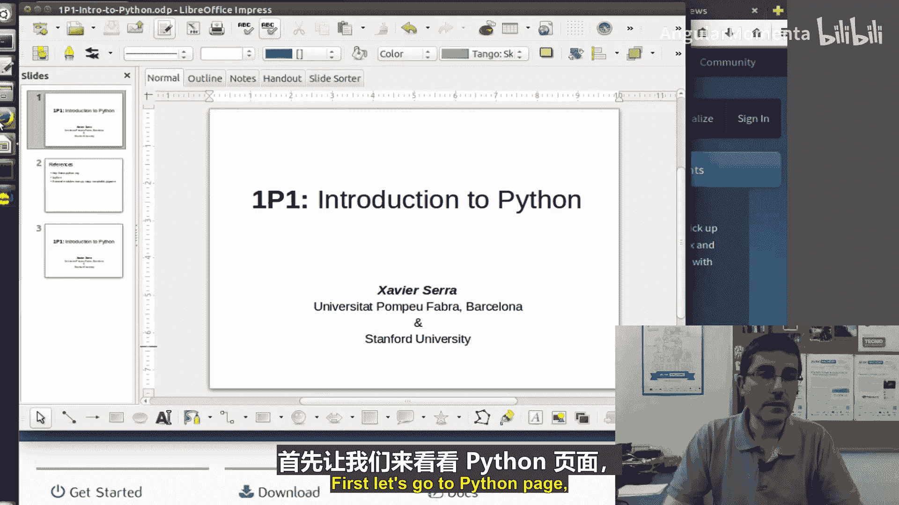
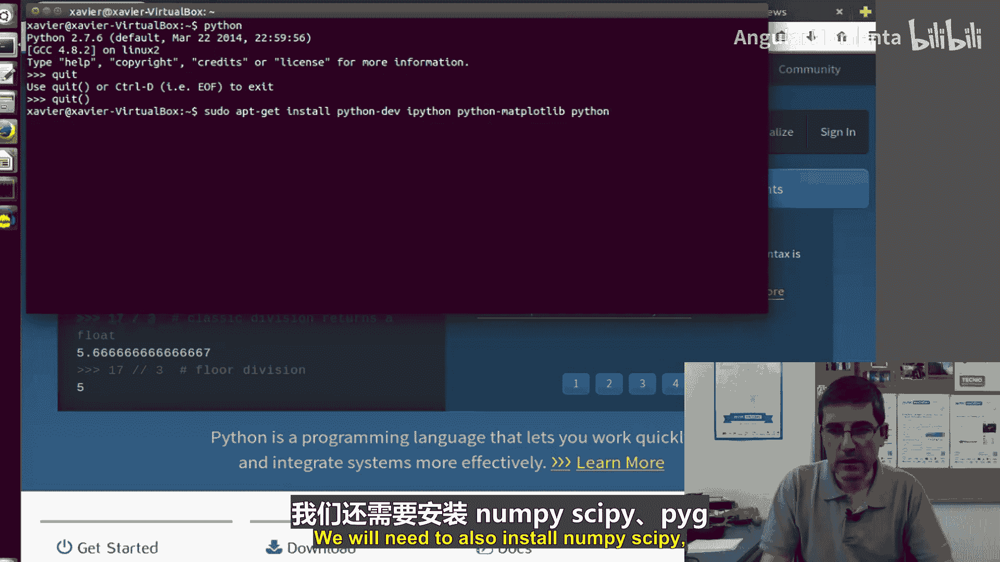
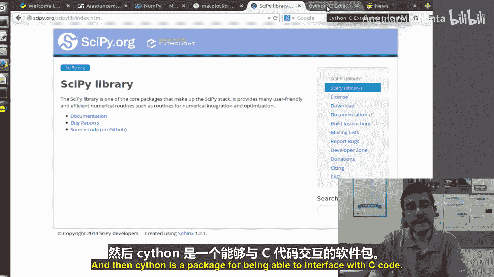
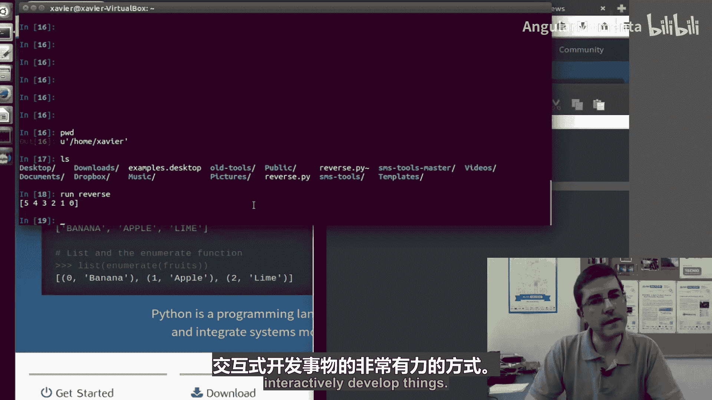
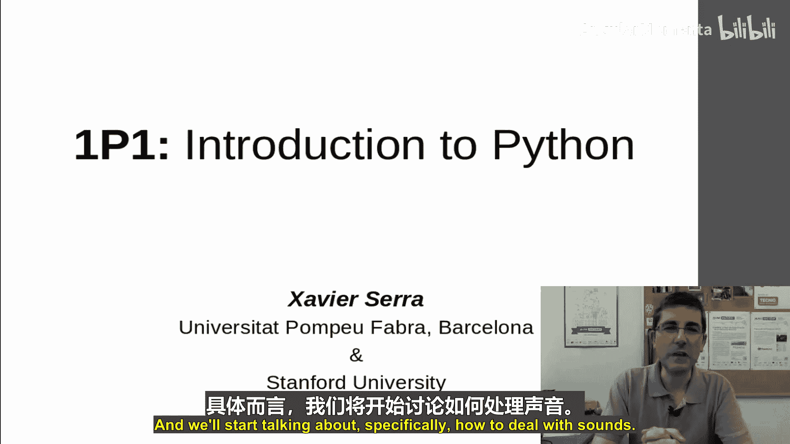

# 009：Python入门 🐍

在本节课中，我们将学习Python编程语言的基础知识。Python是我们将在整个课程中，特别是在所有编程作业中，使用的高级编程语言。请注意，这不是一门专门的编程课程，我们只会编写简单的程序。你不需要有广泛的编程背景，但请确保你对Python和Ubuntu系统有一定程度的熟悉，以便完成作业并理解我们将要进行的操作。

## 概述 📋



本节课程将介绍Python编程环境，包括如何安装必要的软件包、使用交互式Shell以及编写简单的脚本。我们将重点介绍对音频信号处理至关重要的几个Python扩展库。

## 访问Python官方网站 🌐

首先，访问Python官方网站 `Python.org`。这是Python的主页，你可以在此找到大量教程和信息。

## 在Ubuntu中检查Python

在Ubuntu系统中，Python通常已预装。打开终端并输入 `python` 命令，你将看到已安装的Python版本。例如，可能会显示 `2.7.6`。这表明Python已正确安装，你可以立即在此开始输入命令并与Python交互。

Python有许多不同版本，特别是较新的 `3.x` 版本。但在我们的课程中，需要使用 `2.7` 版本，因为许多我们需要的软件包仅支持 `2.7`。请确保你在Ubuntu上安装并能够运行 `2.7.x` 版本的Python。

## 安装必要的Python软件包 📦



除了基本的Python安装，我们还需要使用几个重要的软件包，即函数集合。为了安装它们，我们需要使用Ubuntu的标准安装应用程序 `apt-get`。安装需要超级用户权限，因此需要使用 `sudo` 命令。

以下是需要安装的软件包列表：

*   **基础开发工具**：用于编译和构建其他软件包。
*   **IPython**：我们将使用的交互式Shell。
*   **NumPy**：用于数组处理的包。我们所有的声音数据都将以数组形式处理。
*   **Matplotlib**：用于绘制声音波形和各种分析结果的绘图包。
*   **SciPy**：信号处理包，我们将使用其中的许多函数。
*   **Cython**：用于与C代码接口的包。我们的一些函数是用C语言编写的，为了编译它们，需要Cython。

所有这些包都是知名的Python扩展，你可以找到大量相关信息。请确保安装它们，我们将在课程中稍作介绍。

## 开始使用IPython 🚀

现在，让我们开始使用IPython。在终端输入 `ipython` 命令启动它。它会显示所使用的Python版本（例如 `2.7.6`）。在这里，你可以获得一个交互式Shell，可以开始输入命令和执行操作。



例如，你可以进行标准的算术运算，声明变量并对它们进行操作。

为了处理声音，我们需要处理数组。为此，必须导入数组操作包 `NumPy`。我们通常会给它起一个简短的别名以便引用。

```python
import numpy as np
```

现在，我们可以声明一个变量 `a` 作为一个数组。调用 `np.array` 函数来创建包含不同数字的数组。

```python
a = np.array([1, 2, 3, 4, 5])
```

输入 `a` 可以显示这个数组。我们可以访问数组的元素，例如第三个元素 `a[2]`，或者访问从索引1到3的所有元素 `a[1:4]`。

如果我们想绘制这个数组，就需要 `matplotlib`。我们需要导入 `matplotlib` 中负责二维绘图的模块 `pyplot`。

```python
import matplotlib.pyplot as plt
```

现在，我们可以使用 `pyplot` 的 `plot` 函数来显示数组 `a`。

```python
plt.plot(a)
```

这会生成一个显示对象。为了展示图形，需要输入 `show` 命令。

```python
plt.show()
```

## 使用文本编辑器编写脚本 📝

如果我们想编写更复杂的程序，可以使用文本编辑器。`Gedit` 是Ubuntu的默认文本编辑器。在这里，我们可以输入之前在交互式Shell中执行的Python命令。

例如，我们可以从导入 `numpy` 并命名为 `np` 开始。然后，声明一个变量 `a` 作为 `numpy` 数组。接着，对这个数组进行一些操作。例如，创建一个新数组 `b`，它是 `a` 的反向版本。我们可以通过使用步长为 `-1` 的索引切片来实现。

```python
import numpy as np
a = np.array([1, 2, 3, 4, 5])
b = a[::-1]
print(b)
```

现在，将其保存到主目录中，例如命名为 `reverse.py`。这样就保存了一个Python脚本文件。



如果我们在IPython中，并且位于主目录下，可以看到保存的文件 `reverse.py`。我们可以通过输入 `run reverse` 命令来执行这个文件。执行后，它会返回 `print` 命令的输出，即反向后的数组 `b`。

通过这种方式，我们可以开发更复杂的程序，并可以从IPython交互式地执行它们。这是一种非常强大的开发和交互方式。

## 总结 ✨

本节课中，我们一起学习了Python的基础知识。我们介绍了Python，并推荐访问 `Python.org` 网站获取更多信息。我们使用 **IPython** 作为交互式Shell，可以在其中编程并执行文件。最后，我们介绍并讨论了几个扩展基础Python功能的软件包，特别是用于处理数组的 **NumPy**、用于信号处理工具的 **SciPy** 以及用于绘图的 **Matplotlib**。



今天的内容是对Python非常基础的介绍。希望你能有时间自行深入探索，查看一些教程和进一步的信息。下节课我们将扩展这些介绍，并开始具体讨论如何处理声音数据。