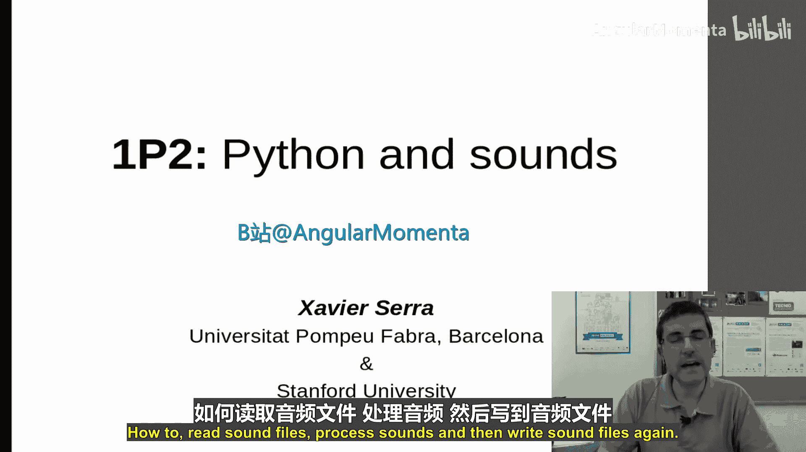
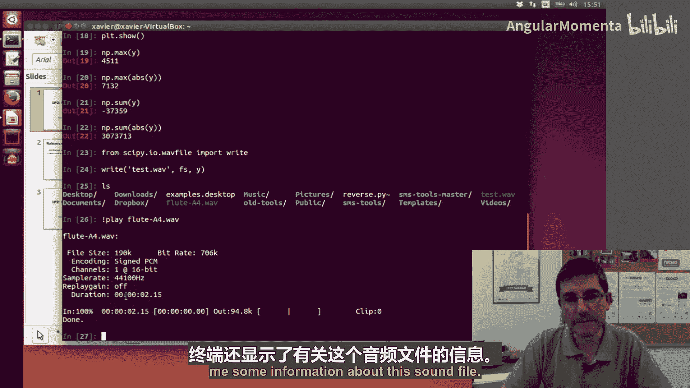
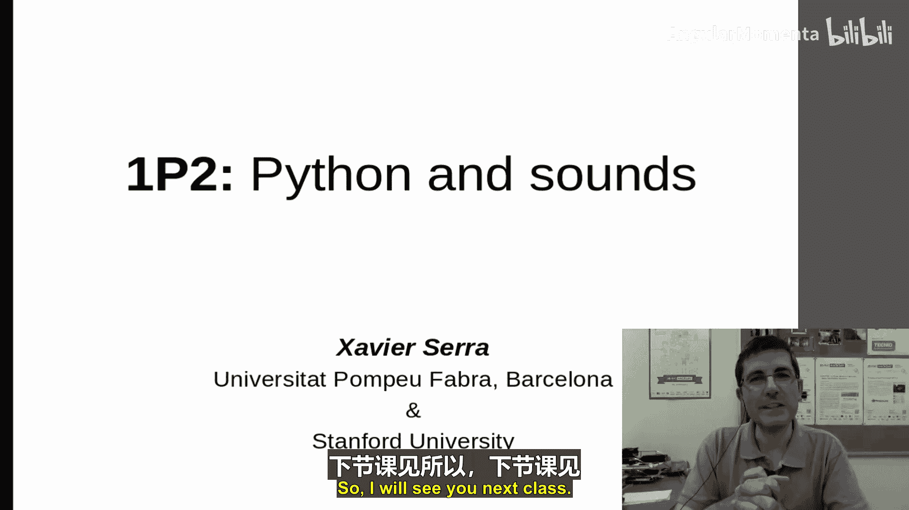

# 010：Python与声音 🎵

在本节课中，我们将学习如何使用Python来处理音频信号。我们将涵盖读取音频文件、处理音频数据以及将结果写入新文件的基本操作。

上一节我们介绍了Python语言，它是一种功能强大的高级语言，非常适合我们进行各种应用和编程。本节中，我们来看看如何利用Python进行具体的音频处理。



## 启动Python环境

首先，我们需要打开终端并启动Python的交互式编程环境iPython。

```python
# 在终端中启动iPython
ipython
```

## 读取音频文件

为了读取音频文件，我们需要使用一个名为`sipi`的包，它包含了处理WAV文件的功能。

```python
# 从sipi包中导入读取WAV文件的函数
from sipi.io.wfile import read
```

`read`函数需要输入文件名作为参数，并返回两个值：采样率（`FS`）和包含音频样本的数组（`x`）。

```python
# 读取音频文件
FS, x = read('flute.A4.wav')
```

现在，变量`FS`存储了采样率（例如44100 Hz），变量`x`存储了音频样本（例如16位整数数组）。

## 分析音频数据

我们可以开始询问关于这个音频文件的一些信息。例如，要获取音频样本的数量，我们可以使用以下命令：

```python
# 获取音频样本的数量
sample_count = x.size
```

要计算音频的持续时间（以秒为单位），我们可以将样本数量除以采样率。为了得到精确的浮点数结果，我们需要将其中一个数字转换为浮点数。

```python
# 计算音频持续时间（秒）
duration = x.size / float(FS)
```

## 可视化音频波形

为了绘制音频波形，我们需要导入`matplotlib`绘图库。

```python
# 导入matplotlib绘图库
import matplotlib.pyplot as plt
```

然后，我们可以绘制音频样本的波形图。

```python
# 绘制音频波形
plt.plot(x)
plt.show()
```

然而，这种显示方式以样本数为横轴，不够直观。我们希望横轴以秒为单位。为此，我们需要创建一个时间轴。

```python
# 导入numpy库以创建时间轴
import numpy as np

# 创建时间轴（秒）
t = np.arange(x.size) / float(FS)

# 以时间为横轴绘制波形
plt.plot(t, x)
plt.show()
```

现在，我们可以在图形界面中缩放和导航，更清晰地观察音频的振荡细节。

## 处理音频片段

我们可以选择音频数组中的一部分进行处理。例如，提取从第44100个样本开始的1000个样本。

```python
# 提取音频片段
y = x[44100:45100]
```

我们可以对这个新数组`y`进行各种操作。例如，计算其绝对值的最大值，这有助于了解音频信号的峰值。

```python
# 计算音频片段绝对值的最大值
max_value = np.max(np.abs(y))
```

我们还可以计算所有样本的总和。由于音频信号围绕零值振荡，总和可能接近零。

```python
# 计算音频片段所有样本的总和
total_sum = np.sum(y)
```

## 写入音频文件

处理完音频后，我们通常需要将结果保存为新文件。为此，我们需要从`sipi`包中导入写入函数。

```python
# 从sipi包中导入写入WAV文件的函数
from sipi.io.wfile import write
```

`write`函数接受文件名、采样率和音频数据数组作为参数。

```python
# 将音频片段写入新文件
write('test.wav', FS, y)
```

## 播放音频文件



在iPython环境中，我们可以使用Unix系统的`play`命令来播放音频文件，以检查处理结果。

```python
# 播放原始音频文件
!play flute.A4.wav

# 播放新生成的音频文件
!play test.wav
```

## 总结



本节课中我们一起学习了使用Python进行音频处理的基础知识。我们介绍了如何利用`sipi`包读取和写入WAV文件，如何使用`matplotlib`绘制音频波形，以及如何借助`numpy`处理和分析音频数据。掌握这些基本操作后，我们已经可以开始进行一些有趣的音频处理实验。当然，要深入音频信号处理领域，我们还需要学习更多知识。我们下节课再见。