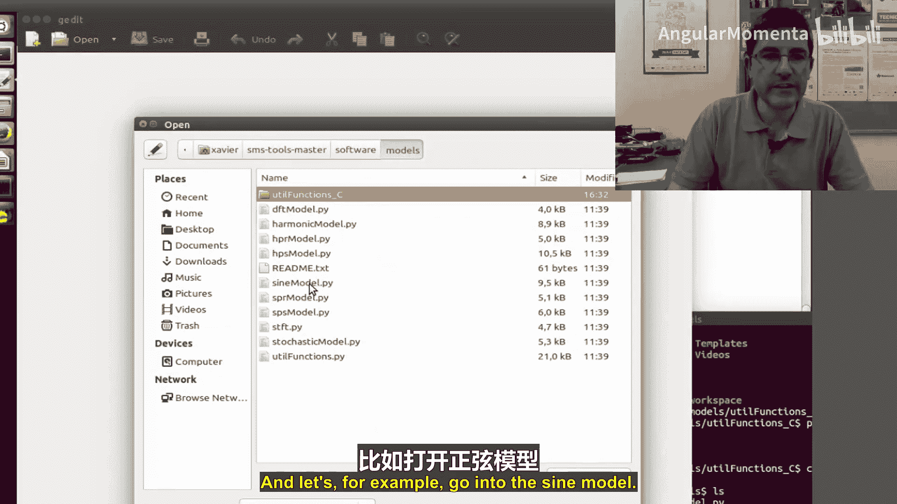
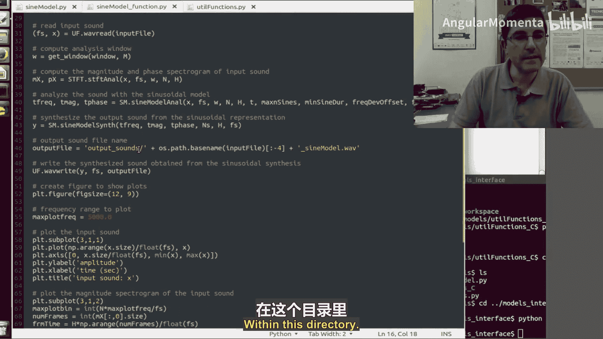
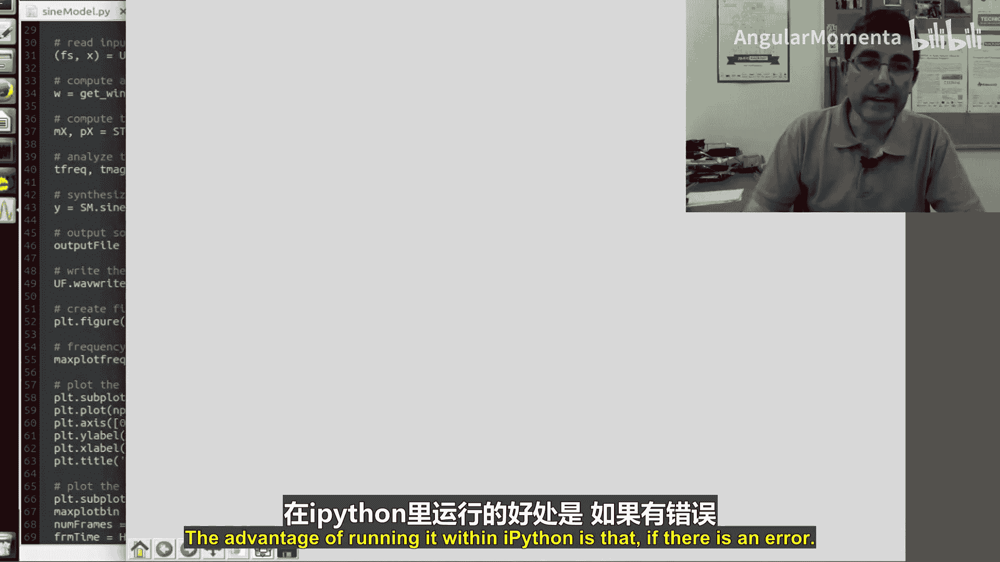
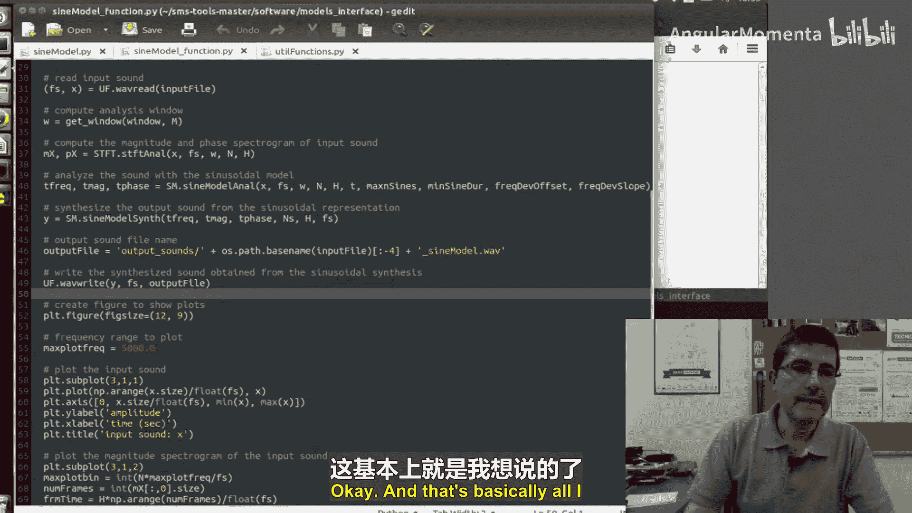
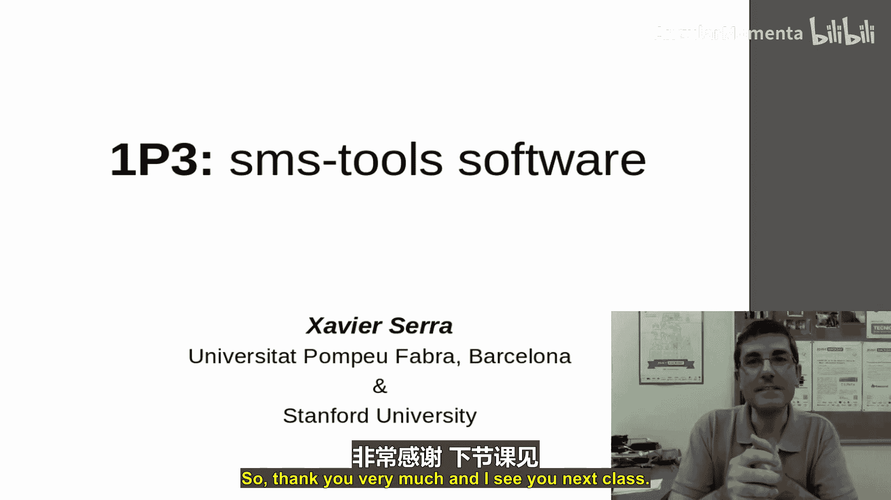

# 011：SMS工具软件 🎼

在本节课中，我们将学习SMS工具软件。这是为本课程开发的Python工具集，我们将深入理解并使用它们。

在之前的两次编程课程中，我们介绍了Python以及如何读取和处理声音的基本工具。本节中，我们来看看SMS工具。

## 概述

SMS源自“频谱建模合成”（Spectral Modeling Synthesis）。这是很久以前我为这类工具起的名字，并一直沿用至今。

这些工具可以从GitHub获取。GitHub是一个在线的软件仓库，也是一个拥有庞大社区的优秀平台，许多免费软件项目都使用这个仓库。

## SMS工具结构

以下是SMS工具包的主要目录结构。

*   **`lectures`**：存放理论课的幻灯片以及用于生成幻灯片中所有图表的代码。
*   **`software`**：本课程的主要软件代码，也是我们当前关注的重点。
*   **`sounds`**：存放课程中使用的所有声音文件。
*   **`workspace`**：供你练习的工作区。

如果我们打开`software`目录，你会看到课程的核心软件模型。

*   **`models`**：我们将要使用的核心模型，例如DFT、谐波模型、SDFT等，以及对这些模型应用变换的代码。
*   **`interfaces`**：用于调用这些模型的函数和文件，也就是我们将要执行的函数。

## 安装与配置

回到根目录，有一个`readme`文件，它描述了基本的安装步骤。

首先，它指出我们需要Python 2.7以及安装一系列软件包（我们在第一讲中已完成）。其次，我们需要编译一些C函数。

为了完成所有步骤，首先要做的是下载包含所有文件的zip压缩包。点击下载后，它会创建一个本地文件。

我已经完成了这一步。在终端中，我的主目录下有一个`sms-tools-master`目录，里面包含了所有内容。

继续按照`readme`文件的指示，我需要执行一个编译命令。我需要进入`software/models/utilFunctions_C`目录并执行该命令。



我已经执行过了，所以它已经编译完成。你应该不会遇到任何问题。

基本上，我们现在已经准备就绪。如果不想深入编码，我们可以直接执行接口文件，就像在另一节演示课中介绍的那样，执行模型或变换的GUI界面。

## 深入核心模型

现在，我想深入`models`目录。这里包含了我们将要学习的核心模型。

让我们用文本编辑器打开其中一个。例如，进入`software/models`目录，打开`sineModel.py`文件。

`sineModel`是其中一个模型，它基本上将声音分析为正弦波的和。在这段代码的开头，导入了所需的包，然后定义了一系列函数，这些函数实现了正弦模型的不同方面。

让我们关注其中一个函数，例如`sineModelAnal`。这个函数以输入声音数组和决定执行何种分析的控制参数作为主要输入参数。

它执行一系列操作，遍历整个声音，并返回三个变量。这些变量基本上存储了声音中所有正弦波的**频率**、**幅度**和**相位**。这些都是存储了所有信息的大型矩阵。这些在开头的注释文本中都有解释，说明了它的功能、输入参数和返回值。

但是，要调用这个函数，我们使用另一个文件。我们转到`interfaces/modelsInterface`目录，在这里我们会找到`sineModel_function.py`文件。

这才是我们实际调用以执行正弦分析的文件。这个文件同样导入了所需的包集，然后有一个名为`main`的单一函数。

为了让这个文件能够被执行而不必手动调用函数，这里有这样一行命令，它基本上表示当我们执行这个文件时，它应该默认执行`main`函数。

所有输入参数都有默认值。它有输入文件的默认值，以及其他所有参数的默认值。当然，我们可以在这里修改所有这些值。

然后，在这个函数内部，它执行正弦分析的所有步骤：读取声音文件，获取分析窗，执行短时傅里叶变换，然后执行`sineModelAnal`函数（即我们刚才看到的函数）。它从之前的所有执行步骤中获取了所有的值和变量，因此我们可以直接调用该函数，它返回存储正弦波频率、幅度和相位的三个变量。之后我们可以重新合成声音，并将声音再次写入输出文件。

顺便提一下，这种读写声音文件的方式是我之前提到的`soundfile`库的一个包装函数。事实上，如果我们查看`models`目录下的`utilFunctions.py`文件中的`read`和`write`函数，它基本上就像我们上节课做的那样读取输入声音，但现在它会进行归一化，将其转换为浮点数，并归一化到-1到1之间的值。这是处理声音时，将声音作为-1到1之间浮点数的惯例。在写入文件时，我们必须逆转这个过程，重新创建16位整数。

## 执行与验证

这就是这个文件功能的基本概述。我们可以执行它。我们可以转到`interfaces/modelsInterface`目录，然后输入：

```bash
python sineModel_function.py
```

这将执行这个`main`文件。它首先会绘制分析结果，然后会将一个声音文件写入一个名为`output_sounds`的目录中。

如果我们查看这里，有一个名为`output_sounds`的目录。输入`ls output_sounds`，它会显示`bend_sineModel.wav`，这就是生成的结果文件。

要播放它，我们只需输入：



```bash
play output_sounds/bend_sineModel.wav
```

这就是我们通过这次分析-合成过程生成的合成声音。

当然，这也可以在IPython中完成。如果我们输入`ipython`进入交互模式，我们也可以通过输入`run sineModel_function`来执行这个文件，它会做同样的事情：执行该函数，然后显示结果并保存声音文件。

在IPython中运行的优势在于，如果出现错误，或者我们真的想探索函数的中间步骤，我们可以做到，我们可以运行调试器等。这对我们来说将非常有用。



## 总结



本节课中，我们一起学习了SMS工具集的介绍，它托管在GitHub上。请随时前往下载并安装。

为了安装它，除了之前完成的安装步骤外，我们唯一需要做的就是编译提到的C函数。

今天我们还简要描述了一个将要分析的模型——正弦模型。我们执行了它，并看到了如何通过它分析和合成声音。

以上就是对SMS工具的简要概述。结合另一节演示课（我在其中演示了界面并实际分析和变换了一些声音），希望你能够了解这些工具以及我们将在课程中学到的内容。



非常感谢，我们下节课再见。