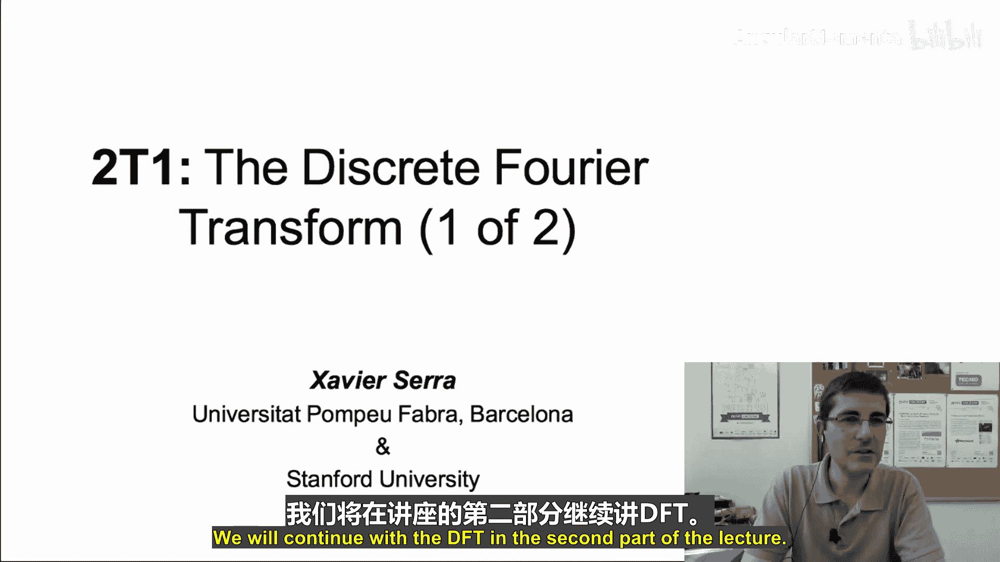

# 012：离散傅里叶变换（一）🎵

在本节课中，我们将开始学习音频信号处理中最基础、最重要的主题之一：离散傅里叶变换。理解这个核心概念是掌握后续所有内容的关键。我们将从离散傅里叶变换的基本方程入手，并详细解释构成该方程的两个基本组成部分：复指数函数和标量积。

---

## 核心方程：离散傅里叶变换（DFT）🧮

这就是整个课程中最重要的方程，请务必仔细理解。

在方程中，你可以看到 **x[n]**，这是我们的输入信号，即一系列声音样本。它被一个**复指数函数**（一个复正弦波）相乘。我们逐样本相乘：一个声音样本乘以复正弦波的一个样本。然后，我们对大写的 **N**（我们计算的样本数量）进行求和。最终，我们得到结果 **X[k]**，这就是我们的频谱。索引 **k** 指的是频率索引。

因此，我们有：
*   **n** 是离散时间索引。
*   **k** 是离散频率索引。
*   输入信号有 **N** 个样本，输出频谱也有 **N** 个频率点。

如果我们想将这些频率理解为弧度频率，需要将 **k** 乘以 **2π** 再除以 **N**，这正好是复指数函数中的指数部分。如果我们想将其转换为以赫兹为单位的频率，只需将索引 **k** 除以 **N**，再乘以采样频率 **Fs** 即可。

**公式**：
`X[k] = Σ_{n=0}^{N-1} x[n] * e^{-j(2π/N)kn}`

---

## DFT 实例分析🎹

让我们看一个例子。上方的图是输入信号 **x[n]**，在本例中是一段双簧管声音的一系列样本。

当我们计算其 DFT 时，会得到一个复数函数 **X**，它可以用极坐标形式表示，即包含**幅度**和**相位**。让我们先听一下这个声音。

（此处为双簧管声音）

在频谱中，我们可以看到幅度谱和相位谱。在幅度谱中，我们可以识别出这个声音的**谐波**，即那些明显的峰值，这清楚地表明这是一个谐波丰富的声音。在相位谱中，我们可以看到这些正弦波在周期长度内、相对于样本序列持续时间的相位位置（以弧度表示）。

---

## 基础函数：复指数正弦波📈

正如 DFT 方程所示，输入信号 **X** 与一系列复指数函数（复正弦波）相乘。这些正弦波是 DFT 的**基础函数**，是我们将在输入信号中识别和测量的成分。

其中一个复正弦波是 **s_k**。利用欧拉公式，我们可以将其表示为一个复指数：
`s_k[n] = e^{-j(2π/N)kn} = cos((2π/N)kn) - j*sin((2π/N)kn)`
这就是该复指数的实部和虚部。

*   如果 DFT 的大小 **N=4**，我们将有 4 个输入样本，因此也需要 4 个长度为 4 的正弦波作为基础函数。输出也将有 4 个频率点。
    *   **s_0**：频率 k=0，所有样本值均为 1（直流分量）。
    *   **s_1**：频率 k=1，一个周期的复正弦波。
    *   **s_2**：频率 k=2。
    *   **s_3**：频率 k=3。
    一个大小为 4 的信号将被投影到这 4 个正弦波上。

*   如果信号大小 **N=8**，我们将需要 8 个这样的正弦波。从 **s_0**（直流分量）开始，到 **s_1**（一个周期的正弦/余弦），周期数逐渐增加。这里存在某种对称性，频率并不会一直增加到 8 个周期，而是会回绕。这些就是进行 8 点 DFT 时使用的 8 个复正弦波。

---

## 标量积视角🔍

DFT 方程也可以从**标量积**的角度来理解。我们实际上是在计算输入信号 **x[n]** 与 **N** 个复指数函数之间的标量积。

**公式**：
`X[k] = <x, s_k> = Σ_{n=0}^{N-1} x[n] * s_k*[n]`

让我们看一个例子。假设 **N=4**，信号 **x** 为四个样本 `[1, -1, 1, -1]`。我们计算这个信号与之前幻灯片中四个正弦波（s_0 到 s_3）中每一个的标量积：

*   **与 s_0 的标量积**：结果为 0。这意味着该信号中**不存在频率 k=0**（直流分量）。
*   **与 s_1 的标量积**：结果为 0。这意味着频率 k=1 也不存在。
*   **与 s_2 的标量积**：结果为 4。这意味着信号 **x** 与这个正弦波完全一致，该频率成分很强。
*   **与 s_3 的标量积**：结果为 0。

因此，我们计算出了 **x[n]** 的 DFT，结果是：**X[2] = 4**，其他 **X[k] = 0**。这表明信号中只存在频率 **k=2**。

---

## 更复杂的信号示例📊

让我们用一个更大的信号来演示。这是一个简单的信号，前四个样本为 1，后四个样本为 -1，类似于一个矩形波。

我们计算这个信号与之前提到的 8 个复正弦波（s_0 到 s_7）的标量积（即 DFT）。结果是一个复数频谱，可以用极坐标（幅度和相位）显示。

从结果中可以看到：
*   频率 **k=0** 不存在。
*   频率 **k=1** 非常强。
*   频率 **k=3**、**k=5**、**k=7** 也存在。
*   相位信息表明了这些正弦波在时间上的相对位置。

这就是 DFT 运算的本质，它将成为我们后续所有处理的核心。

---

## 延伸资源与总结📚

你可以在维基百科或 Julius Smith 的网站上找到更多关于 DFT 的信息。从本讲开始，我们将使用来自 Freesound 的音频样本，所有代码将遵循标准的 Creative Commons 和 GPL 许可。

本节课我们一起学习和解释了 DFT 方程。希望你已经意识到它并非那么复杂。即使你觉得它有些复杂，但它在音频信号处理中的应用极其广泛，因此值得投入时间去掌握。

我们将在本主题的第二部分继续深入探讨 DFT。感谢你的关注，下节课再见。

