# 013：离散傅里叶变换（第二部分）🎵

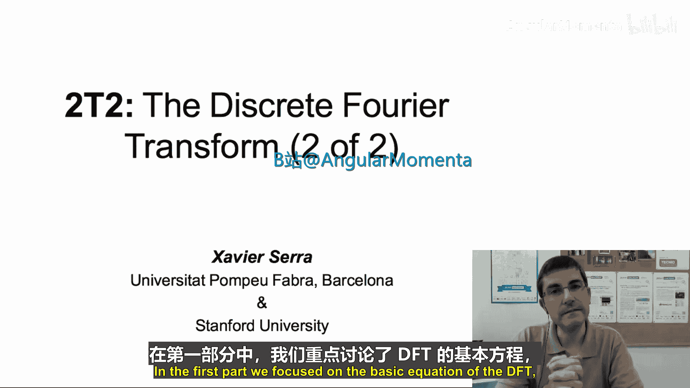

在本节课中，我们将继续学习离散傅里叶变换。上一节我们介绍了DFT的基本方程，本节中我们将看看当输入信号是复正弦波或实正弦波时，DFT如何工作，并讲解逆DFT。

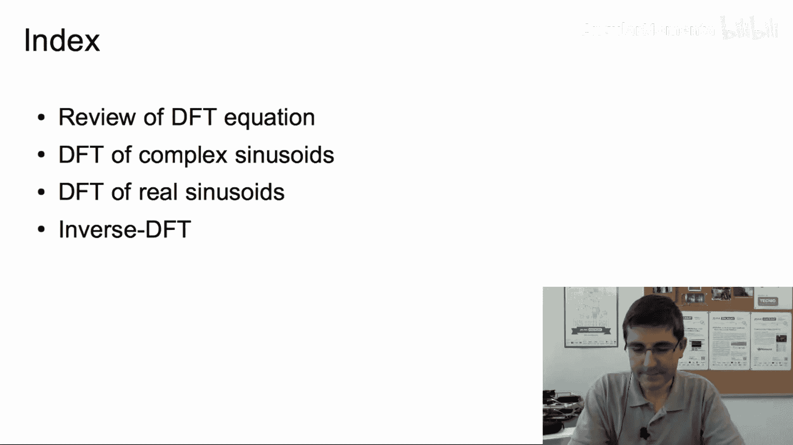

## DFT回顾与工作原理

DFT可以理解为将信号投影到一组有限的复正弦波上。因此，它能够识别信号中每种正弦波成分的含量。

从方程来看，内积的概念表达了这一思想：当我们将信号 `x[n]` 投影到复正弦波 `e^{-j2πkn/N}` 上时，我们本质上是在测量信号中该正弦波的含量。

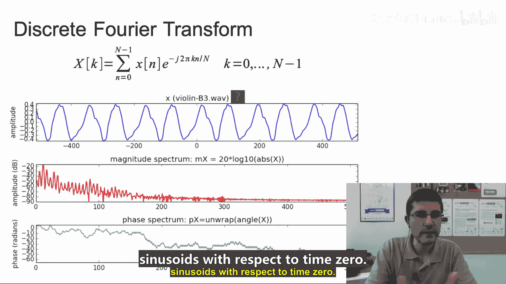

以下是计算DFT的核心公式：

```
X[k] = Σ_{n=0}^{N-1} x[n] * e^{-j2πkn/N}
```

## 计算单个复正弦波的DFT

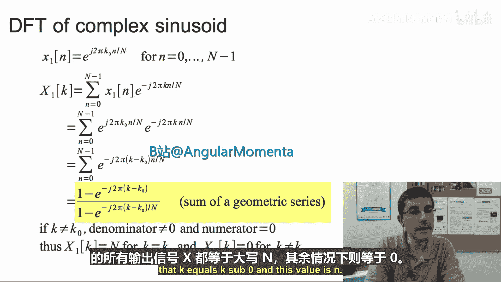

为了更好地理解这个概念，我们先解释如何计算单个复正弦波的DFT。

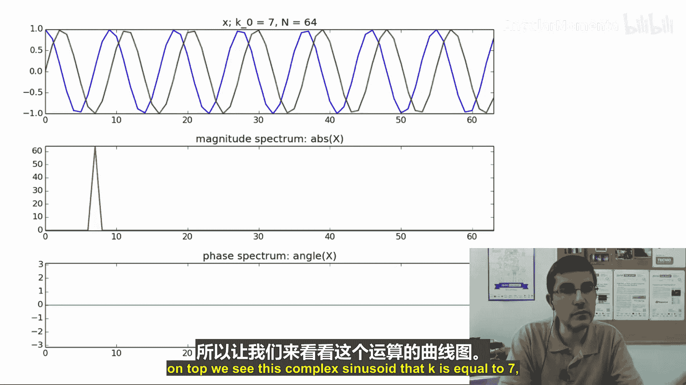

假设输入信号 `x₁[n]` 是一个长度为 `N` 的复正弦波，其频率由索引 `k₀` 表示。我们将这个信号代入DFT方程。

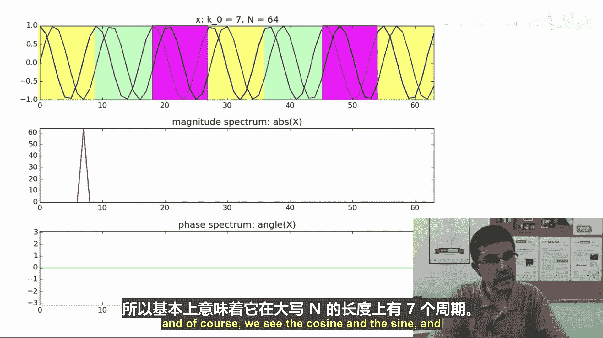

以下是计算过程：

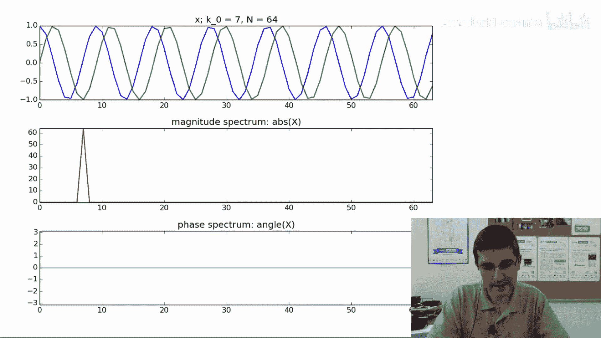

```
x₁[n] = e^{j2πk₀n/N}
X₁[k] = Σ_{n=0}^{N-1} e^{j2πk₀n/N} * e^{-j2πkn/N}
       = Σ_{n=0}^{N-1} e^{j2π(k₀ - k)n/N}
```

这是一个几何级数求和，有闭合形式。通过检查方程可以发现，当 `k ≠ k₀` 时，分母不为零，分子为零，因此输出 `X[k]` 为零。当 `k = k₀` 时，输出 `X[k₀] = N`。

这意味着，对于一个恰好是DFT基函数之一的复正弦波，其DFT结果仅在 `k = k₀` 处有一个非零值 `N`。

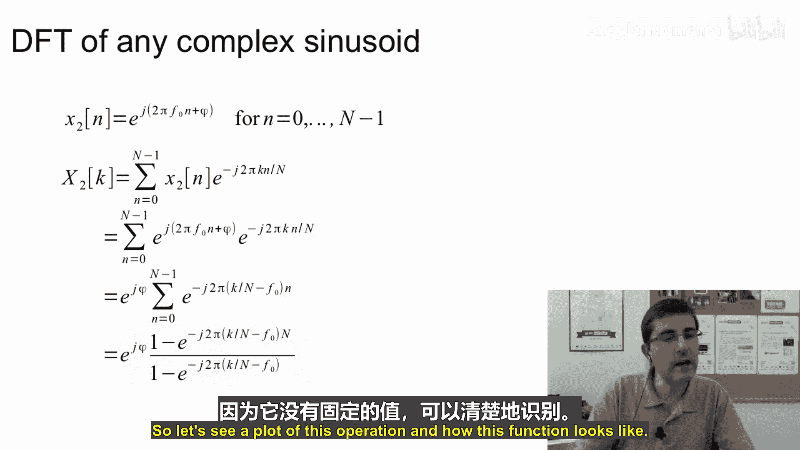

## 任意频率复正弦波的DFT

然而，上述情况非常特殊。让我们看一个更现实的例子：计算任意频率复正弦波的DFT。

假设信号 `x₂[n]` 是一个复指数信号，但其频率 `f₀` 不是DFT正弦波频率的整数倍。将其代入DFT方程后，我们同样得到一个几何级数，但其形式不如前例简洁。

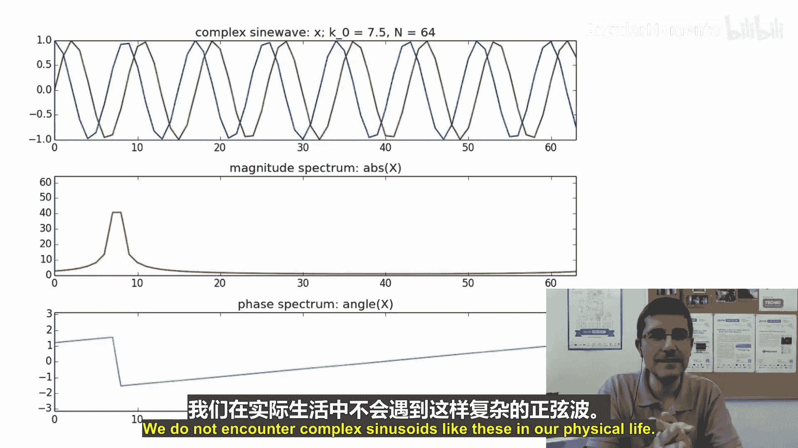

在这种情况下，DFT的幅度谱在所有 `k` 上都有正值，但在频率 `f₀` 附近（例如 `k=7` 和 `k=8` 之间）会出现一个突出的峰值，其余位置的值则小得多。

## 实正弦波的DFT

让我们更进一步，计算更接近真实声音的实正弦波的DFT。这稍微复杂一些。

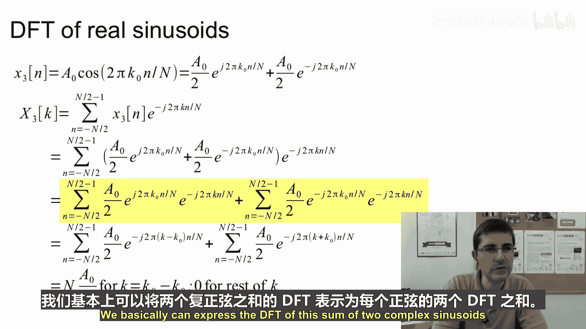

我们取一个实正弦波信号 `x₃[n] = A₀ * cos(2πk₀n/N)`。利用欧拉公式，我们可以将这个余弦表示为两个复正弦波之和。

由于DFT是线性运算，其实正弦波的DFT可以表示为这两个复正弦波各自DFT的和。

以下是关键推导：

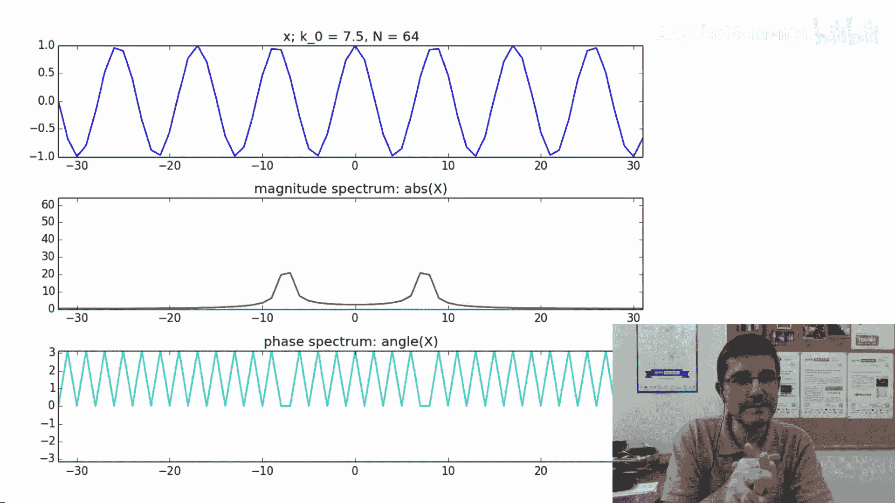

```
cos(2πk₀n/N) = (1/2)(e^{j2πk₀n/N} + e^{-j2πk₀n/N})
X₃[k] = DFT{ (A₀/2) * e^{j2πk₀n/N} } + DFT{ (A₀/2) * e^{-j2πk₀n/N} }
```

因此，结果将在 `k = k₀` 和 `k = -k₀` 两个频率位置出现幅度为 `A₀/2` 的峰值，其余 `k` 值为零。对于非整数频率的情况，则会在正负频率附近各出现一个“凸起”。

## 逆离散傅里叶变换

DFT的一个重要特性是可逆性，这意味着我们可以从其频谱中恢复原始信号。这就是逆DFT。

逆DFT的方程如下：

```
x[n] = (1/N) * Σ_{k=0}^{N-1} X[k] * e^{j2πkn/N}
```

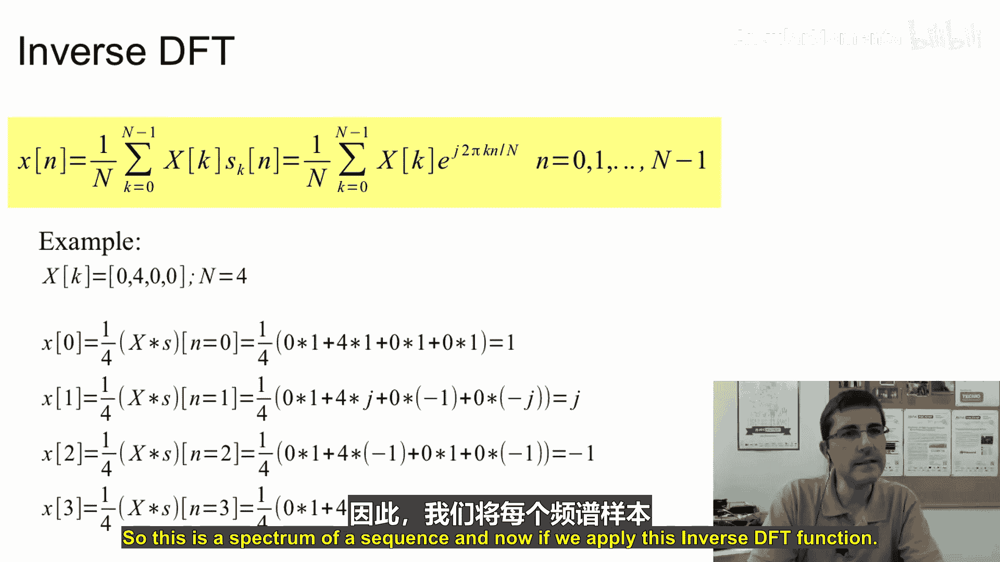

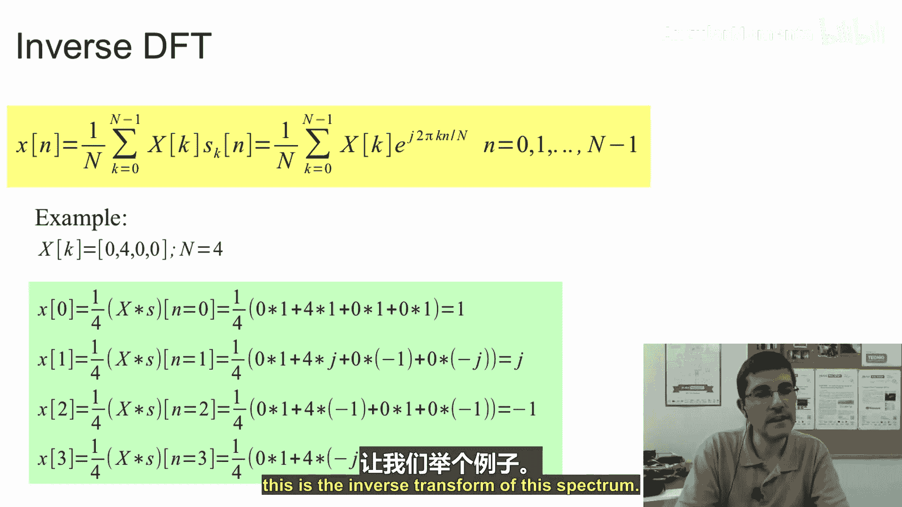

与DFT的主要区别在于：
1.  复指数指数项为正，而非共轭（负指数）。
2.  包含一个归一化因子 `1/N`。

从概念上讲，这是一个合成过程：我们重新生成之前识别出的正弦波，将它们组合起来以重建原始信号。

对于实信号，其频谱是共轭对称的。因此，要恢复原始信号，通常只需要正频率一半的频谱信息。我们可以利用对称性生成完整的频谱，然后应用逆DFT方程，即可得到原始的实正弦波信号。

## 总结

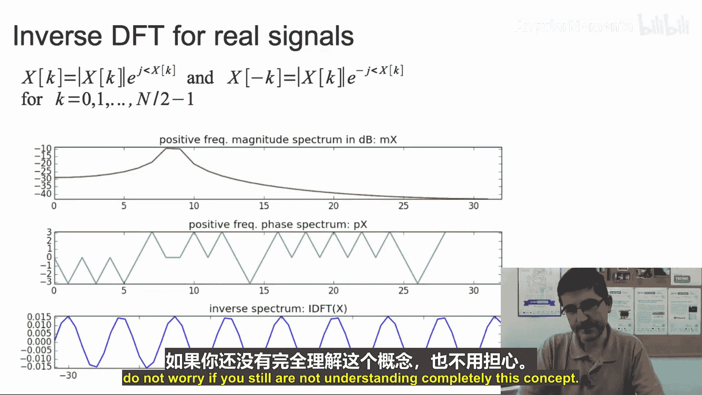

本节课中我们一起学习了离散傅里叶变换的进一步应用。在第一部分，我们介绍了DFT方程；在第二部分，我们探讨了当输入是正弦波时DFT的工作原理，并解释了逆DFT。

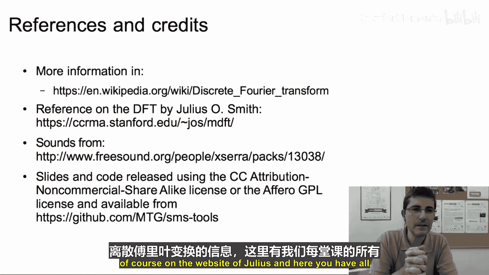

我们了解到：
*   DFT将信号分解为特定复正弦波的组合。
*   对于恰好匹配DFT基频的复正弦波，其DFT结果是一个单一峰值。
*   对于任意频率的复正弦波或实正弦波，其DFT结果会在对应频率附近扩散。
*   逆DFT允许我们从频谱完美地重建原始信号。

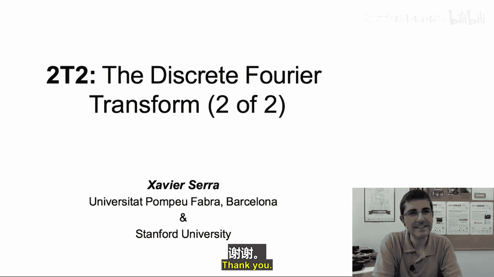

理解这些概念将为后续学习更复杂的音频信号处理技术打下坚实基础。我们将在下一讲中继续深入这些概念。