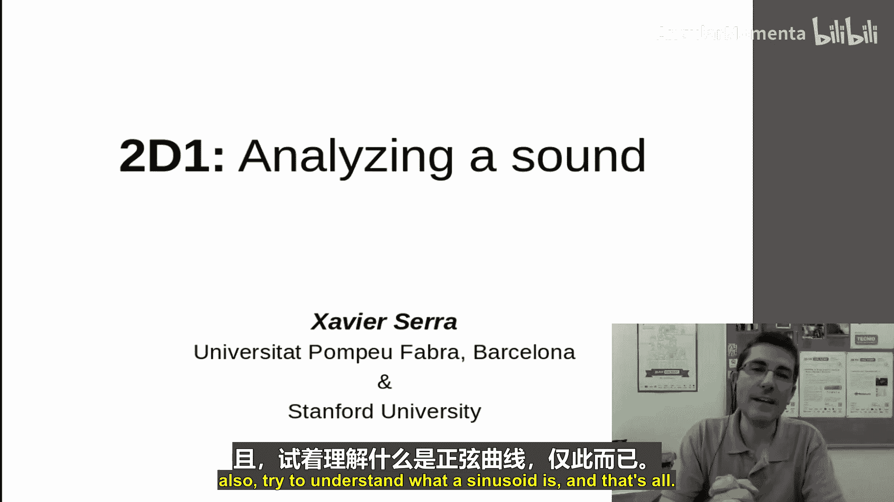

# 014：分析声音 🎵

在本节课中，我们将学习如何使用离散傅里叶变换来分析一个真实的声音。我们将以音叉的声音为例，通过实践操作来理解DFT如何揭示声音的频率成分。

## 概述

我们将使用Audacity录制音叉的声音，并通过其内置的频谱图功能进行初步观察。随后，我们将把声音文件导入到SMS工具包中，利用DFT模型进行更深入的分析，并将结果与一个纯电子合成的正弦波进行比较。

## 录制与初步观察

首先，我们在Audacity中录制音叉的声音。音叉能产生非常清晰的音调，这使其成为为其他乐器调音的理想工具。

以下是录制和初步处理的步骤：

1.  打开Audacity，点击录音按钮，通过麦克风录制音叉的声音。
2.  删除录音中非音叉声音的部分。
3.  选择音量最大的片段进行放大观察。放大后，波形呈现出类似正弦曲线的形态。

在之前介绍Audacity时，我们提到过可以查看频谱图。频谱图本质上是随时间变化的DFT。音叉声音的频谱图显示出一条非常明显的谱线，频率大约在500赫兹左右，这基本上就是我们听到的频率。实际上，这个音叉标注的频率是440赫兹。

## 深入分析准备

为了进行更深入的分析，我们需要清理并导出声音文件。

1.  在声音的开头和结尾添加一小段静音，这有助于后续程序的识别和分析。
2.  将文件导出为WAV格式，采样率为44100 Hz，单声道，并命名为 `tuning_fork.wav`。

## 使用SMS工具进行DFT分析

接下来，我们通过终端进入SMS工具包的 `models` 子目录，启动包含所有模型的交互界面。我们将首先使用DFT模型。

以下是分析步骤：

1.  加载我们刚刚保存的 `tuning_fork.wav` 文件。
2.  使用默认参数对声音进行分析。分析结果会显示输入声音的片段、该片段的DFT幅度谱，以及经过逆DFT重建后的波形。
3.  在幅度谱中，可以清晰地看到一个主峰。将光标置于其上，显示频率大约在440赫兹。同时，频谱中也存在其他强度较弱的分量。

为了对比，我们打开一个预先合成的440赫兹电子正弦波文件，并进行同样的DFT分析。虽然听起来与音叉声音相似，但两者的频谱图看起来有所不同：音叉的频谱看起来更“嘈杂”，而电子正弦波的频谱则有一个非常清晰的主峰，其余部分则微弱得多。

## 调整分析参数

我们可以调整分析参数来观察不同的效果。例如，我们可以改变分析帧的大小。

1.  将分析样本数从默认值改为更大的数值（例如1001个样本）。
2.  重新计算DFT。虽然由于样本数增多，频谱的细节看起来会有所不同，但整体的形状保持不变。
3.  我们也可以调整分析的起始时间点。由于这是一个近乎纯的正弦波，在不同时间点分析的频谱形状基本一致。

## 总结

本节课中，我们一起学习了如何分析真实声音。我们使用Audacity录制并初步观察了音叉的声音，然后利用SMS工具包中的DFT模型进行了深入分析。通过将音叉的DFT结果与纯电子正弦波的DFT结果进行对比，我们直观地理解了理想正弦波与实际物理声源产生的“正弦”声音在频谱上的差异。希望这能让你对DFT处理实际声音的能力有一个具体的认识。