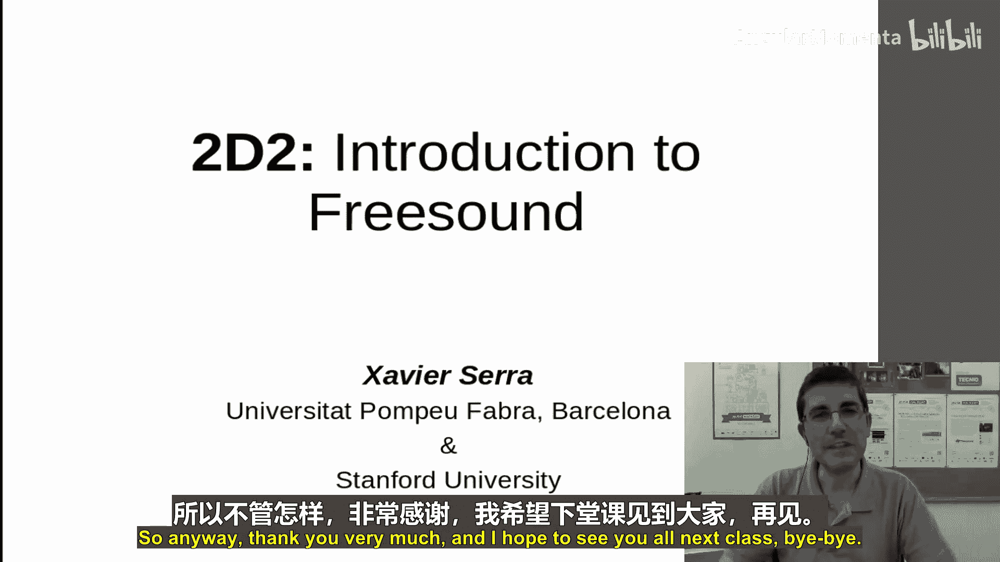

# 015：Freesound简介 🎵

在本节课中，我们将学习一个名为Freesound的在线音频数据库。这是一个为音频处理课程提供声音素材的重要资源，我们将了解如何搜索、下载以及上传声音文件。

## 概述

Freesound是一个由巴塞罗那庞培法布拉大学音乐技术组发起并维护的网站，拥有超过20,000个声音样本和每日超过50,000的活跃用户。它是一个基于社区贡献和共享的音频资源平台。


## 访问与搜索声音


首先，我们访问Freesound网站。在搜索框中输入关键词，例如“flute note”，网站会返回包含这些关键词（标签或描述中）的所有声音。例如，搜索“flute note”会找到1074个相关声音。


以下是搜索声音的基本步骤：
1.  在搜索栏输入关键词。
2.  浏览搜索结果列表。
3.  点击感兴趣的声音进入详情页。

## 声音详情页


每个声音条目都包含详细的信息。详情页通常包括声音的描述、录制方式、关键特征以及标签。此外，还提供声音的技术信息，如采样率和比特深度。

声音详情页通常包含以下信息：
*   **描述**：关于声音内容和录制方式的文字说明。
*   **标签**：用于分类和搜索的关键词。
*   **技术信息**：包括文件格式、时长、采样率等。
*   **播放控件**：用于在线预览声音。

## 基于相似性的搜索

Freesound提供了一个有趣的功能，即通过声音的频谱相似性来查找其他声音。例如，一个陶笛（ocarina）的声音可能被系统认为与某些长笛声音频谱相似。点击“相似声音”选项，系统会列出频谱特征相近的声音，并按相似度排序。


## 浏览与发现声音

除了关键词搜索，还可以通过其他方式浏览声音。在“声音”页面，可以按标签或“包”来浏览。一个特别的功能是“地理标签”，可以查找在世界特定地点录制的声音。例如，搜索“Barcelona”可以找到2300多个在该城市录制的声音。


## 下载声音

要下载声音，需要先登录账户。在声音详情页点击“下载”按钮，文件将以原始上传的格式保存到本地。本课程使用的声音都标记了“ASP_course”标签，方便集中查找和下载。


## 上传声音

我们鼓励用户上传对课程有参考价值或经过处理的有趣声音，并为其打上“ASP_course”标签以便他人查找。

上一节我们介绍了如何下载声音，本节中我们来看看如何上传自己的声音。

以下是上传声音的步骤：
1.  准备声音文件。例如，我们可以使用Audacity生成一个440Hz、时长5秒的锯齿波，并添加淡入淡出效果。
    ```python
    # 示例：生成一个440Hz的锯齿波概念
    # 频率 = 440 Hz
    # 时长 = 5 秒
    # 波形 = 锯齿波
    ```
2.  在Freesound网站点击“上传声音”按钮。
3.  选择文件并上传。
4.  填写声音描述，例如“这是一个使用Audacity生成的440Hz、5秒长的锯齿波”。
5.  添加相关标签，如“sawtooth”、“440Hz”、“synthesis”。
6.  选择许可证。通常推荐使用“署名许可”，这意味着使用者需要注明素材来源。
7.  提交上传。上传后会有审核人员检查描述是否准确并确保没有法律问题，之后声音便会出现在网站上。

## 关于知识共享许可

了解音频素材的许可协议非常重要。Freesound主要使用知识共享许可协议，这是一种非常适合创意作品共享的许可方式。常见的类型有：
*   **CC0（公共领域）**：放弃所有权利，可自由使用。
*   **署名**：使用时需注明作者。
*   **非商业性使用**：禁止用于商业用途。

## 总结



本节课我们一起学习了Freesound平台的基本使用方法。我们了解了如何搜索、浏览和下载声音，特别是通过频谱相似性进行查找的功能。更重要的是，我们学习了如何准备并上传自己的声音文件，包括如何添加描述、标签以及选择合适的知识共享许可协议。希望你能充分利用这个资源，不仅从中获取素材，也积极贡献自己的声音，丰富整个社区。