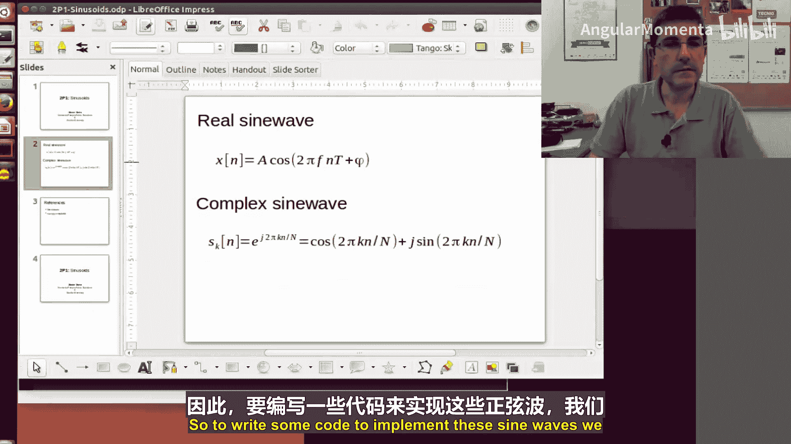
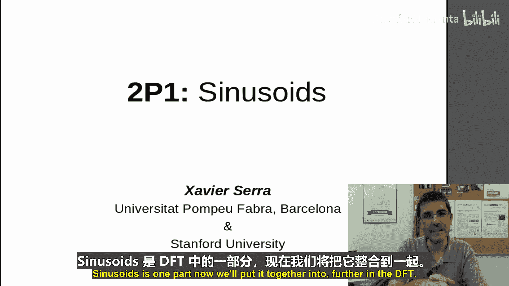

# 016：正弦波编程实践 🎵

在本节课中，我们将学习如何用Python编程实现两种类型的正弦波：实正弦波和复正弦波。正弦波是理解离散傅里叶变换（DFT）的基础，也是音频信号处理的核心。

## 概述

我们将使用Python的NumPy和Matplotlib库来生成和可视化正弦波。实正弦波用于表示时域中的连续信号，而复正弦波是DFT分析中的基本组成部分。

## 实正弦波的实现

实正弦波是一个实数序列，可以通过余弦函数计算得出。其公式为：
**x(t) = A * cos(2πft + φ)**
其中，A是振幅，f是频率，t是时间索引，φ是初始相位。



以下是实现实正弦波的步骤：

首先，我们需要导入必要的Python库。

```python
import matplotlib.pyplot as plt
import numpy as np
```

接下来，我们定义正弦波的参数并生成时间序列。

```python
# 定义正弦波参数
A = 0.8          # 振幅
f0 = 1000        # 频率 (Hz)
phi = np.pi / 2  # 初始相位 (π/2)
Fs = 44100       # 采样率 (Hz)

# 生成时间数组，从-0.002秒到0.002秒
t = np.arange(-0.002, 0.002, 1/Fs)

# 计算实正弦波
x = A * np.cos(2 * np.pi * f0 * t + phi)
```

最后，我们绘制生成的波形。

```python
# 绘制波形
plt.figure(figsize=(10, 4))
plt.plot(t, x)
plt.axis([-0.002, 0.002, -0.8, 0.8])
plt.xlabel('时间 (秒)')
plt.ylabel('振幅')
plt.title('实正弦波')
plt.grid(True)
plt.show()
```

## 复正弦波的实现

复正弦波是DFT中的基本元素，它是一个复数序列，其公式为：
**s[n] = e^(j * 2π * k * n / N)**
其中，k是频率索引（周期数），n是时间索引，N是DFT的大小（序列长度）。

上一节我们介绍了实正弦波，本节中我们来看看如何生成和可视化复正弦波。

以下是实现复正弦波的步骤：

首先，我们定义复正弦波的参数。

```python
N = 500  # DFT大小/序列长度
k = 3    # 频率索引（周期数）

# 生成整数时间索引数组，从 -N/2 到 N/2
n = np.arange(-N/2, N/2)
```

然后，我们计算复正弦波。

```python
# 计算复正弦波
s = np.exp(1j * 2 * np.pi * k * n / N)
```

为了可视化，我们可以分别绘制其实部和虚部。

```python
# 绘制复正弦波的实部（余弦波）
plt.figure(figsize=(12, 4))

plt.subplot(1, 2, 1)
plt.plot(n, np.real(s))
plt.axis([-N/2, N/2, -1, 1])
plt.xlabel('索引 n')
plt.ylabel('振幅')
plt.title('复正弦波实部 (余弦)')
plt.grid(True)

# 绘制复正弦波的虚部（正弦波）
plt.subplot(1, 2, 2)
plt.plot(n, np.imag(s))
plt.axis([-N/2, N/2, -1, 1])
plt.xlabel('索引 n')
plt.ylabel('振幅')
plt.title('复正弦波虚部 (正弦)')
plt.grid(True)

plt.tight_layout()
plt.show()
```


## DFT中的复正弦波


在DFT中，我们使用固定长度N的复正弦波。频率索引k决定了在N个样本内包含多少个完整周期。让我们看一个更接近典型DFT的例子，使用较小的N值。

以下是调整参数后的示例：


```python
# 使用更小的N值，模拟DFT中的情况
N_dft = 32
k_dft = 5

n_dft = np.arange(-N_dft/2, N_dft/2)
s_dft = np.exp(1j * 2 * np.pi * k_dft * n_dft / N_dft)

# 绘制
plt.figure(figsize=(10, 4))
plt.stem(n_dft, np.imag(s_dft), basefmt=" ", use_line_collection=True)
plt.axis([-N_dft/2, N_dft/2, -1, 1])
plt.xlabel('索引 n')
plt.ylabel('振幅')
plt.title(f'DFT中的复正弦波 (N={N_dft}, k={k_dft})')
plt.grid(True)
plt.show()
```

## 总结

本节课中我们一起学习了如何用Python编程生成两种正弦波。
*   我们实现了**实正弦波**，它用于在时域中表示连续的音频信号。
*   我们实现了**复正弦波**，它是离散傅里叶变换（DFT）的基石，由复数指数函数定义。
*   我们使用了 **NumPy** 库进行高效的数组计算，以及 **Matplotlib** 库进行数据可视化。
*   我们了解到，在DFT中，复正弦波的长度N是固定的，频率索引k直接对应信号中包含的周期数。



掌握正弦波的编程实现是深入理解音频信号处理中更高级概念（如即将学习的DFT）的关键第一步。