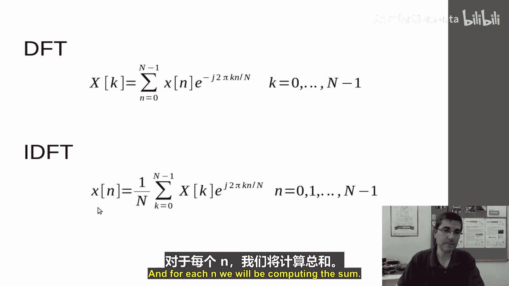
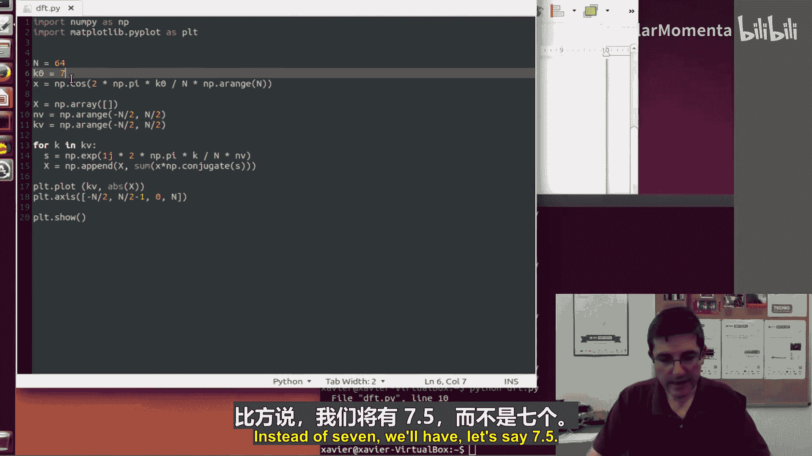
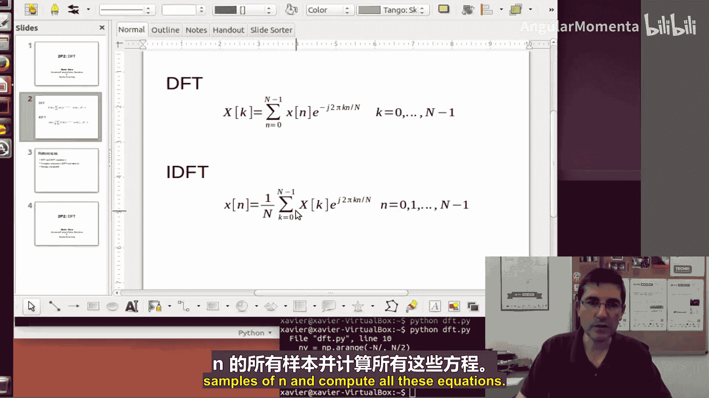
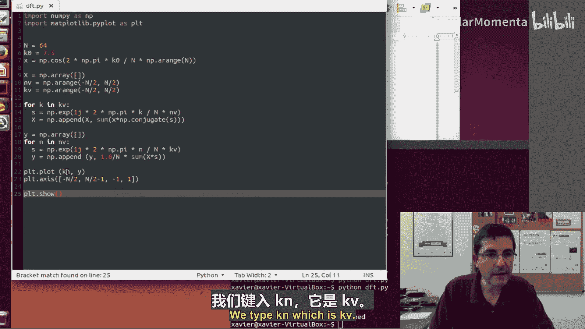
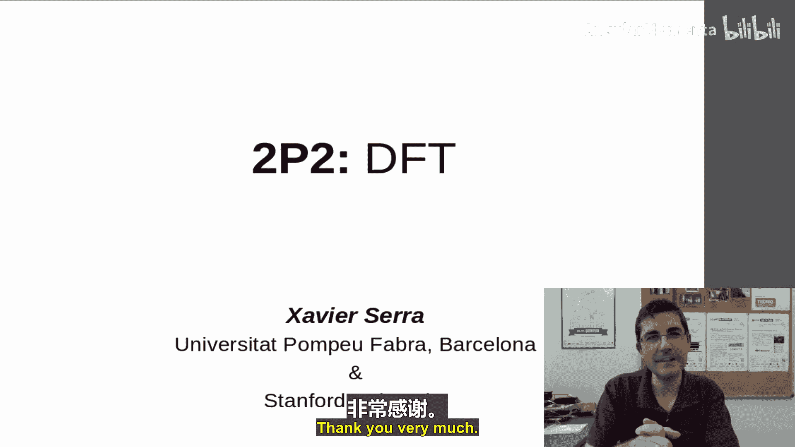

# 017：DFT编程实现 🎵

在本节课中，我们将学习如何用Python编程实现离散傅里叶变换及其逆变换。我们将从基础公式出发，逐步编写代码，并通过可视化结果来验证实现的正确性。

## 概述



离散傅里叶变换是音频信号处理的核心工具之一。它能够将时域信号转换为频域表示，揭示信号的频率成分。本节编程课的目标是理解DFT的数学公式，并将其转化为可运行的Python代码。我们将实现两个核心函数：正向DFT和逆向DFT。

## DFT正向变换的实现

上一节我们介绍了DFT的理论基础，本节中我们来看看如何用代码实现它。正向DFT的公式如下：

**X[k] = Σ (n=0 to N-1) x[n] * e^(-j*2π*k*n/N)**

以下是实现正向DFT的步骤：

1.  导入必要的Python库。
2.  初始化一个空数组来存储频谱结果。
3.  遍历所有频率索引k。
4.  为每个k值生成对应的复指数向量。
5.  计算输入信号与该复指数向量的内积（点乘），得到X[k]。
6.  将结果存入输出数组。

对应的核心代码如下：

```python
import numpy as np
import matplotlib.pyplot as plt

def DFT(x):
    N = len(x)
    X = np.array([])  # 初始化输出频谱数组
    kv = np.arange(-N//2, N//2)  # 频率索引，从-N/2到N/2
    for k in kv:
        # 创建复指数基向量
        s = np.exp(1j * 2 * np.pi * k / N * np.arange(N))
        # 计算内积（点乘并求和）
        Xk = np.sum(x * np.conj(s))
        X = np.append(X, Xk)
    return X
```

## 测试DFT：从复指数信号到实数信号

为了验证DFT代码的正确性，我们使用不同的输入信号进行测试。

首先，我们生成一个复指数信号作为输入。以下是生成和测试信号的代码：

```python
# 设置参数
N = 64  # 信号长度
k0 = 7  # 频率索引

# 生成复指数信号
n = np.arange(N)
x_complex = np.exp(1j * 2 * np.pi * k0 * n / N)

# 计算DFT
X_complex = DFT(x_complex)

# 绘制频谱（取模值）
plt.plot(np.arange(-N//2, N//2), np.abs(X_complex))
plt.show()
```

运行代码后，频谱图会在频率索引7处显示一个峰值，其余位置为0，这证实了我们的输入是一个纯净的复正弦波。

接下来，我们将输入信号改为更常见的实数余弦信号。

```python
# 生成实数余弦信号
x_real = np.cos(2 * np.pi * k0 * n / N)

# 计算DFT
X_real = DFT(x_real)

# 绘制频谱
plt.plot(np.arange(-N//2, N//2), np.abs(X_real))
plt.show()
```

对于实数信号，其频谱会呈现对称的两个峰值，分别位于正负频率索引处（如+7和-7）。这符合理论预期，即实数信号可以分解为两个共轭复指数之和。

最后，我们测试一个非整数频率的信号，观察频谱泄漏现象。



```python
k0_non_int = 7.5  # 非整数频率
x_leakage = np.cos(2 * np.pi * k0_non_int * n / N)
X_leakage = DFT(x_leakage)
plt.plot(np.arange(-N//2, N//2), np.abs(X_leakage))
plt.show()
```

此时，频谱不再是一个单一的尖峰，能量会扩散到多个频率点上，这就是频谱泄漏，在理论课中已经解释过其原因。

## DFT逆向变换的实现

在实现了正向变换并验证了其正确性后，我们接下来实现逆向DFT，以从频域信号恢复时域信号。逆向DFT的公式如下：



**x[n] = (1/N) * Σ (k=0 to N-1) X[k] * e^(j*2π*k*n/N)**

以下是实现逆向DFT的步骤：

1.  初始化一个空数组来存储重建的时域信号。
2.  遍历所有时间索引n。
3.  为每个n值，对频谱X[k]与对应的复指数进行加权求和。
4.  将求和结果乘以归一化因子1/N。
5.  将结果存入输出数组。

对应的核心代码如下：

```python
def IDFT(X):
    N = len(X)
    y = np.array([])  # 初始化输出时域信号数组
    nv = np.arange(-N//2, N//2)  # 时间索引
    kv = np.arange(-N//2, N//2)  # 频率索引
    for n in nv:
        # 创建复指数基向量
        s = np.exp(1j * 2 * np.pi * n / N * kv)
        # 计算加权和，并乘以归一化因子 1/N
        yn = (1.0/N) * np.sum(X * s)
        y = np.append(y, yn)
    return y
```



我们可以用之前得到的频谱`X_real`来测试逆向变换：

```python
# 执行逆向DFT
y_reconstructed = IDFT(X_real)

# 绘制重建的信号与原信号进行对比
plt.plot(nv, np.real(y_reconstructed))  # 取实部，因为理论结果应为实数
plt.xlabel(‘Sample Index’)
plt.title(‘Reconstructed Signal from IDFT’)
plt.show()
```

运行代码后，绘制出的重建信号应与原始的余弦信号`x_real`一致，从而验证了正向和逆向DFT配对的正确性。

## 总结



本节课中我们一起学习了离散傅里叶变换的编程实现。我们首先实现了正向DFT，将时域信号转换为频域表示，并使用复指数信号、实数余弦信号以及非整数频率信号测试了代码，观察了不同的频谱特性。随后，我们实现了逆向DFT，成功地从频谱中恢复了原始时域信号，完成了整个变换的闭环。实现过程中，我们主要依赖了`NumPy`进行数组运算和`Matplotlib`进行结果可视化。理解这些基础方程的代码实现是迈向更高级音频处理应用的第一步。