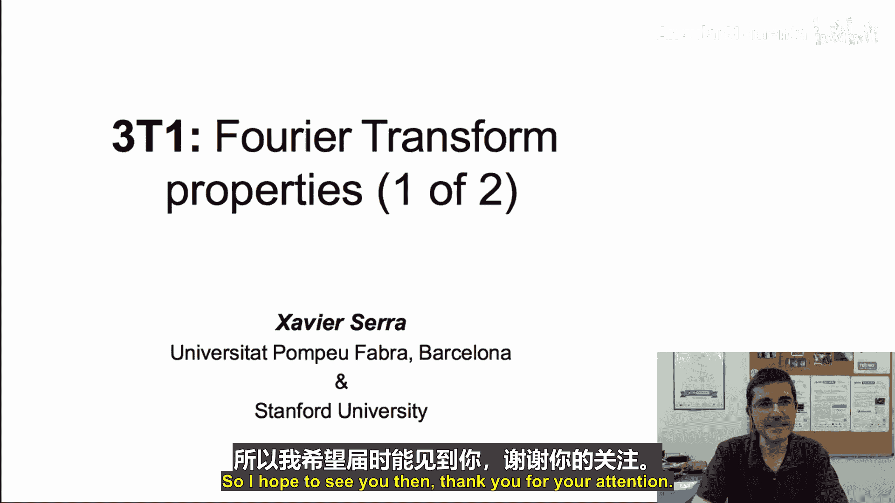

# 018：傅里叶性质1 🎵

在本节课中，我们将深入学习离散傅里叶变换的四个核心性质：**线性性**、**移位性**、**对称性**和**卷积**。理解这些性质对于深入掌握DFT的行为至关重要，尤其是在处理实际音频信号时。

上一节我们介绍了离散傅里叶变换的基本概念。本节中，我们将探讨其关键数学性质，这些性质决定了DFT如何对信号进行操作和变换。

## 线性性 📈

线性性是许多数学运算（包括DFT）的一个非常方便的性质。它意味着DFT是一个“行为良好”的运算。

具体来说，如果我们从两个信号 `x1[n]` 和 `x2[n]` 的线性组合开始，那么在频域（频谱域）中，其结果也对应于各个输入信号频谱的线性组合。

以下是证明过程。我们从两个信号线性组合的DFT开始：

`DFT{a * x1[n] + b * x2[n]}`

我们可以轻松地将求和项分成两部分，一部分用于 `a * x1[n]`，另一部分用于 `b * x2[n]`。由于标量值 `a` 和 `b` 不依赖于 `n`，我们可以将它们移到求和符号之外。因此，我们得到：

`a * DFT{x1[n]} + b * DFT{x2[n]}`

**公式表示：**
`DFT{a·x1[n] + b·x2[n]} = a·X1[k] + b·X2[k]`

我们可以用两个真实信号来举例说明。假设信号 `x1` 具有给定的幅度和频率，信号 `x2` 是另一个具有不同幅度和频率的正弦波。我们可以分别计算这两个信号的DFT，得到它们的幅度谱。如果将这两个幅度谱相加，得到左侧图中的结果。然而，如果我们先计算两个正弦波之和 `(x1 + x2)` 的DFT，得到的结果将与分别计算DFT后再相加的结果完全相同。这本质上是DFT线性性质的结果。

## 移位性 🔄

移位意味着移动信号中的样本点。对于DFT，移位性质是指：如果我们在时域中将信号 `x[n]` 移动 `n0` 个样本，那么在频域中，其频谱 `X[k]` 将乘以一个复指数因子。

同样，这很容易证明。我们从移位信号的DFT开始：

`DFT{x[n - n0]}`

我们进行变量替换，令 `m = n - n0`。然后，我们可以将复指数项拆分为两个部分：一个与 `m` 相关，另一个与 `-n0` 相关。因此，我们可以看到，我们得到了信号 `x[m]` 的DFT（即 `X[k]`），再乘以一个与 `m` 无关的复指数因子 `e^{-j2πkn0/N}`。

**公式表示：**
`DFT{x[n - n0]} = X[k] · e^{-j2πk n0 / N}`

我们也可以看一个例子。这里有两个信号 `x1` 和 `x2`，其中 `x2` 是 `x1` 移动了两个样本的版本（这是一个正弦波的一个周期）。如果我们计算这两个信号的DFT，会发现它们的幅度谱（幅度谱的绝对值）完全相同，没有任何差异。这是因为乘以频谱的复指数因子不影响幅度谱的幅度值。但是，相位谱则明显不同，两条线具有不同的斜率。这是因为频谱中的复指数乘法影响了相位值，但不影响幅度值。这就是DFT移位性质的一个例证。

## 对称性 🪞

在DFT中，存在一系列对称性，这些对称性对我们将要进行的许多操作非常有用。

以下是几种重要的对称情况：
*   如果信号是**实信号**（我们将要处理的信号类型），那么其DFT得到的复频谱，其实部具有**偶对称性**，虚部具有**奇对称性**。从极坐标表示（幅度和相位）来看，幅度谱具有偶对称性，相位谱具有奇对称性。
*   如果信号不仅是实信号，同时其本身在时域也具有**偶对称性**，那么其DFT的实部具有偶对称性，而虚部全部为零。从极坐标表示来看，幅度谱具有相同的偶对称性，相位谱全部为零。

我们可以从一个三角形波的例子中看到这一点。三角形是一个偶函数（当然也是实函数）。我们观察到其频谱的实部是偶对称的，虚部全部为零；幅度谱是偶对称的，相位角全部为零。

我们也可以在真实信号中展示这些对称性。这是一个女高音人声的片段。如果我们观察其极坐标形式的频谱（幅度和相位），幅度谱显示出这种偶对称性：右侧部分恰好是左侧部分关于零点的镜像。相位谱则显示出奇对称性，右侧部分相对于左侧部分似乎是反转的。

## 卷积 ⚙️

最后，我们来讨论与卷积相关的性质。该性质指出：如果在时域中对两个信号进行卷积运算，那么在频域中，其结果对应于两个信号各自频谱的乘积。

证明过程同样直接。我们从两个信号卷积的DFT开始，代入卷积公式，并分离变量。其中一部分涉及 `x1`，另一部分本质上是信号 `x2` 移位后的DFT。正如我们刚刚解释的，时域移位在频域对应于频谱乘以一个复指数因子。因此，我们最终得到 `X1[k]` 和 `X2[k]` 的乘积。

**公式表示：**
`DFT{x1[n] * x2[n]} = X1[k] · X2[k]`

与大多数性质一样，这也是一个可逆的性质。这意味着，如果在时域中将两个信号相乘，那么在频域中，其结果对应于两个频谱的卷积。

以下是该性质的两种视角示例：
1.  **时域乘法对应频域卷积**：我们从两个信号 `x1` 和 `x2` 开始，分别计算它们的DFT（这里显示的是幅度谱）。如果将这两个频谱进行卷积，会得到右侧图中的形状。然而，相同的形状也可以通过先将两个时域信号 `x1` 和 `x2` 相乘，再计算其DFT来获得。
2.  **滤波应用**：这是滤波中非常常见的例子。假设我们有一个海洋声音（一个非常嘈杂的信号）和一个空间脉冲响应（一个很短的声学特性信号）。标准的滤波操作是在时域中将这两个信号进行卷积。但在DFT的背景下，我们可以计算海洋声音的频谱 `X1[k]` 和脉冲响应的频谱 `X2[k]`。卷积操作可以通过将这两个频谱相乘来实现。这意味着，滤波既可以在时域中通过卷积两个信号来完成，也可以在频域中通过将两个频谱相乘来完成。这是一个我们可以利用DFT的非常方便的特性。

## 总结 📝

本节课中，我们一起学习了离散傅里叶变换的四个基本性质：**线性性**、**移位性**、**对称性**和**卷积**。线性性确保了信号组合在时域和频域的一致性；移位性揭示了时域平移对频谱相位的影响；对称性描述了实信号及其特殊形式（如偶对称信号）频谱的内在结构；而卷积性质则建立了时域卷积与频域乘法之间的等价关系，这是数字滤波等音频处理技术的核心基础。理解这些性质是深入掌握DFT并将其有效应用于音乐和音频分析的关键一步。

在下一部分课程中，我们将继续探讨DFT的更多性质。