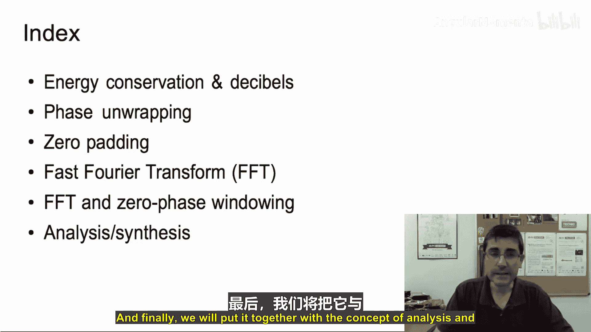
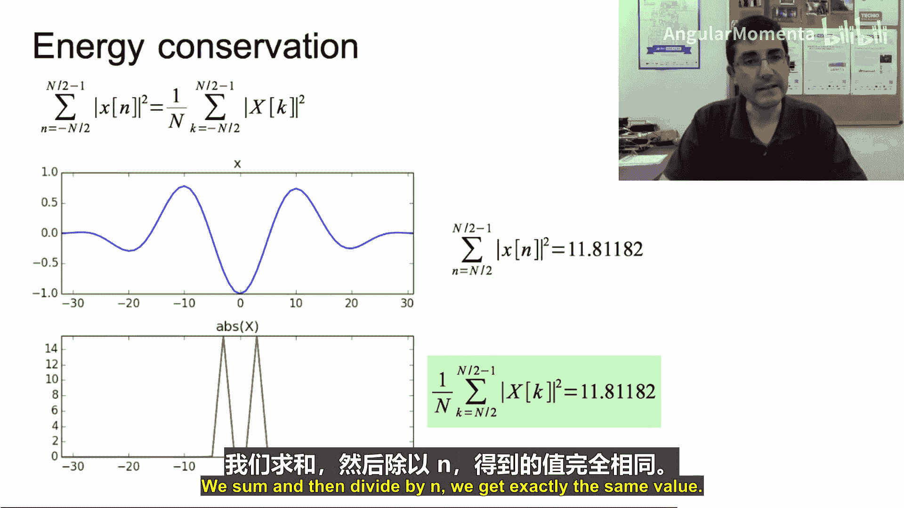
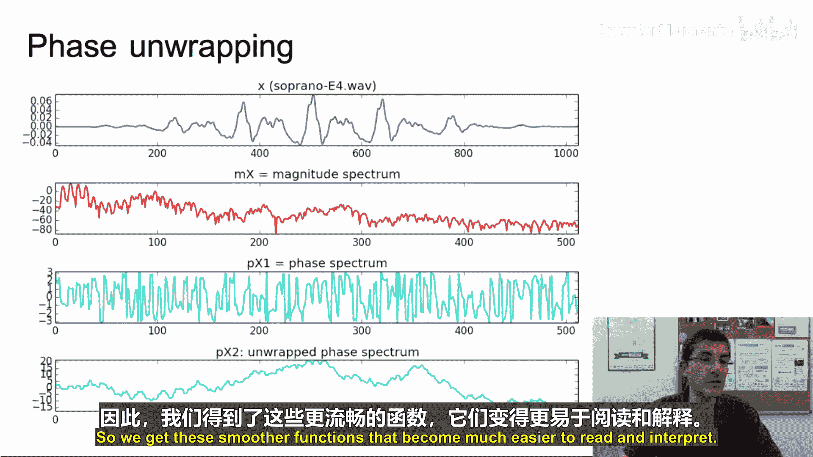
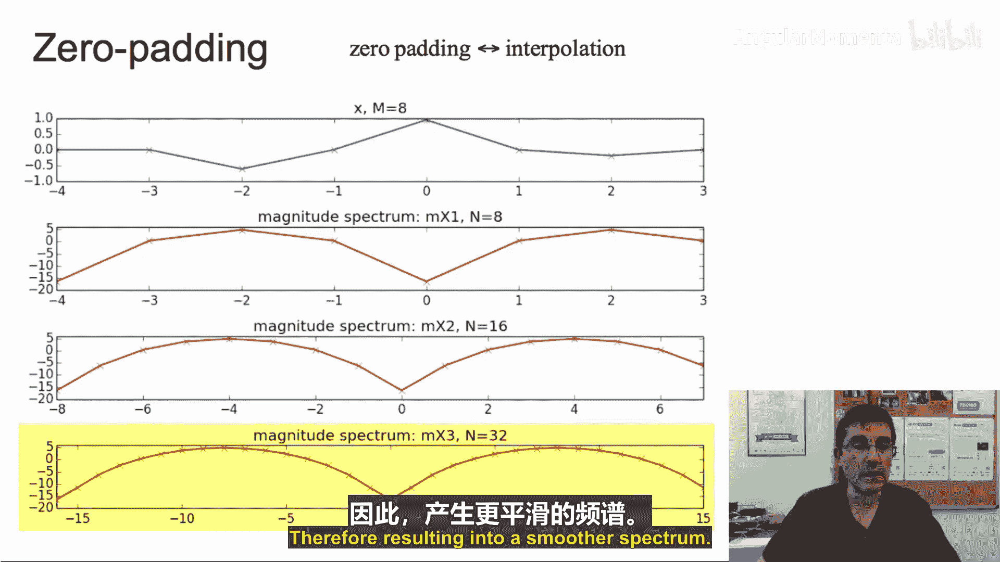
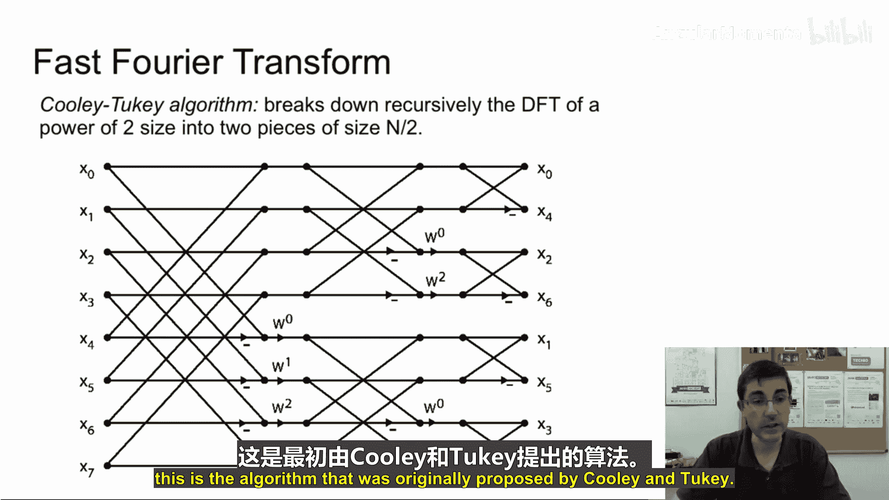
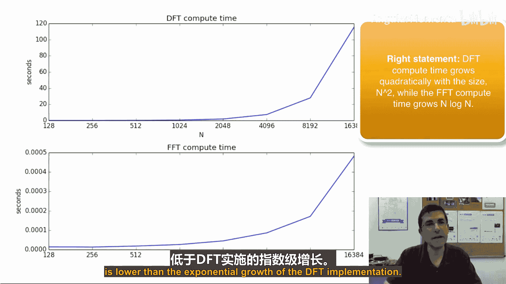
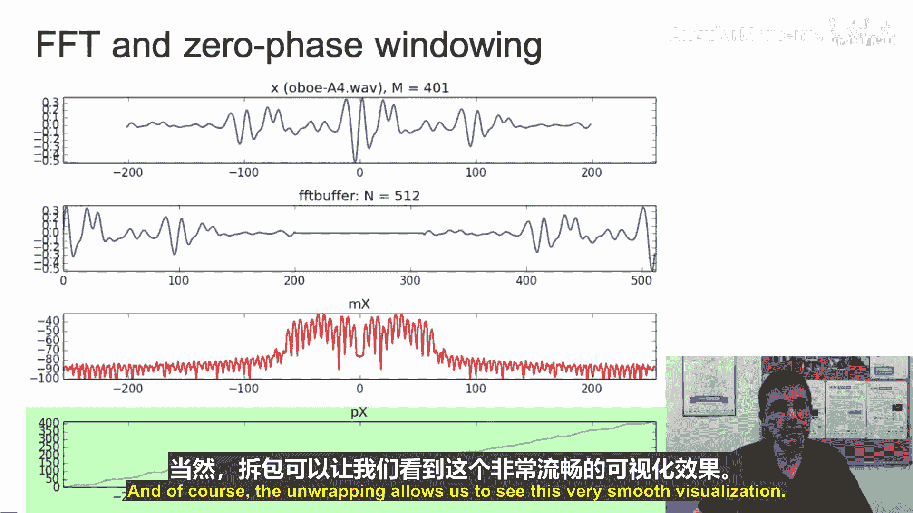
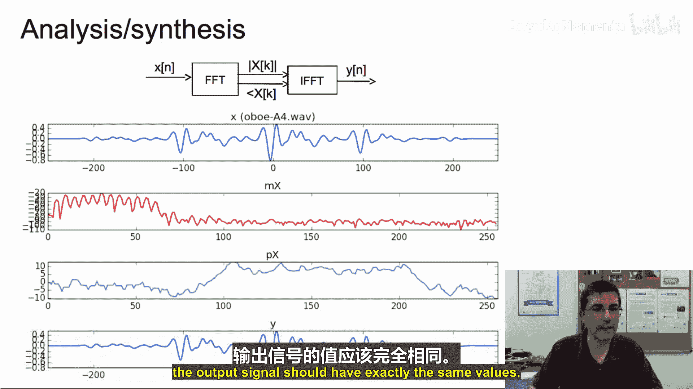
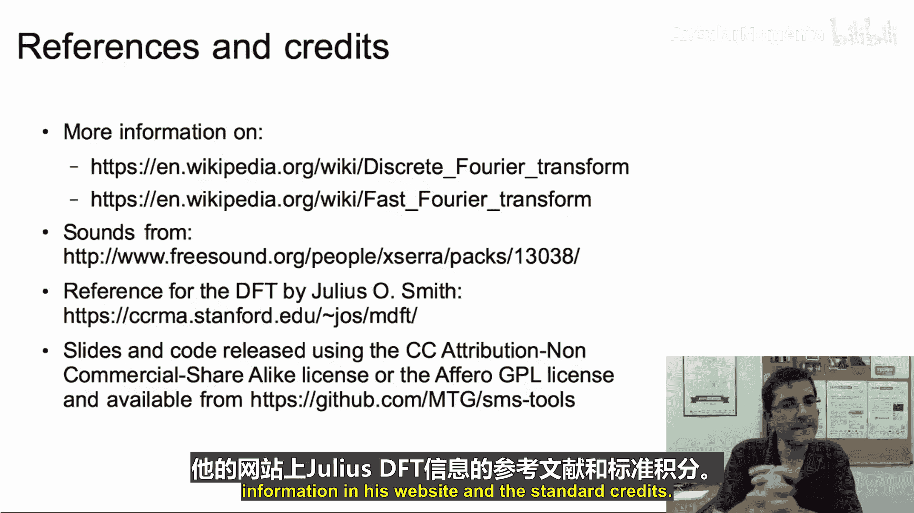
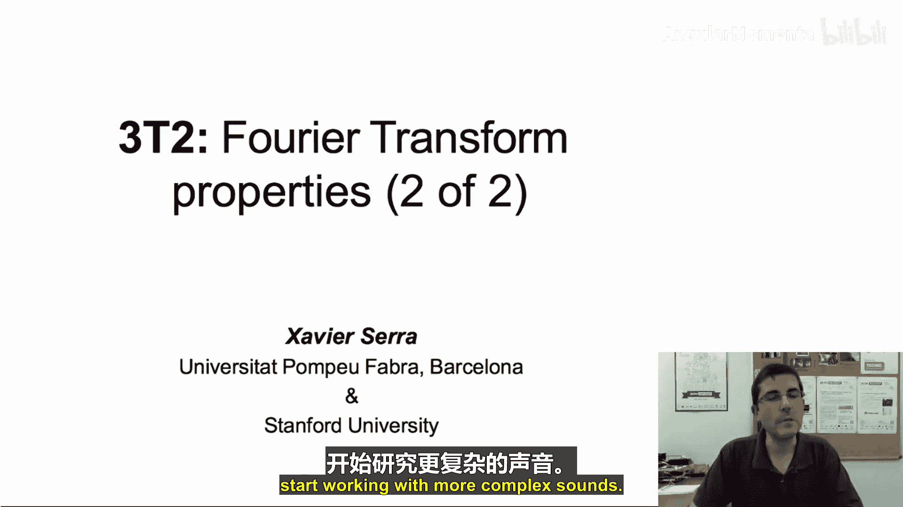

# 019：傅里叶性质（二）📊

在本节课中，我们将继续学习离散傅里叶变换（DFT）的更多重要性质。这些性质对于音频处理工作至关重要。我们将探讨能量守恒、分贝表示、相位解卷绕、零填充、快速傅里叶变换（FFT）以及结合零相位窗的分析与综合概念。

上一节我们介绍了DFT的一些基本性质，本节中我们来看看更多实用的高级性质。

## 能量守恒 ⚖️

能量守恒性质指的是，信号在时域和频域中的能量可以用相同的方式测量，并且数值相等。我们可以在任一域中计算能量。

能量定义为信号绝对值的平方和。在频域中，如果我们同样计算绝对值平方和，并除以归一化因子 **N**，我们将得到相同的值。

**公式**：
时域能量：`E_time = sum(|x[n]|^2)`
频域能量：`E_freq = (1/N) * sum(|X[k]|^2)`

例如，一个时域信号的能量计算值为11.8。在频域中，对DFT结果的绝对值平方求和并除以N，我们得到完全相同的值11.8。

## 分贝表示 🔊

与能量相关的概念是振幅。无论是在时域还是频域，当我们获得信号的频谱极坐标表示时，振幅通过计算绝对值（线性度量）获得。然而，对于声音，将振幅转换为对数尺度的分贝值是一种更直观的表示方式。

分贝定义为 **20 * log10(|信号|)**。

因此，从原始的时域信号，我们可以得到线性表示的频谱振幅。而使用分贝刻度来可视化频域振幅，则更为直观。

## 相位与解卷绕 🔄

信号的频谱包含振幅（现在用分贝计算）和相位。相位解卷绕是一种表示DFT相位谱的方法，使其更易于可视化和理解。

原始相位谱计算为频谱复数值的角度，其可视化结果通常显得杂乱。解卷绕通过在有间断处添加 **2π** 来平滑相位曲线。由于相位被限制在 **0** 到 **2π** 之间，当它超过 **2π** 时会回绕到 **0**。解卷绕让其以自然方式增长，从而得到更平滑、更易解读的函数。

## 零填充 🧩

零填充意味着在信号末尾添加零值。在DFT的上下文中，在一个域进行零填充会在另一个域产生插值信号。

例如，从一个大小为8的信号 **x** 开始，其DFT结果大小也为8。如果我们计算这8个样本加上8个零样本（总大小为16）的DFT，那么大小为8的原始幅度谱样本点保持不变，但在它们之间会出现插值点，使得频谱可视化更平滑。如果零填充到 **N=32**，则会得到更多插值点，频谱曲线更加平滑。

## 快速傅里叶变换（FFT）⚡

DFT的计算可能相当耗时。快速傅里叶变换是DFT方程的一种高效实现，它通过利用对称性来加速计算。

FFT要求输入信号的长度为 **2的幂次方**。基于此，算法（如经典的Cooley-Tukey算法）可以将计算分组，利用对称性进行成对计算，从而大幅提升效率。

以下是标准DFT与FFT计算时间的对比示例：
*   在普通笔记本电脑上，一个Python实现的DFT，当大小增加到16000时，计算时间接近2分钟。
*   而使用Python内置的高效FFT实现（底层为C语言），计算16000个样本的FFT只需不到1毫秒。

FFT的计算时间复杂度为 **O(N log N)**，远低于DFT的指数级增长。

## 结合零相位窗使用FFT 🪟

为了使用FFT，我们需要输入信号长度为2的幂。但我们希望计算任意长度信号的频谱。为此，我们首先进行零填充，然后应用**零相位窗**。

具体步骤如下：
1.  从一个给定长度的声音片段开始（例如401个样本）。
2.  确定下一个2的幂长度（例如512）。
3.  进行零填充，但并非简单地在末尾加零。我们采用零相位窗方式：将信号“中心”样本置于缓冲区的左侧（索引0处），然后是正时间样本（直到中间点），接着是负时间样本。这样就将信号打包进了所谓的FFT缓冲区。
4.  对此缓冲区调用FFT，然后计算分贝表示的幅度谱和解卷绕后的相位谱。

这样可视化得到的幅度谱对称性良好且平滑，相位谱也呈现奇对称性且非常平滑。这得益于零相位窗消除了未对中样本可能引起的移位失真，以及解卷绕带来的平滑效果。

## 分析与综合 🎵

现在，我们可以将所学知识整合起来，进行DFT的分析与综合操作。

流程如下：
1.  **分析**：从原始信号开始，计算其FFT，并正确表示为幅度谱和相位谱。由于对称性，通常只需显示正频率部分。
2.  **综合**：利用正频率部分的幅度和相位信息，进行逆傅里叶变换，即可重建原始信号。

如果操作正确，输入信号和重建的输出信号的值应该完全相同。

## 总结 📝

本节课中我们一起学习了DFT的多个关键性质：能量守恒、分贝表示、相位解卷绕、零填充、快速傅里叶变换及其与零相位窗的结合使用，最后将这些概念整合到音频的分析与综合框架中。掌握这些性质对于后续处理更复杂的音频信号至关重要。

在下一讲中，我们将以此为基础，开始处理更复杂的声音信号。