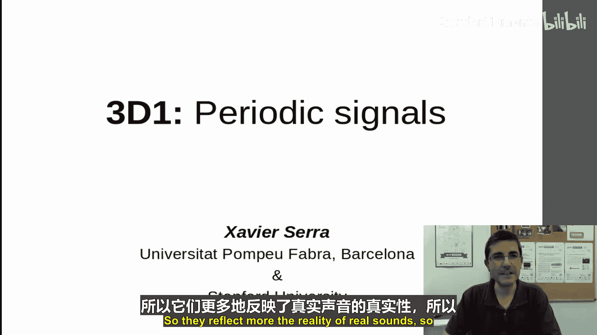

# 020：周期信号 📈

在本节课中，我们将要学习周期信号的基本概念。周期信号是理解大多数信号以及傅里叶分析的基础。我们将通过生成和分析不同类型的周期信号，来直观地理解其特性。

## 生成基本周期信号

上一节我们介绍了课程背景，本节中我们来看看如何使用Audacity生成基本的周期信号。

最基础的周期信号是我们已经见过的正弦波。让我们生成一个500赫兹的正弦波。

以下是生成正弦波的步骤：
*   选择“生成”菜单下的“音调”。
*   设置波形为“正弦波”。
*   设置频率为 **500 Hz**。
*   设置持续时间为5秒。
*   设置振幅为0.8。

生成了我们的正弦波。我们可以播放它来听一听。

为了观察其周期性，我们可以放大波形。这里我们可以看到正弦波的周期性振荡。如果我们进一步放大，将开始看到信号中的采样点。这是一个离散信号，我们以44.1kHz的采样率生成了它，因此每秒有44100个采样点。

## 理解周期与频率

为了理解周期性的概念，我们需要测量周期长度。

周期性的含义是存在一个不断重复的周期或声音循环。这是一个正弦波的周期。在这里，我们可以看到所选区域的长度是0.002秒，也就是2毫秒。

我们可以通过Python终端将其用作计算器，将周期长度转换为频率。频率是周期的倒数。

以下是计算频率的公式：
`频率 = 1 / 周期`

所以，`1 / 0.002` 得到500赫兹，这正是这个正弦波的频率。

我们可能还想检查一个周期内有多少个采样点。要计算这个，我们应该从采样率开始。

以下是计算一个周期内采样点数量的公式：
`采样点数 = 采样率 × 周期时长`

所以，`44100 × 0.002` 得到88.2，这是一个周期内的采样点数。当然，它应该是一个整数，所以一个周期大约有88个采样点。

## 不同频率的正弦波

现在，让我们生成另一个不同频率的正弦波。例如，生成一个5000赫兹的正弦波。

这是5000赫兹的正弦波。听起来明显更高。我们也可以放大观察其周期性。但这里我们看到波形并不那么平滑。这是因为每个周期内的采样点更少，因此我们没有得到一个非常平滑的版本。

一个周期内有多少个采样点呢？实际上并不多，这里我们甚至可以数出来，大约有8到9个采样点。这很合理，因为500赫兹时有88个采样点，现在频率是它的10倍（5000赫兹），采样点数就会减少到大约十分之一，即8或9个。

采样点数量与频率之间的关系非常重要，并且与采样率相关。采样率越高，对于相同频率，每个周期内的采样点就越多。随着频率升高，在44100赫兹采样率下，每个周期内的采样点会变少，因此波形看起来甚至不像正弦波，尽管它确实是正弦波。

## 非正弦波的周期信号

让我们看看另一种周期信号，它不同于正弦波。我们将生成一个音调，但这次生成一个锯齿波。

我们回到500赫兹，振幅不要设得太高，因为这是一个频谱丰富的音色，否则会非常响亮。

这是一个锯齿波波形。我们可以播放它。如果我们放大这个波形，会看到它非常有周期性。由于采样率足够高且频率较低，如果我们放大，每个周期内会有很多采样点。

在这种情况下，我们测量到的周期将是相同的，对应500赫兹。但这并不意味着只有一个500赫兹的频率。实际上，这个波形包含许多频率，它以500赫兹为基频，并包含其倍数，因此它是一个谐波声音。

我们如何验证这一点呢？可以通过频谱分析来检查。在Audacity中，我们可以绘制频谱。

现在我们可以可视化这个锯齿波的频谱。清楚地看到它是一个相当复杂的频谱，其中有许多峰值。为了理解这一点，最好与我们开始时生成的正弦波进行比较。

这是我们开始时生成的正弦波，如果我们对它进行与锯齿波相同的频谱计算，现在会看到它明显非常不同。正弦波的频谱在500赫兹处只有一个主要的峰值，而这个锯齿波的频谱有许多峰值，对应这个谐波信号中存在的所有频率。

## 频率变化的周期信号

现在让我们做一些更复杂的事情。生成一个信号，但其频率不是恒定的，而是随时间变化。这通常被称为啁啾信号。

让我们生成一个正弦啁啾信号，频率从我们提到的两个频率之间变化，例如从500赫兹上升到5000赫兹。

振幅始终保持0.8，持续5秒。现在我们得到了一种滑音或啁啾信号。当然，我们可以播放它。这是一个频率上升的声音。

我们放大观察，会看到周期随时间不断变化。在开始处，周期会相当长（对应500赫兹，2毫秒），而到结束时，周期会小得多（是开始的十分之一）。

当然，我们可以通过分析这个信号的频谱来可视化这一点。如果我们选择开始部分并分析频谱，会看到频率大约在500赫兹。如果我们到信号的结尾部分并重新绘制频谱，会发现峰值已经偏移，移向了5000赫兹附近。它也是一个单一的峰值，但频率更高。

## 总结与展望

本节课中我们一起学习了周期信号。我们主要使用了Audacity，讨论了电子合成的周期信号。这些信号非常适合进行实验，因为我们知道如何生成它们，因此在分析时我们知道预期会看到什么。

在下一个演示课程中，我们将使内容更复杂。我们将实际分析更复杂的信号，那些可能部分具有周期性、部分不具有周期性的声音，以更真实地反映实际声音的复杂性。

