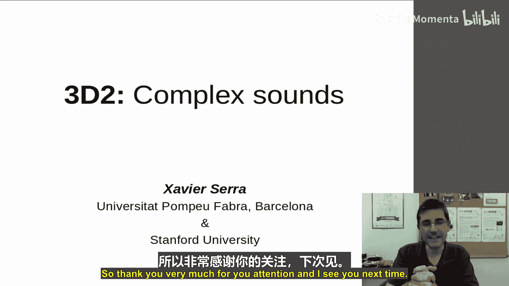

# 021：复杂声音分析 🎵

在本节课中，我们将学习如何使用音频分析工具来观察和理解复杂声音信号。我们将从简单的周期性信号过渡到更复杂的真实声音，例如语音、复音乐器以及管弦乐，并探索在时域和频域中分析它们的方法。

上一节我们介绍了周期性信号的分析。本节中，我们将看看如何分析更为复杂的真实声音。

## 使用Sonic Visualizer分析语音

我们将从Sonic Visualizer开始，并打开一个语音文件进行分析。

这是一个男性语音的声音。我们可以听到：“Do you hear me? They don't lie at all.”

我们可以放大声音的不同部分，会发现有些部分更具周期性，而有些部分则完全没有周期性。

例如，单词结尾的“N”音。我们可以选择并播放它：“Doong”。它包含不同的段落。

在中间部分，声音更具“嗓音”特性。放大后，我们可以看到它相当具有周期性，虽然随时间变化，但存在重复且演变的模式。

相反，在这个声音起始的“T”音（爆破音）部分，则明显是非周期性的。我们看到它相当嘈杂，是一个典型的非周期性辅音。

为了强化这些概念，我们可以使用频谱分析。在Sonic Visualizer中，有“窗格”的概念，我们可以显示不同的窗格，其中一个就是频谱图。

这是声音在光标特定位置处的频谱。如上一课所述，最好以线性刻度可视化水平轴，并调整动态范围以便观察。

在元音类型的区域，我们可以看到对应于该声音谐波的峰值。

相反，如果我们移动到起始的“T”音部分，频谱明显更嘈杂，更难观察。

通过在此处更改DFT大小（例如改为2048个样本），我们或许能看得更清楚一些。

## 分析复音乐器声音

让我们看另一个更复杂的声音，例如这个大提琴二重奏。

这个声音包含两个音符。它不是单音乐器声音，而是复音声音。我们可以清楚地听到两个频率，一个相当稳定，另一个则是一个上下起伏的小音阶。

如果我们放大此处，会发现很难看到任何周期性，因为两个声音同时播放。在某些区域，两个音符的频率可能相互增强，我们或许能看到一些周期性振荡，但这通常相当困难。

在频域中，如果我们计算频谱窗格并显示频谱，再次设置为线性刻度并适当缩放，我们可以看到情况在变化。

我们可以识别出这两个旋律一起演奏时产生的谐波。如果能够放大这个区域（可惜Sonic Visualizer不允许），我们将看到两个同时发声的声部各自的不同谐波。

显然，在频域中，我们可以尝试识别在时域中困难得多的特征。我们可以逐步查看声音并找出不同的方面。

## 分析管弦乐声音

最后，让我展示一个更为复杂的声音，我认为即使是频谱分析也难以完全理解它，例如这个管弦乐声音。

这是一个完整的管弦乐队，包含许多弦乐器，是一个中国管弦乐团在演奏，还有打击乐器等等。

如果我们放大，几乎无法理解其中的任何部分。它基本上看起来像随机噪声，但其中当然包含大量结构。

希望频谱分析能让我们从中理解一些东西。因此，我们打开频谱窗格，再次更改为线性刻度，使其更平滑，并尝试获得更好的可视化效果。

这非常困难，但我们会发现这里有一些明显的峰值，通过它们我们可以理解一些突出的声部。我们将尝试理解它，但这当然非常困难。

事实上，这超出了本课程将进行的频谱分析范畴。分析如此复杂的信号需要技术，这仍然是开放的研究问题，非常具有挑战性。

## 总结

本节课中我们一起学习了使用Sonic Visualizer分析不同类型的真实声音。

我们分析了语音、包含两个旋律同时演奏的大提琴声音，以及管弦乐声音。

我们看到，分析真实声音并不容易。真实声音非常复杂。语音可能是最简单的，当有几个旋律同时演奏时我们或许能尝试理解一些东西，但在完整的管弦乐中，这确实非常困难。

无论如何，我们不应气馁，我们将尝试从中找出意义。在接下来的课程中，我们将学习如何处理它们。

今天的内容是对上一节周期性信号的补充，我们尝试分析了复杂声音，并使用了Sonic Visualizer，它允许我们比Audacity更好地可视化一些频谱分析。

下节课我们将介绍我们的工具——我们开发的SMS工具，尝试看看用这些工具是否能在分析声音方面做更多的事情。