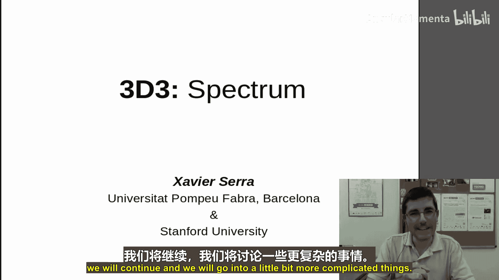

# 022：频谱分析实践 🎵

在本节课中，我们将学习如何使用SMS工具进行离散傅里叶变换分析，以理解真实音频信号（如小提琴声音）的频谱特性。我们将通过调整分析参数，观察不同时间点和不同分析长度下的频谱变化。


---

## 回顾与工具介绍

在之前的演示课程中，我们使用Audacity和Sonic Visualizer分析了电子周期信号和真实声音的频谱。本节我们将继续这一主题，利用专门为此课程开发的SMS工具进行DFT分析，以深入理解声音。

SMS工具提供了一个交互式界面，允许我们灵活地调整分析参数并直观地查看结果。


## 加载与分析小提琴声音

首先，我们使用Audacity打开一个小提琴声音文件，以获得声音的整体概览。这是一个持续约2秒、相对稳定的小提琴音符。

为了进行更深入的分析，我们将使用SMS工具的模型界面。通过命令行进入相应目录并运行 `python modelsGUI.py` 即可启动界面。

在界面中，我们加载小提琴声音文件，并选择使用DFT模块进行分析。以下是初始分析步骤：

1.  **选择分析参数**：我们首先设置分析窗口大小为512个样本（FFT大小需为2的幂次方），并从声音的中间部分（例如第1秒处）开始截取。
2.  **执行计算**：计算该片段的DFT（使用FFT算法），并显示结果。

分析结果包含以下部分：
*   **时域波形**：显示被分析的512个样本（加窗后）。
*   **幅度谱**：显示正频率部分（0 Hz 至 采样率/2，即22050 Hz），幅度以分贝（dB）为单位。
*   **相位谱**：显示解缠绕后的相位，单位是弧度，以便观察更平滑的变化。
*   **重建信号**：通过对频谱进行逆变换得到的时域信号，由于加窗操作，它与原始输入片段并不完全相同。

## 调整分析参数以优化频谱


初始分析（512点FFT）的频谱可能无法清晰显示声音的谐波结构。这是因为频率分辨率不足，无法区分紧密相邻的频率成分。

为了提高频率分辨率，我们将FFT大小增加到下一个2的幂次方，即1024点，并重新计算。

```python
# 示例：将FFT大小从512调整为1024
FFT_size = 1024
```


使用1024点FFT进行分析后，幅度谱中清晰地出现了多个峰值，这些峰值对应着小提琴声音的**谐波**。这表明增加分析长度可以获得更详细的频谱信息。


## 分析声音的不同部分：起始与稳态

声音在不同时间点可能具有不同的特性。小提琴声音的起始部分（起振阶段）与中间的稳态部分在听感和波形上都有差异。我们通过DFT分析来观察这种差异。

我们将分析位置从声音中间（第1秒）调整到起始部分（第0秒），并使用相同的1024点FFT进行分析。

对比两次分析结果可以发现：
*   **稳态部分**：频谱中的谐波峰值清晰、突出。
*   **起始部分**：频谱显得更杂乱，谐波不如稳态部分明显。这是因为起振阶段包含更多琴弓摩擦的噪声成分，这些时域上的不规则性在频谱中表现为更随机和不规则的形状。


## 理解分析参数：窗口大小与FFT大小

在DFT分析中，从输入信号中截取的样本数（窗口大小）与进行FFT计算的点数（FFT大小）可以不同。FFT大小决定了频率分辨率和计算出的频率点数量。


例如，我们可以从输入信号中截取800个样本，但在计算时使用1024点的FFT（不足的部分补零）。这与直接截取1024个样本进行分析相比，频率分辨率相同（因为FFT大小都是1024），但前者由于实际信号信息更少，频谱的清晰度可能略逊于后者。


## 深入解读频谱信息

在获得清晰的频谱图（如使用1024点FFT分析稳态部分）后，我们可以进一步解读其中的信息。

利用Python图形界面的缩放功能，我们可以聚焦于频谱的特定区域，例如前5000 Hz。

1.  **识别谐波与基频**：在幅度谱中，可以观察到一系列等间距的峰值。将光标移动到第一个峰值处，其频率读数约为 **240 Hz**，这很可能就是该声音的**基频**。下一个峰值约为480 Hz（即2 * 240 Hz），后续峰值依次为基频的整数倍，这些就是**谐波**。
    *   **公式**：`谐波频率 = n * 基频`，其中 `n = 1, 2, 3, ...`
2.  **查看相位信息**：在相位谱的相同频率位置（如240 Hz, 480 Hz），可以读取对应谐波在分析中心时刻（本例中为第1秒）的**相位值**（单位为弧度）。这提供了谐波在时域中相对位置的另一维度信息。

通过SMS工具的交互界面，我们可以方便地缩放和测量，从而直观地识别出声音各个频率成分的幅度和相位，这比使用Sonic Visualizer或Audacity进行类似操作更为直接和灵活。

---

## 总结


本节课中，我们一起学习了如何使用SMS工具的DFT模块分析真实音频信号。我们以一个小提琴声音为例，实践了以下内容：


*   加载声音并设置DFT分析参数（窗口大小、FFT大小、分析位置）。
*   通过增加FFT大小来提高频率分辨率，从而更清晰地观察声音的谐波结构。
*   比较声音不同部分（起振段与稳态段）的频谱差异，理解时域特性如何在频谱中体现。
*   区分了分析窗口大小与FFT大小的概念。
*   学习了如何从幅度谱中识别基频和谐波，并从相位谱中读取对应频率的相位信息。



通过本周的三个演示课程，我们初步掌握了用于声音分析、时域可视化和频谱可视化的不同工具。当然，还有更多内容有待探索，下周我们将继续学习更深入的主题。