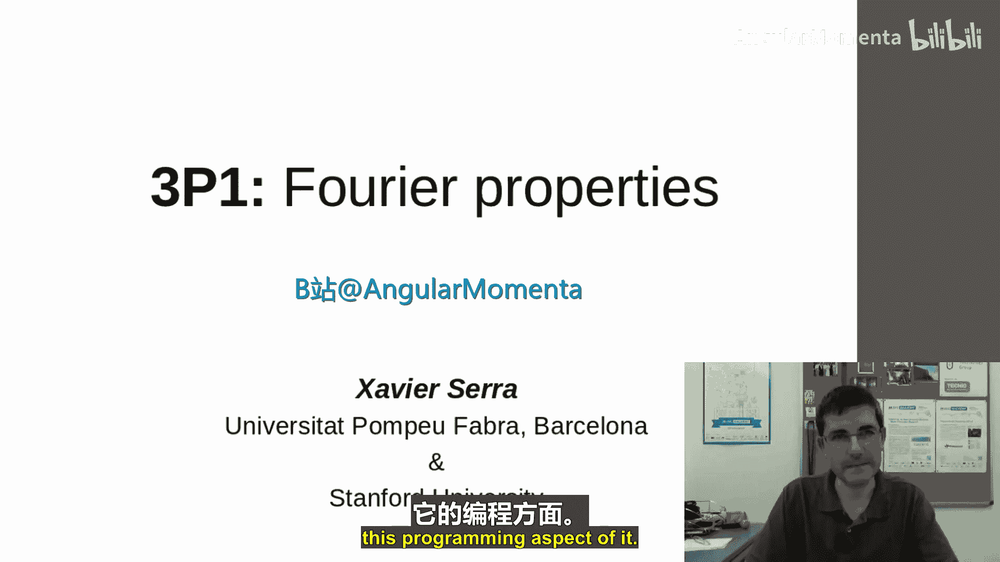
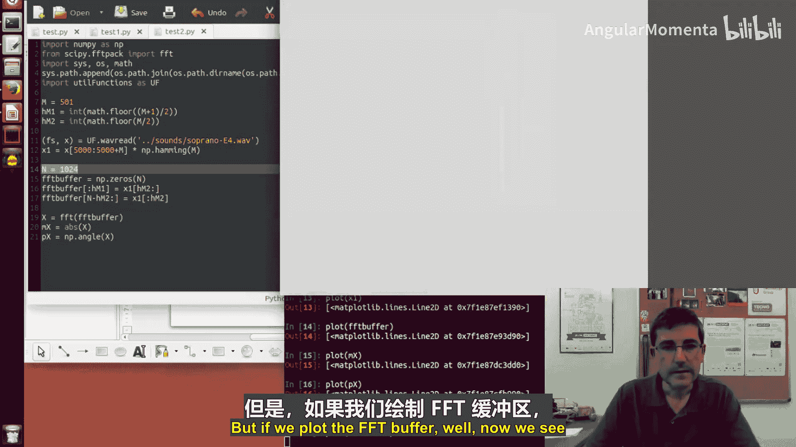
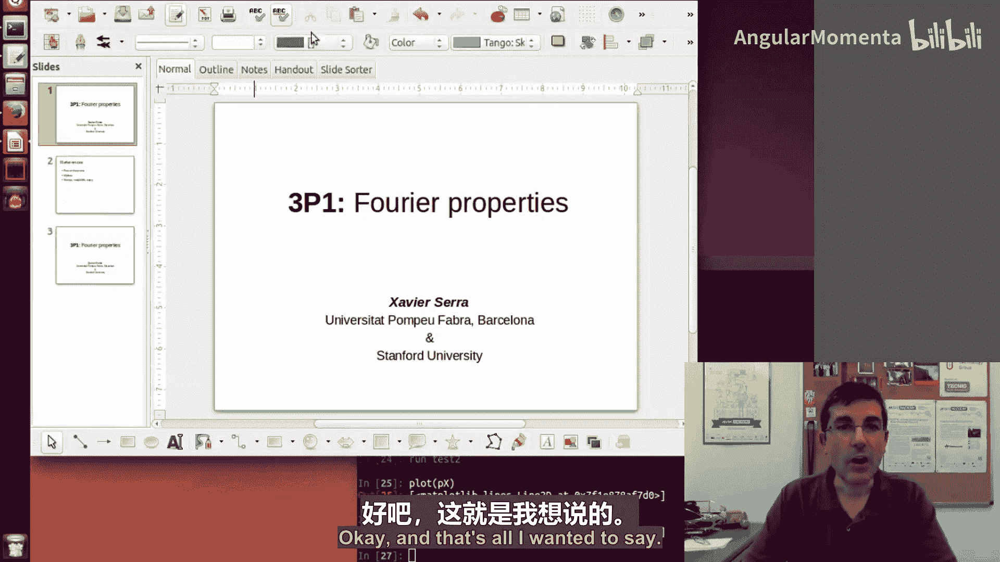
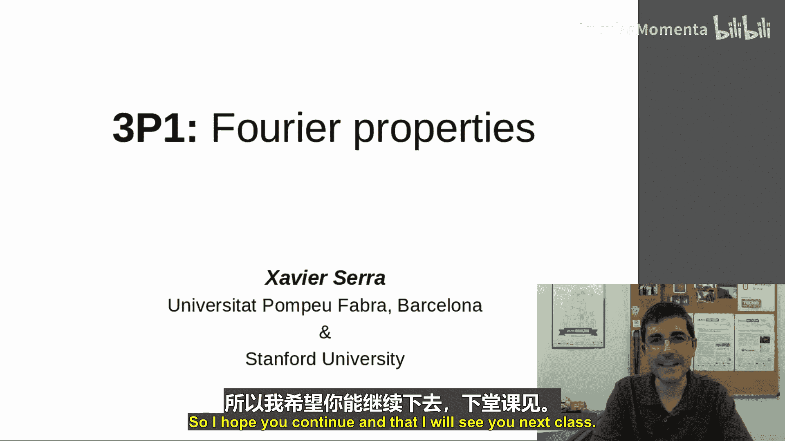

# 023：傅里叶性质编程实践



在本节课中，我们将学习如何利用傅里叶变换的性质，通过编程来分析音频信号。我们将使用Python及其相关库，实现一个能够计算并可视化信号频谱的程序。

## 概述

我们将从设置编程环境开始，逐步实现一个三角函数的傅里叶变换，并探讨信号中心化对相位谱的影响。接着，我们将把同样的方法应用于一个真实的音频文件片段，学习如何正确地进行零填充、使用对数刻度显示幅度谱以及对相位谱进行解卷绕处理。

## 环境设置与基础实现

首先，我们需要进入工作目录并启动一个交互式的Python环境。我们将使用`iPython`，并预先导入`matplotlib`库以便绘图。

```python
# 启动iPython并预加载matplotlib
%pylab
```

在文本编辑器中，我们编写一个简单的脚本。该脚本导入必要的库，生成一个三角波信号，并计算其离散傅里叶变换。

```python
import numpy as np
from scipy import signal
from scipy.fftpack import fft

# 生成一个包含15个样本的三角波
x = signal.triang(15)
# 计算DFT（当长度非2的幂时，使用标准DFT算法）
X = fft(x)
# 计算幅度谱和相位谱
mX = abs(X)
pX = np.angle(X)
```

执行此脚本后，我们可以在`iPython`中查看和绘制生成的变量。三角波信号`x`及其幅度谱`mX`和相位谱`pX`现在可供使用。

绘制三角波信号：
```python
plot(x)
```
幅度谱显示出对称性，但需要理解的是，在DFT中，频谱是循环的。数组的前半部分对应正频率，后半部分对应负频率。

绘制相位谱时，我们发现它并非为零，这与三角波作为偶函数的预期不符。这是因为我们的时间信号`x`并非以零点为中心。

## 信号中心化与相位谱

上一节我们介绍了三角波的频谱，并发现其相位谱非零。本节中我们来看看如何通过将信号在时域中心化来获得零相位谱。

我们修改脚本，在计算FFT之前，先将三角波信号中心化到时间零点。

```python
# 创建与x同长的全零数组作为FFT缓冲区
fftbuffer = np.zeros(len(x))
# 将三角波的后半部分放在缓冲区开头（正时间）
fftbuffer[:len(x)//2] = x[len(x)//2:]
# 将三角波的前半部分放在缓冲区末尾（负时间）
fftbuffer[-(len(x)-len(x)//2):] = x[:len(x)//2]

# 对中心化后的缓冲区进行FFT
X = fft(fftbuffer)
mX = abs(X)
pX = np.angle(X)
```

执行新脚本后，再次绘制中心化后的信号`fftbuffer`和其相位谱`pX`。此时，信号以零点为中心，其相位谱理论上应为零。由于数值计算误差，相位值会是非常接近于零的极小值。

## 分析真实音频信号

我们已经学会了如何对合成信号进行频谱分析。本节中我们来看看如何将这些技术应用于一个真实的音频文件。

我们编写一个新的脚本，用于读取一个音频文件，选取其中一段，并对其进行加窗和频谱分析。

```python
import numpy as np
from scipy.fftpack import fft
import sys
sys.path.append(‘../software/models/‘) # 添加工具包路径
from utilFunctions import wavread



# 定义参数
M = 501 # 窗口大小（样本数）
N = 1024 # FFT大小（2的幂）
# 计算半长，用于中心化
hM1 = int(np.floor((M+1)/2))
hM2 = int(np.floor(M/2))

# 读取音频文件
fs, x = wavread(‘../sounds/soprano-E4.wav‘)
# 选取片段（从第5000个样本开始）
x1 = x[5000:5000+M]
# 应用汉明窗以减少频谱泄漏
xw = x1 * np.hamming(M)

# 创建FFT缓冲区并进行中心化零填充
fftbuffer = np.zeros(N)
fftbuffer[:hM1] = xw[hM2:]
fftbuffer[-(hM2):] = xw[:hM2]

# 计算FFT
X = fft(fftbuffer)
# 计算幅度谱（dB刻度）和相位谱
mX = 20 * np.log10(abs(X))
pX = np.unwrap(np.angle(X)) # 解卷绕相位
```

执行此脚本后，我们可以绘制原始音频、加窗后的片段、中心化零填充后的缓冲区，以及最重要的——其对数幅度谱和解卷绕后的相位谱。通常，我们只绘制频谱的前一半（从0到`N/2`），因为对于实信号，后半部分是冗余的。

以下是分析真实音频信号时的一些关键步骤列表：
*   **读取与切片**：使用`wavread`函数读取WAV文件，并选取感兴趣的短时段。
*   **加窗**：应用如汉明窗之类的窗函数，以减少频谱泄漏。
*   **中心化与零填充**：将信号样本重新排列，使其在时域上以零点为中心，并用零填充至预定的FFT长度`N`（通常为2的幂）。
*   **计算FFT**：使用高效的FFT算法计算频谱。
*   **后处理与可视化**：将幅度谱转换为分贝（dB）刻度以便观察，对相位谱进行解卷绕使其连续，并仅绘制有效的前半部分频谱。



## 总结

本节课中我们一起学习了如何将傅里叶变换的理论性质应用于编程实践。我们实现了对三角波和真实音频信号的频谱分析，关键点包括：
1.  理解了信号时域中心化对获得零相位谱的重要性。
2.  掌握了使用零填充技术来适配FFT算法（要求长度为2的幂）的方法。
3.  学会了以对数（dB）刻度可视化幅度谱，以及对相位谱进行解卷绕，从而得到更清晰、更有意义的频谱图。
4.  熟悉了`iPython`交互环境与`NumPy`、`SciPy`、`matplotlib`等库在音频信号处理中的基本用法。



通过本次编程实践，我们为后续更复杂的音频分析任务打下了坚实的基础。