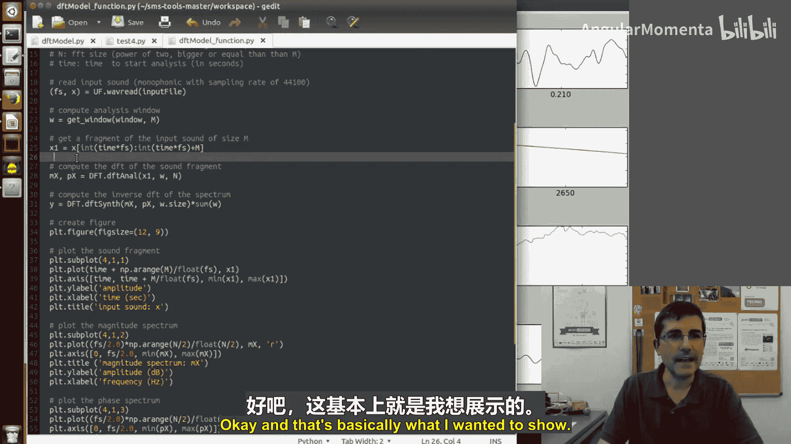
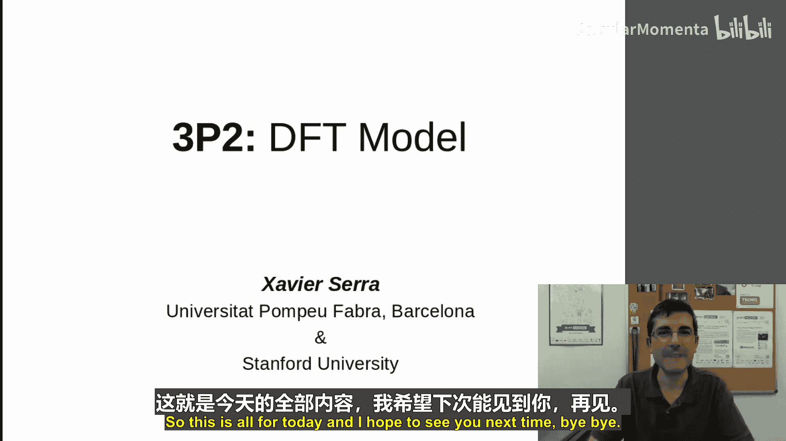

# 024：03_03_02 DFT模型实现 🎵

在本节课中，我们将学习SMS工具包中用于实现离散傅里叶变换（DFT）分析与合成的实际代码。我们将深入探讨`DFTmodel`函数，了解它如何从声音片段中提取频谱，并重构出声音。

## 概述

我们将介绍SMS工具包中`models`子目录下的`dftModel.py`文件。该文件包含三个核心函数，分别用于完整的DFT分析合成、独立的分析以及独立的合成。我们将通过一个测试程序来演示这些函数的使用，并可视化分析结果。

## DFT模型函数详解

上一节我们介绍了DFT的基本概念，本节中我们来看看其在SMS工具包中的具体实现。

`dftModel.py`文件定义了三个主要函数：

*   **`dftModel`**：该函数实现了完整的分析与合成流程。输入为原始声音信号`x`、窗函数`w`和FFT大小`N`，输出为合成后的声音信号`y`。
*   **`dftAnal`**：该函数仅实现分析部分。输入同样为`x`、`w`和`N`，输出为幅度谱`mX`和相位谱`pX`。
*   **`dftSynth`**：该函数仅实现合成部分。输入为幅度谱`mX`、相位谱`pX`和窗函数长度`M`，输出为合成信号`y`。

### 分析函数 (`dftAnal`) 流程

以下是`dftAnal`函数的核心步骤：

1.  **声明与初始化变量**：为计算准备必要的变量和数组。
2.  **窗函数归一化**：对输入的窗函数进行归一化处理。
3.  **加窗**：将输入信号`x`与窗函数`w`相乘。
4.  **零相位窗**：将加窗后的信号置于一个长度为`N`的缓冲区中心，实现零相位窗。
5.  **计算FFT**：对缓冲区信号执行快速傅里叶变换（FFT）。
6.  **计算频谱**：从FFT结果中计算对数幅度谱`mX`和解卷绕后的相位谱`pX`。

### 合成函数 (`dftSynth`) 流程

以下是`dftSynth`函数的核心步骤：

1.  **声明与初始化**：初始化输出信号数组等变量。
2.  **重建完整频谱**：由于`dftAnal`只返回正频率部分的频谱，`dftSynth`需要根据对称性重建负频率部分。
    *   正频率的复数表示由幅度和相位通过欧拉公式计算：`complex = mX * exp(j * pX)`。
    *   负频率部分是正频率的共轭对称。
3.  **计算逆FFT**：对重建的完整复数频谱执行逆FFT（IFFT）。
4.  **提取实部**：IFFT结果通常是复数，我们取其实部作为时域信号。
5.  **去除零相位窗效应**：对信号进行移位，抵消分析时零相位窗操作的影响。
6.  **归一化**：应用必要的归一化因子（如除以窗函数能量）以得到正确的幅度。

## 测试程序与结果可视化

为了测试这些函数，我们创建了一个小程序。以下是程序的主要步骤：

1.  **导入包**：指定工具包路径，导入`utilFunctions`和`dftModel`模块。
2.  **读取音频**：读取一个钢琴声音文件，并将其转换为浮点数数组。
3.  **生成窗函数**：使用`get_window`函数生成一个长度为511的汉明窗。
4.  **截取片段**：从输入声音中截取一个起始于0.2秒、长度为`M`的片段。
5.  **执行分析**：调用`dftAnal`函数，传入声音片段、窗函数和FFT大小（1024），得到幅度谱和相位谱。
6.  **执行合成**：将得到的频谱送入`dftSynth`函数进行合成，并对输出进行归一化。

运行测试程序后，我们可以绘制以下图像进行验证：

*   **原始输入信号**：完整的钢琴声音波形。
*   **分析片段**：起始于0.2秒的音频片段。
*   **窗函数**：应用的汉明窗形状。
*   **幅度谱**：分析得到的频谱幅度（0到`N/2`，即512点）。
*   **相位谱**：解卷绕后的相位谱。

此外，SMS工具包还提供了一个更完善的`dftModel_function.py`文件，它集成了分析、合成并生成格式规范的图表。运行该文件，可以得到包含时间域波形、频率域幅度谱（dB标度）和相位谱、以及加窗后输出信号的完整图表。我们可以放大图表的特定区域，以观察某个谐波分量的细节行为。

## 总结

本节课我们一起学习了SMS工具包中DFT分析合成模型的实现代码。我们详细了解了`dftAnal`和`dftSynth`函数的工作流程，包括加窗、零相位处理、FFT/IFFT计算以及频谱的对称性重建。通过测试程序，我们实践了如何使用这些函数处理音频片段并可视化频谱结果。理解这些代码对于掌握DFT至关重要，并为下一周学习**短时傅里叶变换**——一个能够分析任意长度声音的分析合成框架——奠定了坚实的基础。