# 025：短时傅里叶变换-1 🎵

在本节课中，我们将学习短时傅里叶变换。这是分析时变音频信号的关键技术。我们将首先介绍其基本方程，然后重点讨论分析窗的作用。

## 概述

到目前为止，我们已经学习了如何计算信号的频谱，即离散傅里叶变换。然而，真实的声音无法用单一的频谱来表示。声音会随时间变化，我们需要捕捉这种时间变化。短时傅里叶变换就是我们的解决方案。

## 短时傅里叶变换方程

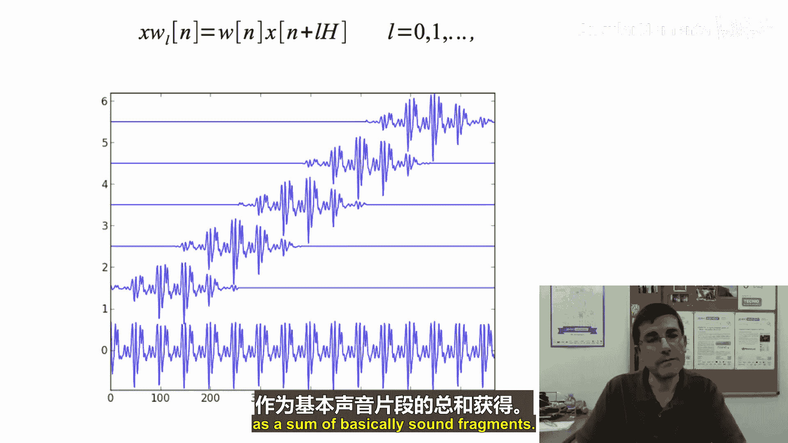

上一节我们介绍了DFT，本节中我们来看看短时傅里叶变换方程。它本质上是DFT的一个修改版本，有几个重要区别。

基本方程如下：
`X(l, k) = Σ_{n=0}^{N-1} [w(n) * x(n + lH)] * e^{-j2πkn/N}`

输入信号 `x(n)` 不再是直接输入，而是与分析窗 `w(n)` 相乘后的一个片段。变量 `l` 是帧编号，`H` 是跳跃大小。这意味着输出将是一个频谱序列，每个频谱对应声音的一个不同时间片段。

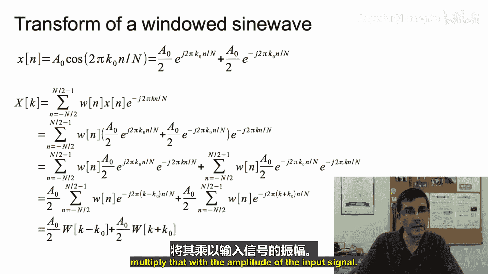

为了强调零相位窗的概念，从现在起，我们通常将时间索引指定为从 `-N/2` 到 `N/2-1`，使其始终以0为中心。这样就不会产生任何相位变化或时移。

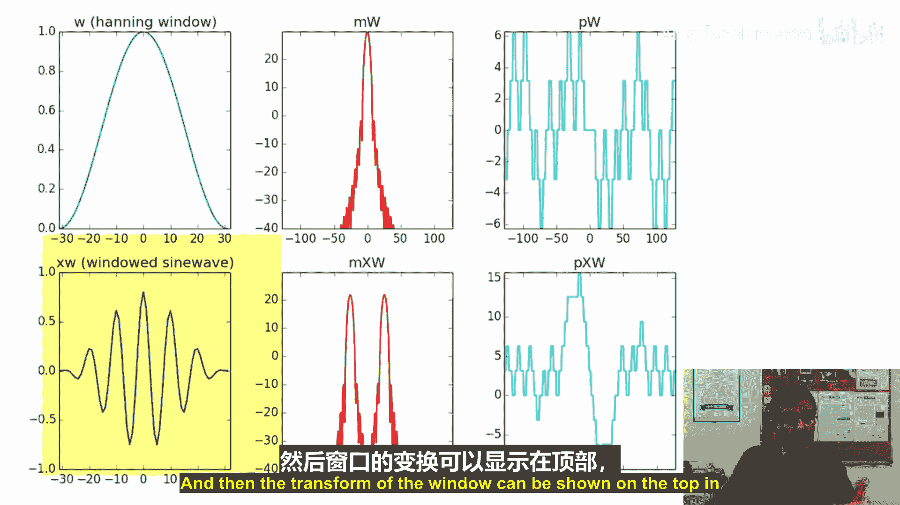

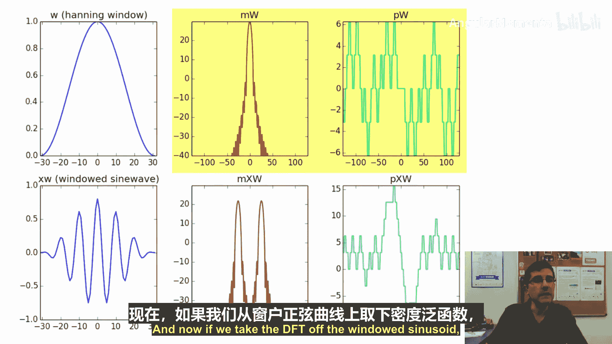

## 理解加窗过程

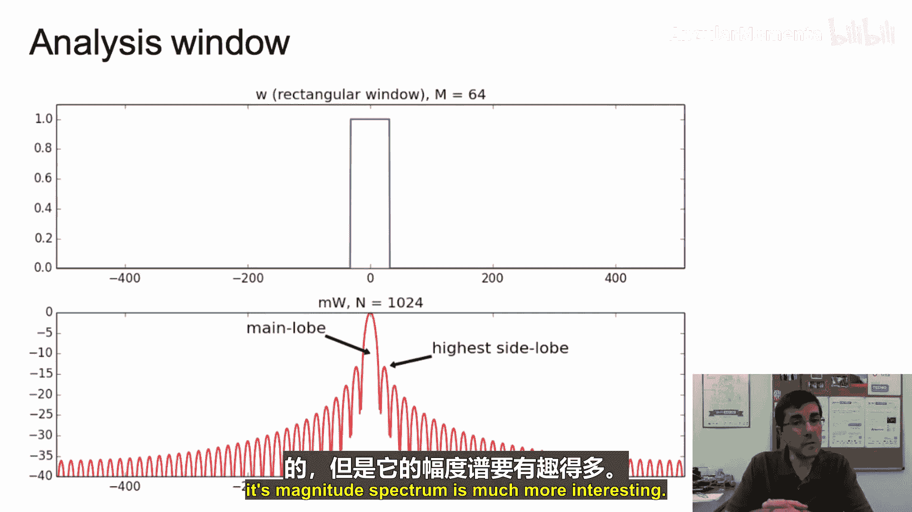

为了更好地理解对声音加窗的效果，让我们看一个对实正弦波加窗并计算其频谱的例子。

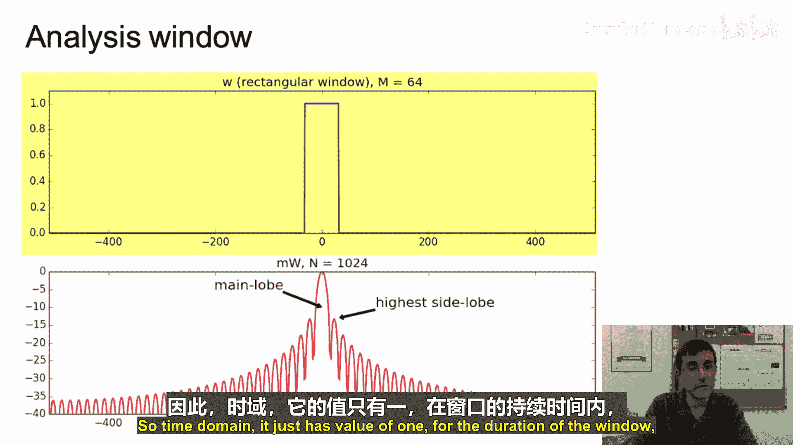

从一个实正弦波开始：
`x(n) = A_0 * cos(2πk_0 n / N)`

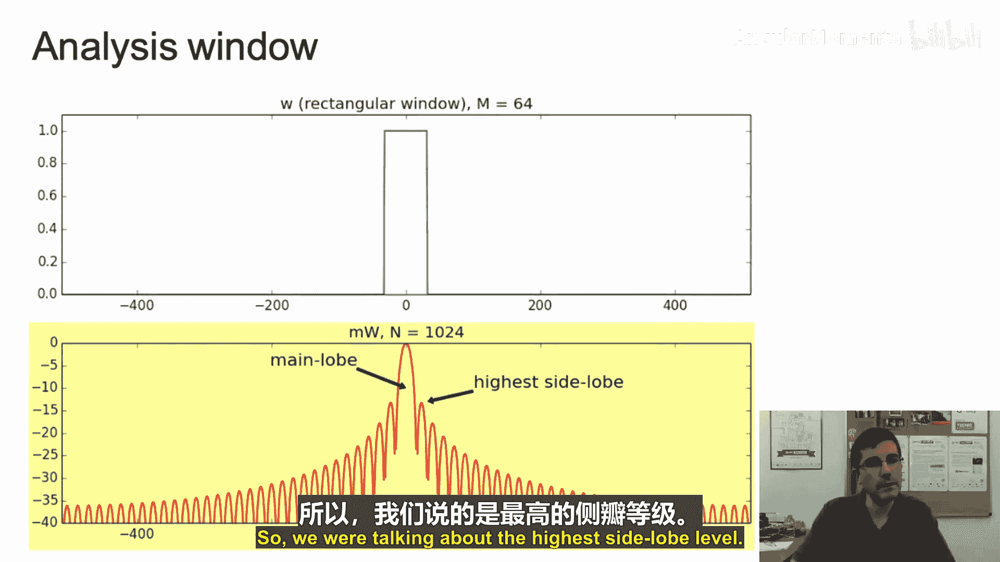

它可以表示为两个复指数的和。代入STFT方程并加窗后，由于DFT的线性，我们可以将其拆分为两个方程。最终结果是分析窗的频谱，频率偏移了输入信号的频率，并乘以输入信号的振幅。

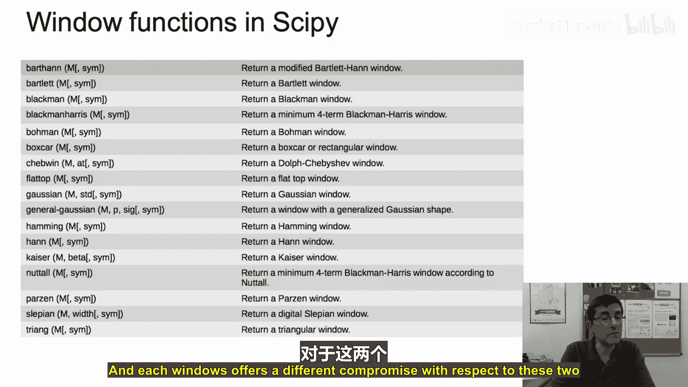

通过图示，我们可以更好地理解这个过程。顶部是窗函数，下方是输入的正弦信号。窗函数的频谱（例如汉宁窗）是一个以零为中心的幅度谱。加窗正弦波的DFT结果，其形状与窗函数的频谱相同，但出现在正弦波的正负频率处，并带有正弦波的相位。

## 分析窗的重要性

从以上讨论中，我们可以认识到分析窗在正弦波及任何声音频谱中的重要性。显然，我们需要花些时间来解释各种窗函数。

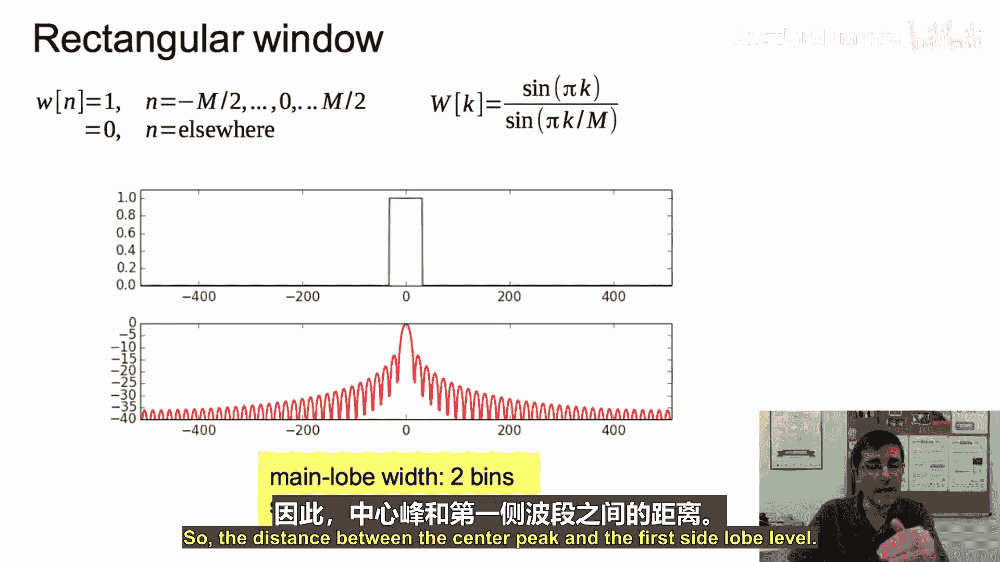

分析窗通常是一个实函数，并且关于原点对称。最简单的窗是矩形窗。其频域幅度谱具有我们称之为sinc函数的形状。我们主要关注两个方面：主瓣的宽度和最高旁瓣的电平。

以下是音频信号处理中常用的几种窗函数列表：

*   **矩形窗**：`w(n) = 1`， 主瓣宽度为2个频点，最高旁瓣电平为-13.3 dB。
*   **汉宁窗**：`w(n) = 0.5 - 0.5 * cos(2πn/(N-1))`， 主瓣宽度为4个频点，最高旁瓣电平为-31.5 dB。
*   **汉明窗**：`w(n) = 0.54 - 0.46 * cos(2πn/(N-1))`， 主瓣宽度为4个频点，最高旁瓣电平为-42.7 dB。
*   **布莱克曼窗**：`w(n) = 0.42 - 0.5*cos(2πn/(N-1)) + 0.08*cos(4πn/(N-1))`， 主瓣宽度为6个频点，最高旁瓣电平为-58.1 dB。
*   **布莱克曼-哈里斯窗**：由四个余弦项求和构成，主瓣宽度为8个频点，最高旁瓣电平为-92 dB。

每种窗都在主瓣宽度和旁瓣电平之间提供了不同的折衷方案。理想情况是拥有最窄的主瓣和最低的旁瓣。

## 窗函数应用对比

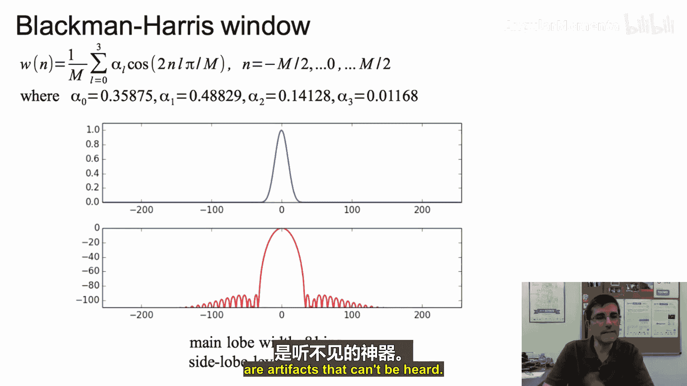

现在，让我们比较一下将不同窗函数应用于同一段声音的效果。我们取一段固定长度的声音片段，分别应用矩形窗、汉明窗和布莱克曼窗。得到的频谱明显不同。对于这种分析，布莱克曼窗可能效果最好，它呈现出更平滑的频谱，谐波峰值也更清晰可辨。

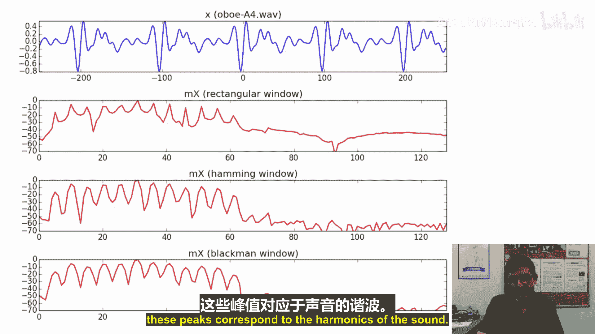

## 总结

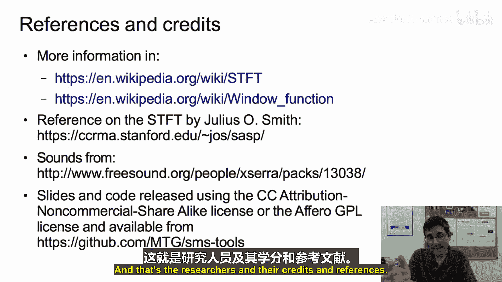

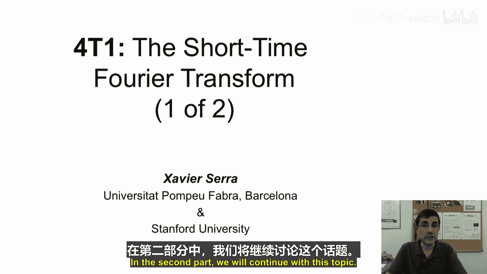

本节课中，我们一起学习了短时傅里叶变换的第一部分内容。我们解释了STFT的基本方程，并重点讨论了分析窗的作用。在下一部分，我们将继续探讨这个话题。