# 026：短时傅里叶变换（第二部分）🎵

在本节课中，我们将继续学习短时傅里叶变换。我们将回顾核心概念，并深入探讨窗口大小、FFT大小、跳跃步长等关键参数的选择，以及它们如何共同影响时频分辨率。最后，我们将学习如何通过逆变换从频谱中重建原始信号，并构建一个完整的分析-合成系统。

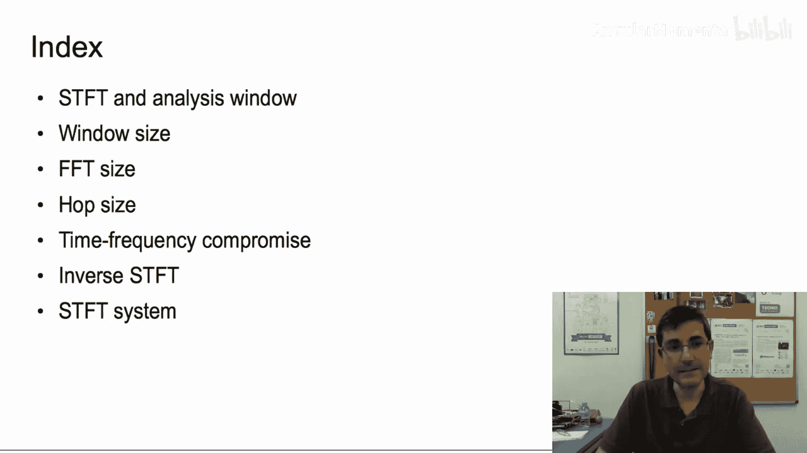

## 回顾：STFT与加窗

上一节我们介绍了短时傅里叶变换的基本概念。我们知道，STFT是DFT的时变版本，而**加窗**是理解STFT的关键。例如，对于同一段小提琴声音，使用矩形窗和布莱克曼窗得到的幅度谱截然不同。

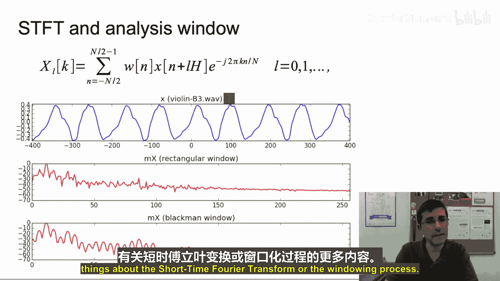

## 窗口大小的影响

窗口大小对分析结果有显著影响。以下是不同窗口大小的效果对比：

*   **小窗口（如128点）**：得到的幅度谱信息较少，细节不足。
*   **大窗口（如1024点）**：得到的幅度谱包含更多细节，能更清晰地展示声音的谐波结构。

因此，选择窗口大小时需要在时间分辨率和频率分辨率之间进行权衡。

## 窗口的奇偶性

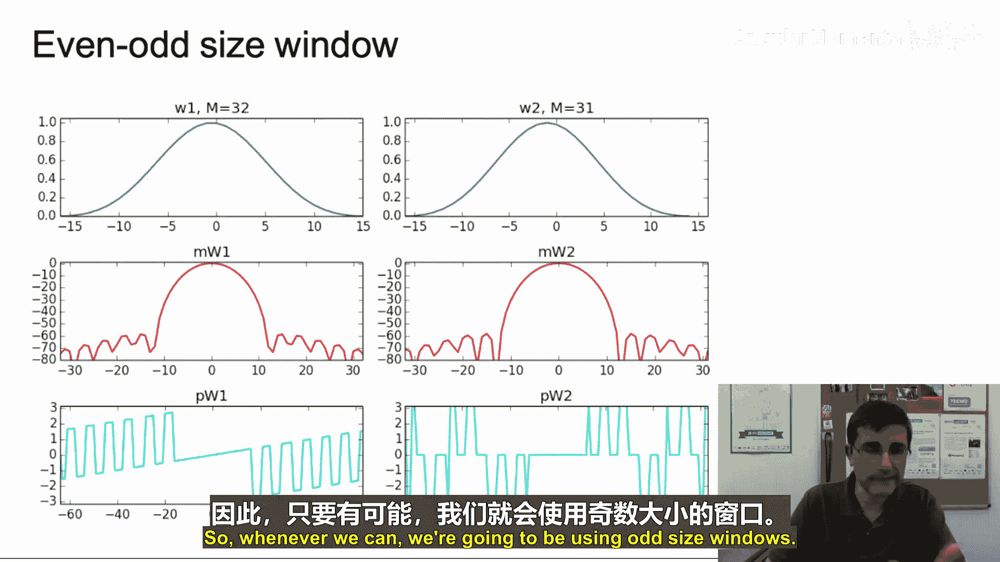

窗口大小可以是奇数或偶数，这主要影响相位谱：

*   **偶数大小窗口**：无法以零点为中心完全对称，导致相位谱存在斜率。
*   **奇数大小窗口**：可以以零点为中心完美对称，从而获得零相位值。

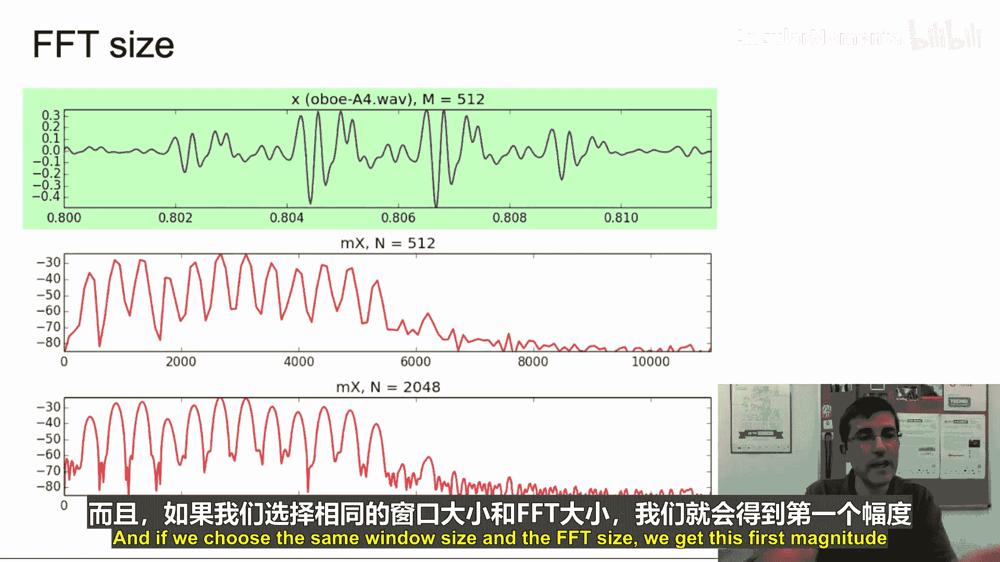

因此，在可能的情况下，我们倾向于使用**奇数大小**的窗口。

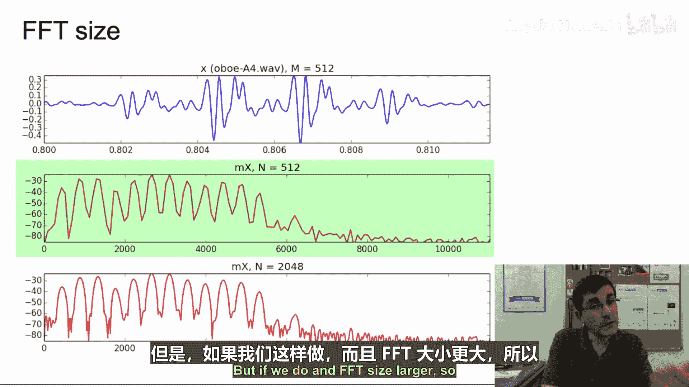

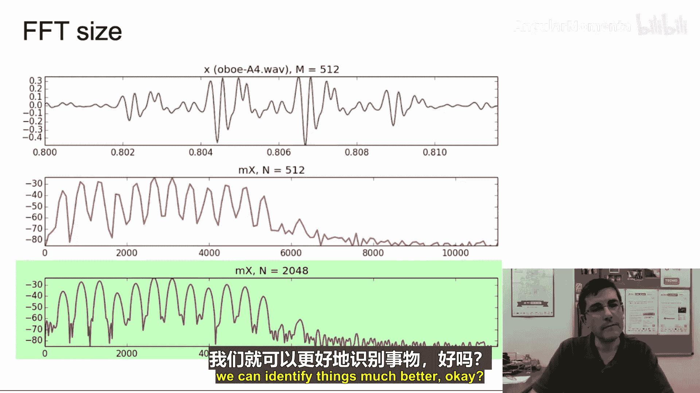

## FFT大小与零填充

FFT大小可以独立于窗口大小进行选择，这通过**零填充**实现。零填充可以增加频谱的采样点数，使频谱图更平滑，便于观察频谱特征。

*   **FFT大小等于窗口大小**：得到基本的幅度谱。
*   **FFT大小大于窗口大小（如4倍）**：通过零填充，得到更平滑、插值更细致的频谱，有助于更精确地识别频率成分。

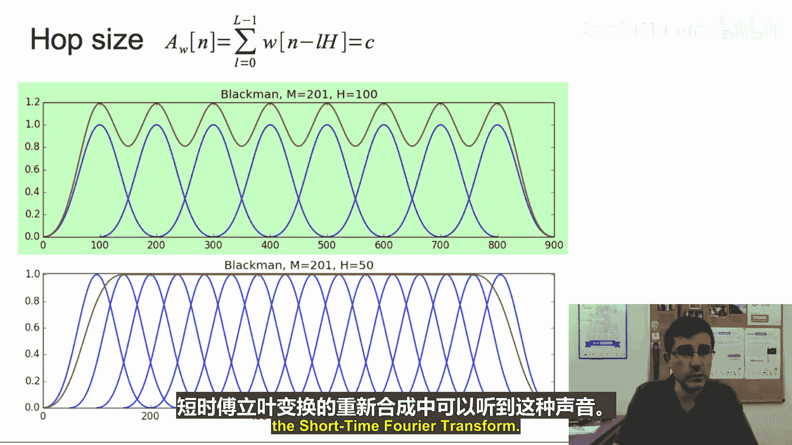

## 跳跃步长与重叠

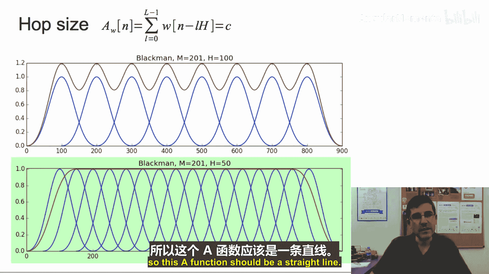

STFT分析中，窗口每次向前移动的样本数称为**跳跃步长**或**Hop Size**。跳跃步长会影响分析帧之间的重叠程度，进而影响最终合成信号的质量。

跳跃步长的选择应确保所有分析窗叠加后的和尽可能为一个常数，以避免合成时产生调制失真。例如：
*   跳跃步长为窗口长度的一半时，叠加后的函数存在明显的振荡。
*   跳跃步长为窗口长度的四分之一时，叠加后的函数在中间部分接近一条直线，这是更理想的情况。

## 时频权衡

将上述概念应用于分析一个复杂的钢琴乐句时，我们可以直观地看到**时频权衡**效应：

*   **小窗口**：具有良好的**时间分辨率**，能清晰捕捉音符的起振瞬态（垂直方向特征明显），但**频率分辨率**较差，谐波（水平线条）较模糊。
*   **大窗口**：具有良好的**频率分辨率**，能清晰显示谐波结构（水平线条清晰），但**时间分辨率**较差，音符的起振变得模糊。

## 相位谱信息

除了幅度谱，相位谱也包含重要信息。通常我们观察相位谱的导数，其中颜色平坦的区域表示相位稳定（如谐波处），颜色变化剧烈的区域表示相位快速变化。

## 逆短时傅里叶变换

与DFT不同，STFT是可逆的。我们可以通过**逆STFT**从幅度谱和相位谱中重建原始信号。核心方法是**重叠相加法**：

1.  对每一帧的频谱 `X_l[k]` 进行逆DFT，得到时域帧 `y_w[l, n]`。
2.  将所有时域帧按其时间位置进行移位并对齐。
3.  将所有移位后的帧相加，合成完整的输出信号 `y[n]`。

合成过程能否完美重建原始信号，取决于分析时使用的窗函数和跳跃步长是否满足**完全重构条件**。

## 完整的分析-合成系统

基于STFT和逆STFT，我们可以构建一个完整的分析-合成系统。该系统的工作流程如下：
1.  **分析**：输入信号 `x[n]` 经过加窗、分帧，对每一帧进行FFT，得到幅度谱和相位谱。
2.  **处理**：（可选）在频域对频谱进行修改。
3.  **合成**：对每一帧进行逆FFT，得到加窗的时域帧，然后通过重叠相加法合成最终输出信号 `y[n]`。

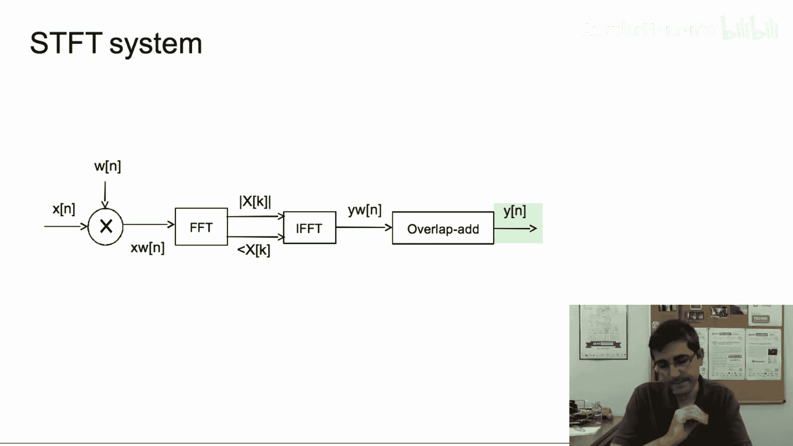

当窗函数和跳跃步长满足完全重构条件时，输出信号 `y[n]` 将与输入信号 `x[n]` 完全相同。

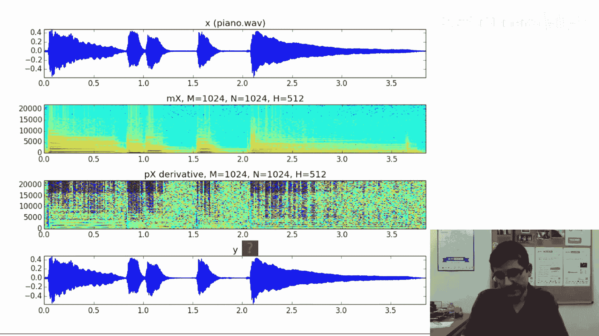

## 总结

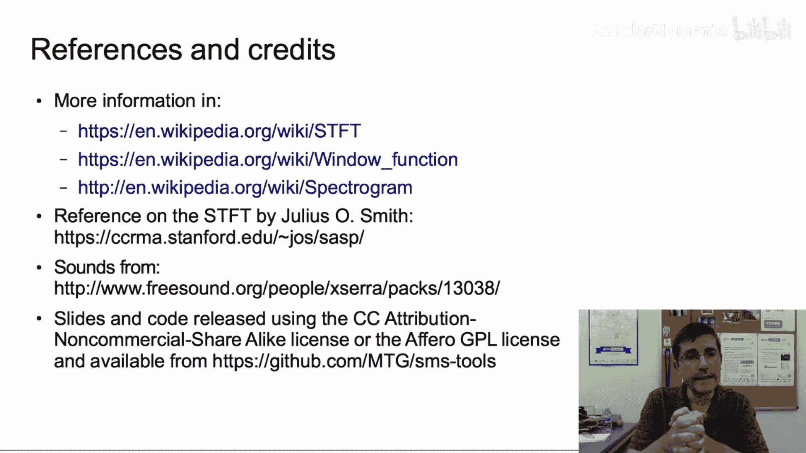

本节课中，我们一起深入学习了短时傅里叶变换的第二部分。我们探讨了窗口大小、FFT大小、跳跃步长等关键参数的选择及其对时频分析结果的影响，理解了著名的“时频权衡”原理。最重要的是，我们学习了如何通过逆STFT和重叠相加法从频谱中完美重建原始信号，从而构建出一个完整的音频分析-合成系统框架。

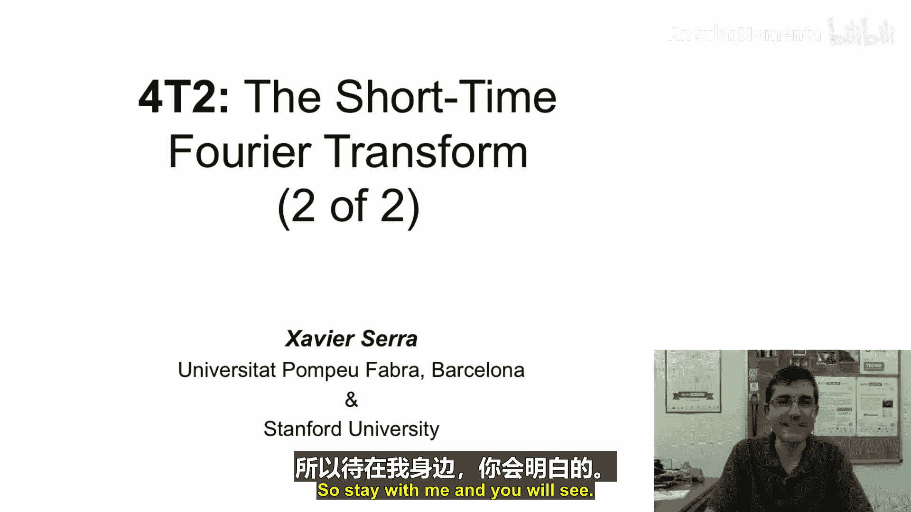

掌握STFT是进行更高级音频处理的基础。在接下来的编程实践课程中，我们将把这些理论知识付诸实践。