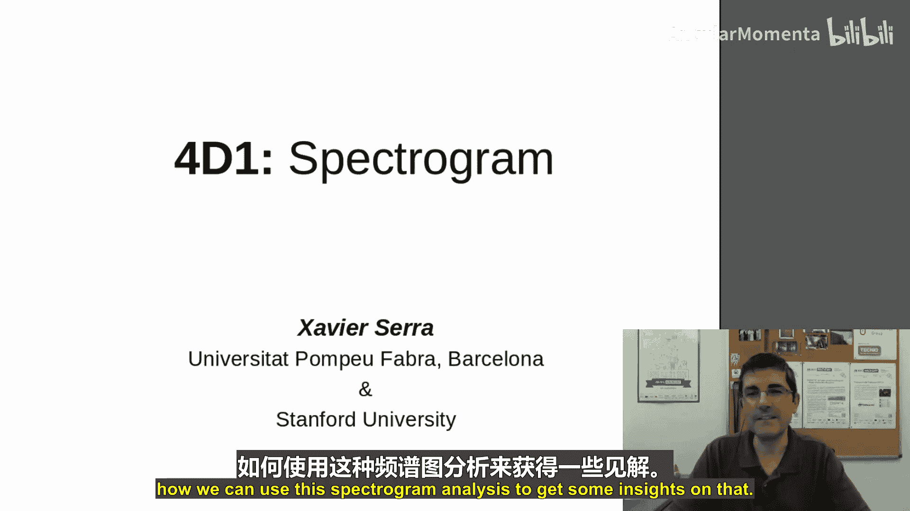

# 027：频谱图分析实践

在本节课中，我们将学习如何使用短时傅里叶变换及其可视化形式——频谱图，来分析一个具体的音频信号。我们将通过分析一个女高音演唱的片段，来深入理解STFT的参数设置及其对分析结果的影响。

## 概述

频谱图是短时傅里叶变换输出的可视化结果，它展示了信号随时间变化的频谱。本节课将通过Sonic Visualizer和SMS Tools两个工具，分析一个带有颤音的女高音演唱片段，以理解STFT的工作原理和参数选择的重要性。

## 使用Sonic Visualizer进行分析

首先，我们使用Sonic Visualizer打开并聆听需要分析的音频。这是一个音调较高、带有明显颤音的女高音演唱音符。

为了更深入地理解这个声音，我们打开频谱图面板。在频谱图中，我们可以看到一些清晰的信息：水平线对应着声音的谐波，而上下振荡的线条则对应着演唱中的颤音。

为了进行更细致的分析，我们打开另一个面板来查看单个时间点的频谱。我们首先在线性刻度下查看，并使用与STFT相同的窗函数，设置窗长为1024个样本。这个频谱图的一个切片清晰地显示了多个峰值，这些峰值对应着频谱图中的水平谐波线。

现在，让我们改变一些参数。例如，将窗长改为256个样本。此时，我们看到的频谱形状变得平滑许多，无法分辨出单个谐波，只能看到整体的共振峰结构。共振峰是声道共振的结果，正是它让我们能够区分不同的元音。

如果我们回到能分辨谐波的窗长设置，并在时间轴上移动，会发现谐波的变化比共振峰的变化更为明显。

接下来，我们尝试改变窗函数的类型。在首选项的分析选项卡中，将当前的黑曼窗改为矩形窗。结果显示，单个频谱的噪声基底变得很高，谐波难以辨认；在频谱图中则出现了垂直的线条和失真。这表明对于此类声音，黑曼窗是更优的选择。

## 使用SMS Tools进行分析

现在，我们使用SMS Tools进行同样的分析。SMS Tools提供了计算单帧频谱和时变频谱图的功能。

我们首先分析同一个女高音声音在0.5秒处的单帧频谱。使用与之前相同的参数：1024点的FFT大小和窗长，以及黑曼窗。计算得到的频谱清晰地显示了谐波对应的峰值，并且我们还看到了之前未显示的相位谱，以及通过对该频谱进行逆FFT重建回来的加窗信号。

同样，我们可以改变参数。将窗长和FFT大小都改为256，得到的频谱就平滑得多，信息量减少。SMS Tools界面的一个优势是可以独立控制窗长和FFT大小。例如，我们可以设置FFT大小为1024，而窗长为801。这样，我们虽然使用了更少的样本，但由于进行了零填充，频率分辨率仍然很好，频谱形状也相当平滑。

接下来，我们从短时傅里叶变换的角度，即频谱图，来观察整个信号。我们使用相同的参数：1024点的窗长和FFT大小。跳数需要远小于窗长以确保正确的重叠相加重建，对于1024点的黑曼窗，我们至少需要四分之一的重叠，因此设置跳数为256。计算得到的频谱图结果良好，重建出的声音与原始声音非常接近。

然而，如果跳数设置不正确，例如将跳数设置为与窗长相同（1024），重建就会出错。输出信号会出现以帧率为频率的调制，因为帧与帧之间没有正确的重叠来平滑过渡。这清楚地表明，我们需要一个更小的跳数值。

## 参数探索与总结

总之，我鼓励大家尝试调整这些参数：改变窗长、FFT大小、跳数以及窗函数类型，并在DFT和STFT之间切换。我相信这能帮助你很好地掌握这些不同参数对频谱图可视化以及信号重建效果的影响。

本节课中，我们一起使用Sonic Visualizer分析了人声，并可视化了频谱图与单帧频谱。我们也使用SMS Tools的界面完成了相同的分析。所使用的女高音声音来自Freesound。

希望这次实践能让你对STFT有更直观的认识，并理解使用这类技术来可视化特定声音（在本例中是女高音）是多么有用。当然，这只是更复杂分析的开始。在下一次实践课中，我们将分析一个结构更复杂的时变声音，并探讨如何利用频谱图分析来获取其中的信息。

感谢你的关注，我们下节课再见。