# 028：分析声音 🎵

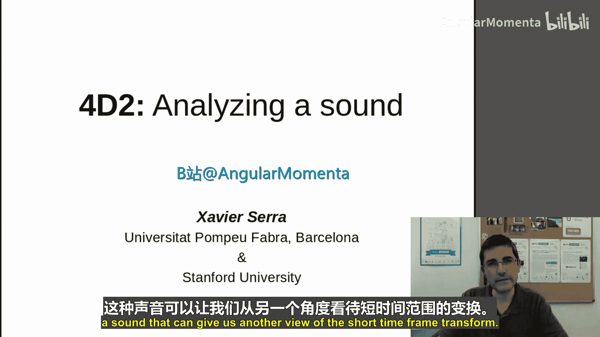

在本节课中，我们将继续学习如何使用短时傅里叶变换分析声音。上一节我们分析了女高音的声音，本节中我们将以钢琴声音为例，从另一个视角理解短时傅里叶变换的应用。

## 分析钢琴声音 🎹

我们使用Sonic Visualizer软件打开一个钢琴声音文件。这是一个包含五个音符的简单钢琴乐句，声音清晰。

以下是分析步骤：

1.  打开SMS工具中的短时傅里叶变换模块。
2.  加载钢琴声音文件 `piano.wav`。

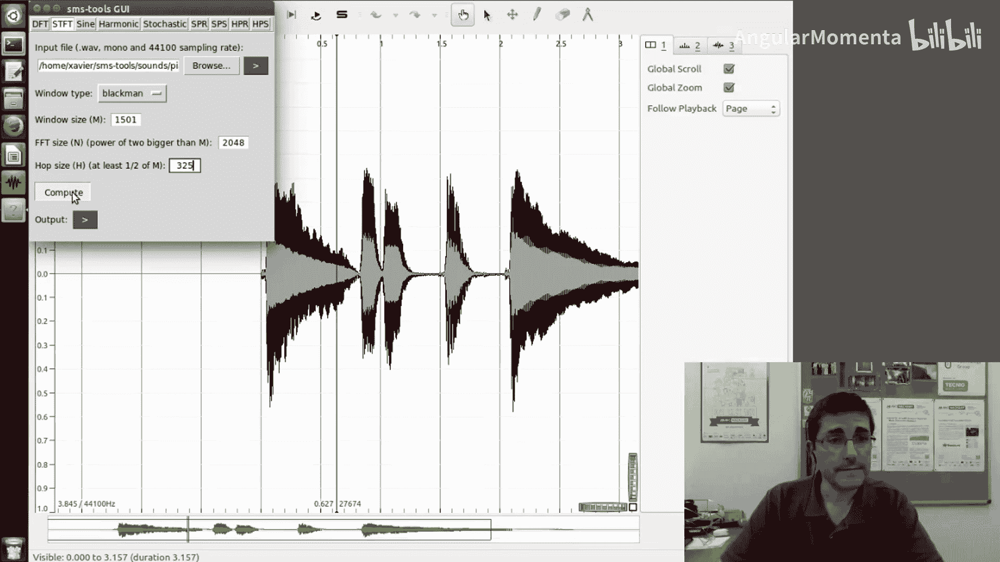

## 设置分析参数 ⚙️

上一节我们提到，布莱克曼窗是一个不错的选择。我们将继续使用它。

*   **窗口大小**：钢琴音高不像人声那么高，因此需要更大的窗口尺寸。我们从1501开始。通常我们使用奇数大小的窗口，这样窗口可以以0为中心，对相位分析尤其方便。
*   **FFT大小**：FFT大小必须大于窗口大小。为了计算效率，我们通常使用2的幂次方。大于1500的2的幂是2048，这是一个合适的尺寸。
*   **跳跃大小**：对于布莱克曼窗，跳跃大小应确保窗口正确重叠，至少为窗口大小的四分之一。1500的四分之一大约是325。

使用这些参数进行计算后，我们得到输入声音、幅度谱图、相位谱图和重建的输出。

重建的声音听起来很好，这意味着跳跃大小和窗口大小的选择是正确的，确保了正确的重叠。

在相位谱图中，我们看到清晰的垂直线，这些线对应着音符的起振阶段。这表明在起振期间，相位发生了显著变化。在音符的稳定阶段，我们看到更多的水平结构，这意味着谐波保持了某种可识别的相位连续性。

在幅度谱图中，我们可以清晰地看到红色的谐波线。随着声音演变，钢琴作为一种打击乐器，在起振阶段能量更高，谐波更丰富。随着时间的推移，谐波衰减，尤其是高频谐波衰减得更快，而低频谐波保留得更多。声音的起振过程也清晰可见。

## 深入细节：时间-频率权衡 🔍

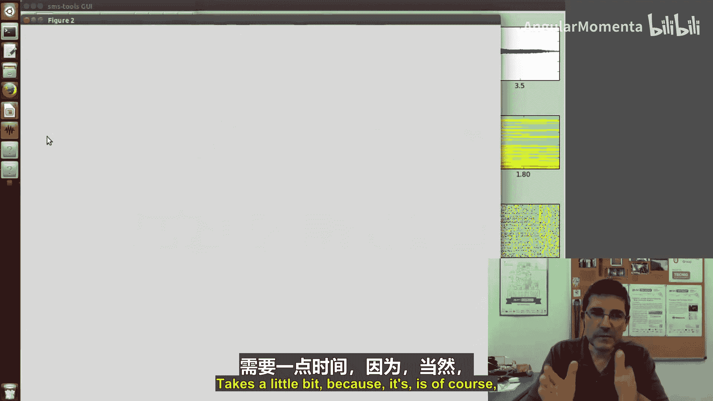

现在，让我们放大观察中间音符的细节，从起振前一点到音符结束。

放大后，我们可以看到分析的离散化特性。垂直方向上，每个竖条对应一个分析帧，即跳跃大小的样本数（325个样本）。水平方向上，我们也看到离散化的横线，由于FFT使用了2048个样本，频率分辨率较好，这些横线更细。

接下来，我们使用另一组参数进行计算，以观察区别。

*   **窗口大小**：201个样本（更小）。
*   **FFT大小**：256。
*   **跳跃大小**：50（约为窗口大小的四分之一）。

计算后，我们得到新的分析结果。由于保持了跳跃大小与窗口大小的比例关系，合成输出与原始声音相同。

现在，放大到与之前相同的区域进行比较。第一个分析具有较好的频率分辨率和相对较差的时间分辨率。第二个分析则具有较好的时间分辨率和较差的频率分辨率。

这揭示了短时傅里叶变换的一个核心概念：**时间-频率权衡**。在选择分析参数时，需要在时间分辨率和频率分辨率之间做出取舍，这取决于所要分析的特定声音。

## 分析起振与稳态阶段 📊

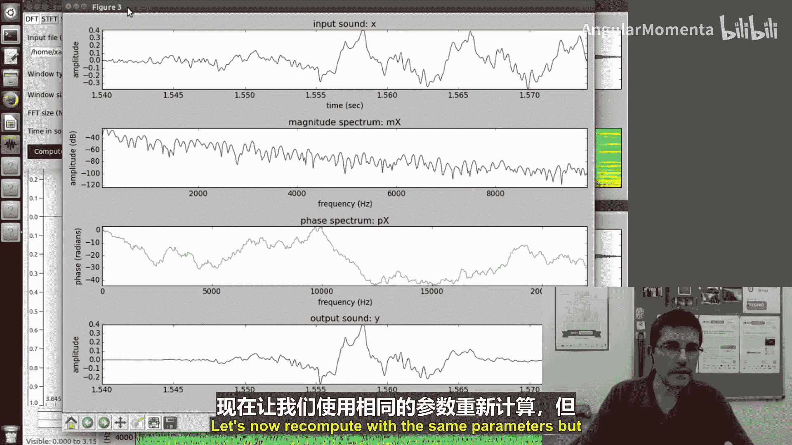

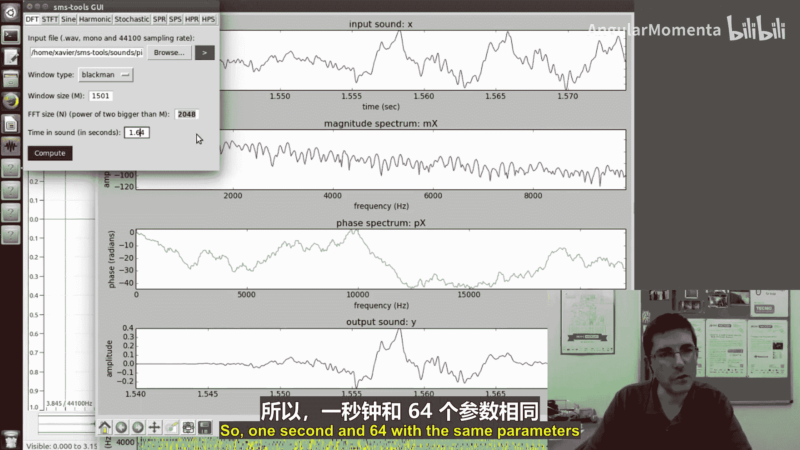

为了进一步理解声音特性，我们分析声音在起振阶段和稳态阶段的单个频谱。

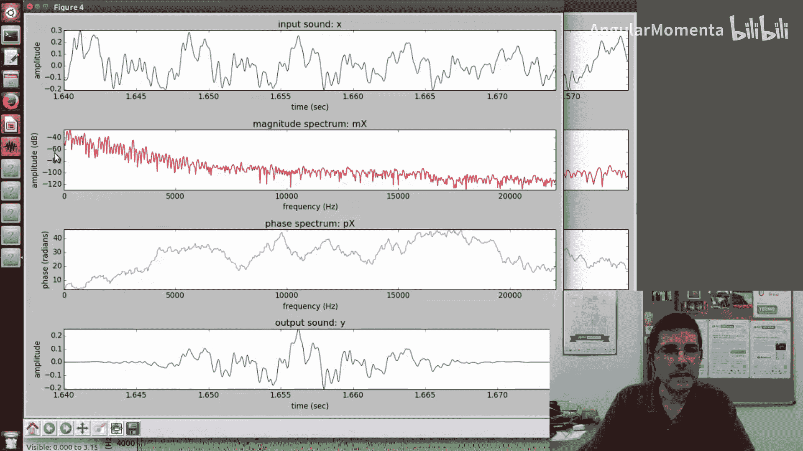

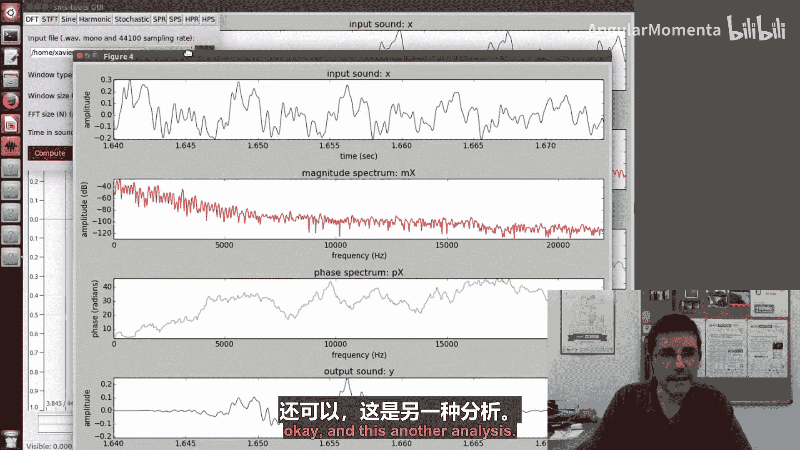

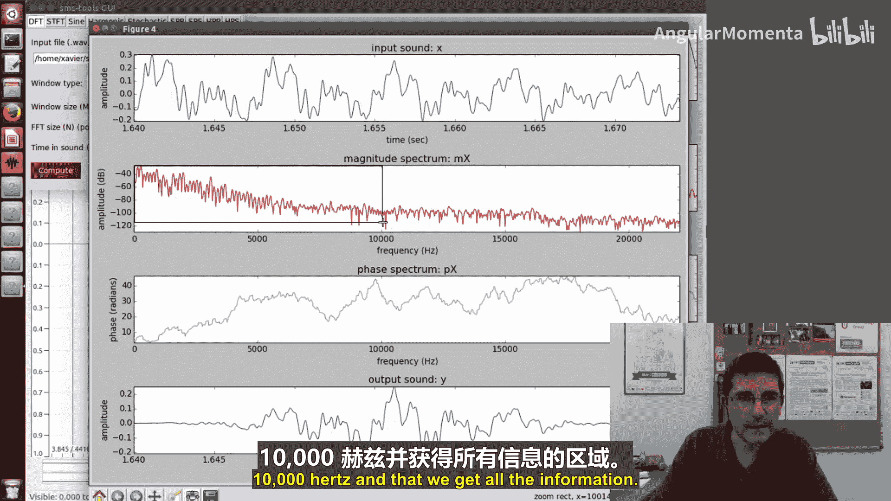

首先，在起振时刻（约1.54秒）计算DFT，参数与之前相同（窗口1501，FFT 2048）。然后，在稳态阶段（起振后约100毫秒，约1.64秒）用相同参数再次计算。

比较这两个频谱图（上图为起振阶段，下图为稳态阶段），我们可以观察到：

*   **时域**：两者有明显区别。
*   **频域**：在起振阶段，谐波不那么清晰明确，因为声音刚开始，谐波尚未完全建立。在稳态阶段，频谱峰值更加清晰明确。此外，在起振阶段，高频部分的噪声基底能量更高，即高频更响亮；而在稳态阶段，低频谐波明显更突出。

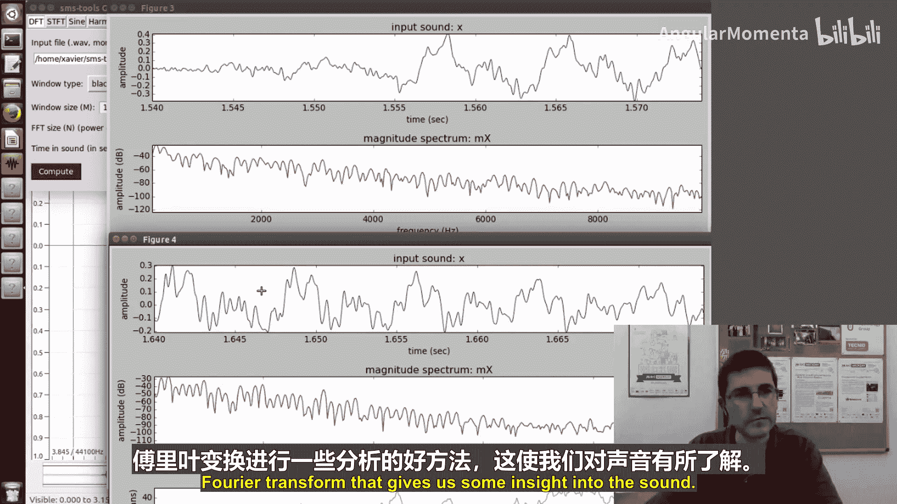

这是一种利用短时傅里叶变换进行声音分析、理解特定声音片段的好方法。

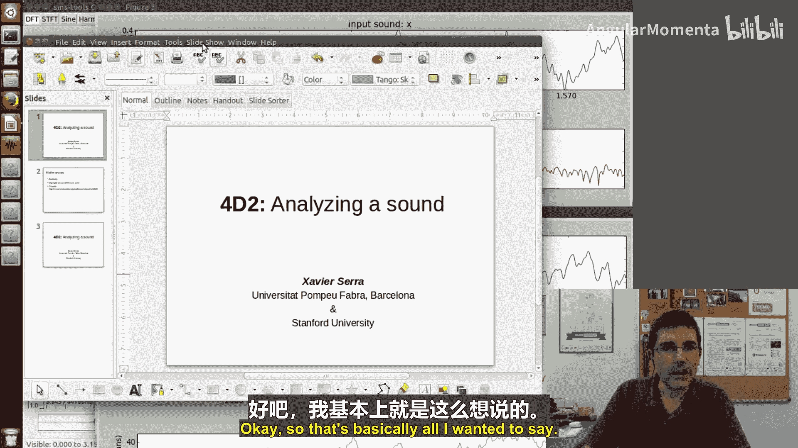

## 总结 📝

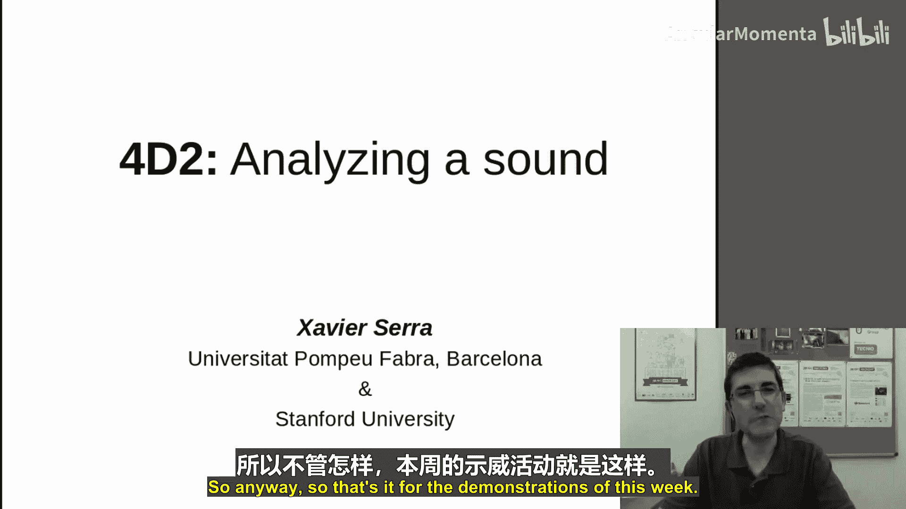

本节课中我们一起学习了如何使用SMS工具和短时傅里叶变换分析钢琴声音。我们探讨了参数设置（如窗口大小、FFT大小和跳跃大小）对分析结果的影响，特别是**时间-频率权衡**这一核心概念。通过对比声音在起振阶段和稳态阶段的频谱，我们获得了对钢琴声音特性的深入理解。希望本次分析能让你对短时傅里叶变换这一工具，以及钢琴这一有趣乐器的声音有更深的体会。