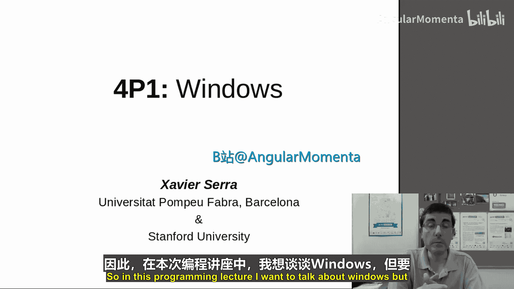
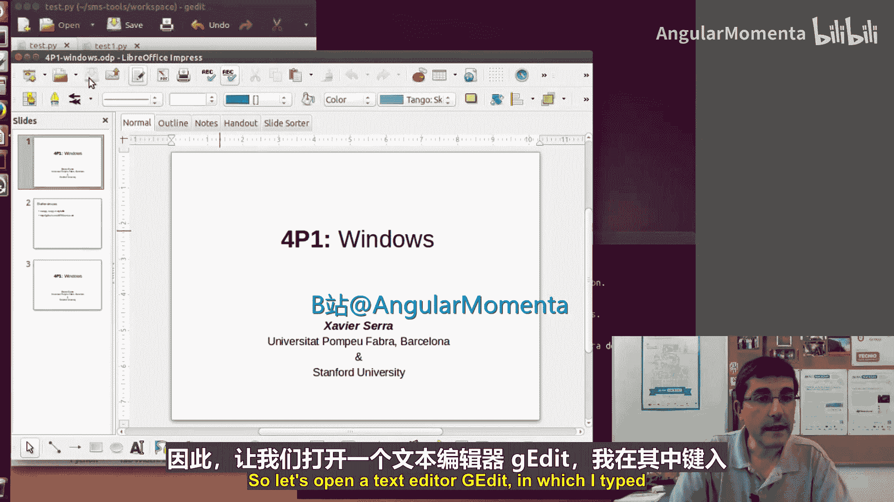
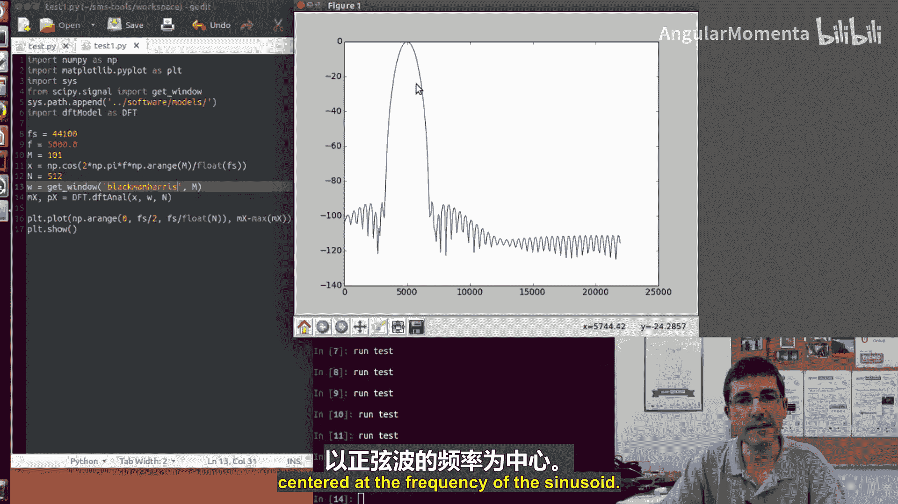
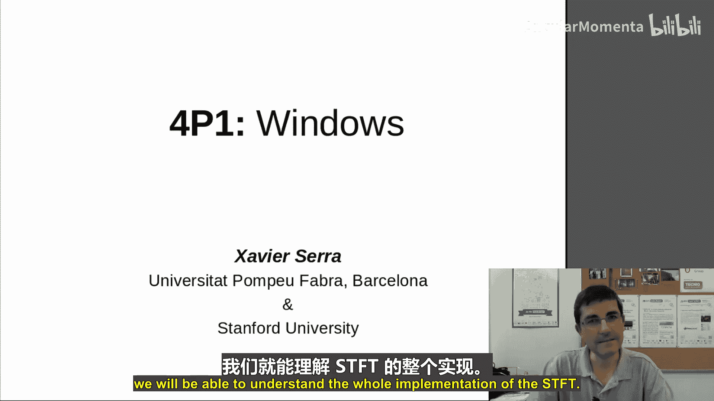

# 029：04_03_01_窗函数（第一部分）🎵





在本节课中，我们将从编程的角度探讨短时傅里叶变换的一个基本元素——分析窗函数。我们将学习如何生成不同的窗函数，计算其频谱，并观察窗函数如何影响正弦信号的频谱分析。

## 概述

窗函数是短时傅里叶变换的核心。它决定了我们如何截取音频信号的一小段进行分析。不同的窗函数具有不同的频谱特性，如主瓣宽度和旁瓣衰减水平，这些特性直接影响频谱分析的精度和分辨率。

## 窗函数的生成与频谱分析

首先，我们需要导入必要的Python库，并生成一个窗函数。以下代码展示了如何生成汉宁窗并计算其频谱。

```python
import numpy as np
import scipy as sp
import matplotlib.pyplot as plt

# 定义窗长度
M = 63
# 生成汉宁窗
window = sp.signal.get_window(‘hann‘, M)
```

上一节我们介绍了如何生成一个基本的窗函数。本节中，我们来看看如何为FFT计算准备这个窗函数，特别是进行零相位窗处理和补零操作。

为了将窗函数中心对齐到零频位置以进行FFT分析，我们需要执行以下步骤：
1.  创建一个FFT缓冲区（例如512个样本）。
2.  将窗函数的后半部分放在缓冲区的开头，前半部分放在缓冲区的末尾。

```python
# 计算窗的中间点，处理奇偶长度
hM1 = int(np.floor((M+1)/2))
hM2 = int(np.floor(M/2))

# 创建FFT缓冲区并执行零相位窗移位
N = 512
fft_buffer = np.zeros(N)
fft_buffer[:hM2] = window[hM1:]
fft_buffer[N-hM1:] = window[:hM1]
```

准备好缓冲区后，我们就可以计算其频谱了。

```python
# 计算FFT
X = np.fft.fft(fft_buffer)
# 计算幅度谱（转换为分贝）和相位谱
absX = np.abs(X)
# 避免对零值取对数
absX[absX < np.finfo(float).eps] = np.finfo(float).eps
mX = 20 * np.log10(absX)
pX = np.angle(X)
```

为了更直观地可视化频谱，我们通常将零频分量调整到频谱图的中心。

```python
# 调整频谱显示，将零频移至中心
mX = np.fft.fftshift(mX)
pX = np.fft.fftshift(pX)
```

运行上述代码后，我们可以绘制窗函数本身、其在FFT缓冲区中的位置以及最终的幅度谱和相位谱。一个零相位窗的相位谱在通带内应接近0（模2π）。

## 不同窗函数的特性比较

窗函数的主要特性可以通过其频谱来观察，特别是主瓣宽度和最高旁瓣电平。

以下是几种常见窗函数的特性描述：
*   **汉宁窗**：主瓣宽度约为4个频点（bin），最高旁瓣电平约为-31 dB。
*   **汉明窗**：主瓣宽度同样约为4个频点，但最高旁瓣电平更低，约为-42 dB。
*   **布莱克曼窗**：主瓣更宽，约为6个频点，旁瓣抑制更好，最高旁瓣电平约为-58 dB。
*   **布莱克曼-哈里斯窗**：主瓣最宽，约为8个频点，但旁瓣抑制能力最强，最高旁瓣电平可低至-92 dB。

通过修改代码中的窗函数名称，我们可以直观地比较这些差异。选择窗函数时，需要在频率分辨率（主瓣宽度）和频谱泄漏抑制（旁瓣电平）之间进行权衡。

## 窗函数对信号频谱分析的影响

理解了窗函数自身的特性后，我们来看看它对实际信号分析的影响。当我们分析一个加窗后的正弦信号时，在频谱中看到的实际上是窗函数的频谱，它被搬移到了正弦信号的频率位置上。

为了简化分析过程，我们可以使用SMS工具包中的`dftAnal`函数。该函数封装了加窗、补零和FFT计算等步骤。

```python
# 导入SMS工具包中的DFT分析函数
import sys
sys.path.append(‘../software/models/‘)
import dftModel as DFT

# 生成一个正弦信号
fs = 44100
f = 5000
t = np.arange(101) / fs
x = np.sin(2 * np.pi * f * t)

# 使用汉明窗进行分析
window = sp.signal.get_window(‘hamming‘, 101)
N = 1024
mX, pX = DFT.dftAnal(x, window, N)
```



运行分析后，我们得到正弦信号的频谱。该频谱以5000 Hz为中心，形状与我们之前看到的窗函数频谱一致。信号的幅度信息也体现在频谱的幅度值中。

如果我们更换窗函数，例如使用布莱克曼-哈里斯窗，频谱的形状会随之改变，主瓣变宽，旁瓣被显著抑制。这再次验证了窗函数特性直接决定了我们观察到的信号频谱形态。

## 总结



本节课中，我们一起学习了窗函数在频谱分析中的关键作用。我们掌握了如何用Python生成和可视化不同窗函数，并理解了主瓣宽度和旁瓣电平这两个核心概念。通过分析加窗的正弦信号，我们认识到信号频谱是窗函数频谱在信号频率处的搬移。深入理解窗函数是掌握短时傅里叶变换及其他频谱分析技术的基础。在下一次编程课中，我们将把这些知识整合起来，实现完整的短时傅里叶变换。