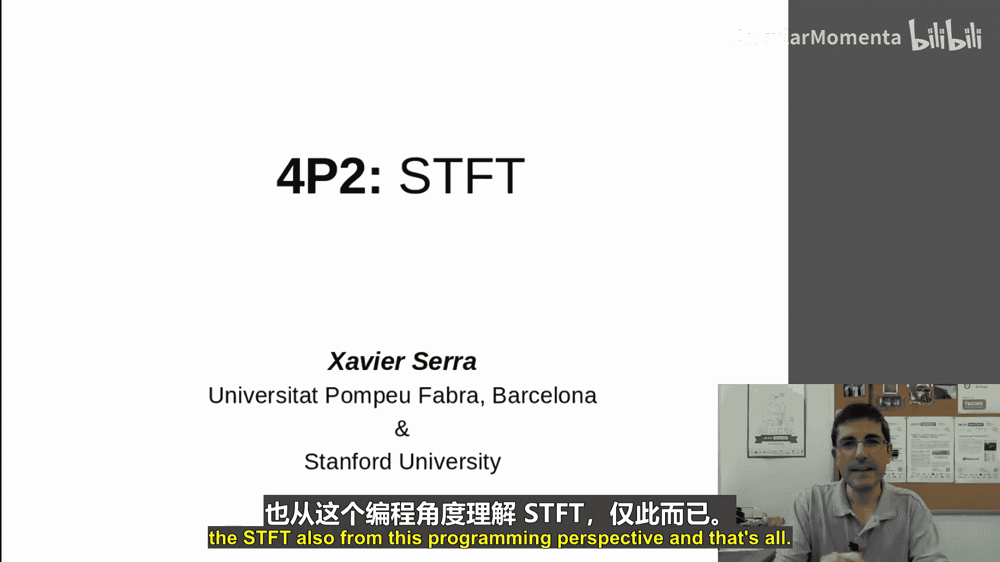

# 030：短时傅里叶变换编程实现 🎵

在本节课中，我们将学习如何编程实现短时傅里叶变换。我们将从理论过渡到实践，使用Python和SMS工具包来构建一个完整的STFT分析-合成系统。我们将详细讲解核心代码，并演示如何可视化频谱结果。

上一节我们介绍了窗函数及其频谱特性，本节中我们来看看如何利用窗函数来实现完整的短时傅里叶变换。

## 概述：STFT系统与实现


短时傅里叶变换的核心思想是将一个长音频信号分割成多个短片段（帧），对每个片段应用窗函数后进行傅里叶变换，从而得到一系列随时间变化的频谱。其核心公式可以表示为：


**X(l, k) = Σ_{n=0}^{N-1} [x(n + lH) * w(n)] * e^{-j2πkn/N}**

其中：
*   `x(n)` 是原始音频信号。
*   `w(n)` 是窗函数（如汉明窗）。
*   `l` 是帧索引。
*   `H` 是帧移（hop size）。
*   `N` 是FFT大小。
*   `k` 是频率索引。

整个STFT处理流程可以看作一个信号处理系统：首先对加窗后的信号片段进行FFT分析，得到复频谱；然后可以通过逆FFT和重叠相加法（Overlap-Add）来合成重建原始信号。

## SMS工具包中的STFT实现

SMS工具包中的STFT实现主要包含在 `stft.py` 文件中。以下是该文件的核心函数结构：

```python
# stft.py 中的主要函数
def stft(x, fs, w, N, H):
    # 完整的分析-合成函数
    # 返回合成后的音频

def stftAnal(x, w, N, H):
    # 仅分析函数
    # 返回幅度谱和相位谱序列

def stftSynth(mY, pY, w, N, H):
    # 仅合成函数
    # 根据幅度谱和相位谱重建音频
```

`stft` 函数是分析-合成的核心。它接收原始音频数组 `x`、采样率 `fs`、窗函数 `w`、FFT大小 `N` 和帧移 `H` 作为参数。其内部是一个循环，指针 `pin` 以 `H` 为步长遍历整个音频，在每一帧位置调用 `dftAnal` 函数进行分析。


## 使用STFT函数分析音频

以下是一个调用 `stftAnal` 函数分析音频文件的示例脚本步骤：

1.  **导入必要的包和函数**。
2.  **定义参数**：包括音频文件路径、窗函数类型、窗长、FFT大小和帧移。
3.  **读取音频文件**。
4.  **生成窗函数**。
5.  **调用 `stftAnal` 函数**进行分析，得到幅度谱矩阵 `mX` 和相位谱矩阵 `pX`。

运行脚本后，我们可以检查得到的变量。例如，`mX.shape` 会返回 `(238, 512)`，表示共有238帧，每帧有512个频谱值（对应正频率部分）。

## 可视化频谱结果

我们可以通过绘图来直观地观察STFT的分析结果。

*   **绘制单帧频谱**：可以选取特定帧（如第50帧）的幅度谱 `mX[50, :]` 或相位谱 `pX[50, :]` 进行绘制。对于长笛声音，我们能在幅度谱中看到清晰的谐波结构。
*   **绘制时频谱图**：为了观察整个信号频谱随时间的变化，我们需要绘制时频谱图。可以使用 `pcolormesh` 函数来绘制矩阵。为了符合习惯（时间从左到右，频率从下到上），通常需要先将频谱矩阵 `mX` 转置。

```python
# 绘制时频谱图的示例
plt.pcolormesh(mX.T) # 转置矩阵以调整坐标轴方向
plt.xlabel(‘时间 (帧)‘)
plt.ylabel(‘频率 (bin)‘)
plt.title(‘幅度谱时频图‘)
plt.show()
```

## 完整的分析-合成与图形界面

`stft_function.py` 文件提供了一个更完整的示例，它集成了分析、合成、绘图和文件输出功能。该脚本的 `main` 函数执行以下步骤：
1.  读取输入音频。
2.  进行STFT分析。
3.  进行STFT合成，重建音频。
4.  将合成音频写入新的WAV文件。
5.  绘制输入音频、幅度谱、相位导数谱和输出音频的波形图。


运行此脚本后，会生成一个合成音频文件（如 `pianoSTFT.wav`），其听起来应与原始音频几乎完全相同，这验证了STFT分析-合成过程的正确性。

## 总结



本节课中我们一起学习了短时傅里叶变换的编程实现。我们深入探讨了SMS工具包中STFT函数的工作原理，包括其分析、合成以及可视化频谱的方法。通过动手编写和运行代码，我们理解了如何将音频信号分割成帧、加窗、进行FFT变换，以及如何通过逆变换和重叠相加法重建信号。请务必亲自尝试修改代码中的参数（如窗函数、帧移），并观察其对分析结果和合成质量的影响，从而加深对STFT从编程角度的理解。