# 031：正弦模型一 🎵

在本节课中，我们将学习正弦模型。这是一种在短时傅里叶变换基础上构建的、更高层次的音频表示方法。它通过牺牲部分STFT的精确性，换取了更高的灵活性和抽象能力。

上一节我们讨论了短时傅里叶变换。本周，我们将进一步探讨如何获得更高层次的音频表示。

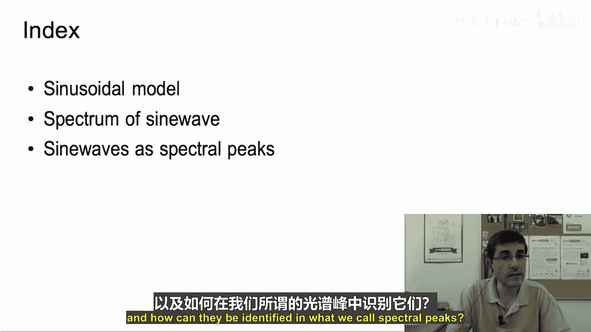

## 正弦模型介绍

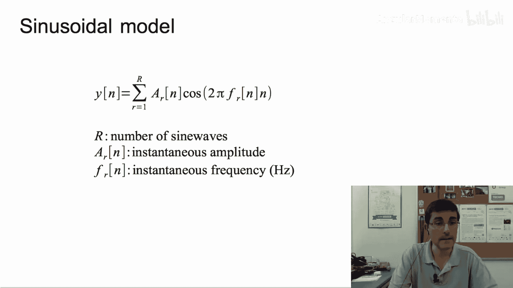

正弦模型的核心思想很简单：将声音表示为多个时变正弦波的和。

该模型可以用以下公式表示：
`x(n) = Σ_{r=1}^{R} A_r(n) cos(2π f_r(n) n + φ_r(n))`
其中，`R` 是正弦波的数量，每个正弦波都有随时间变化的瞬时振幅 `A_r(n)`、频率 `f_r(n)` 和相位 `φ_r(n)`。

## 频域中的正弦波

我们更关心在频域（频谱）中表示这些正弦波。让我们看看这是如何实现的。

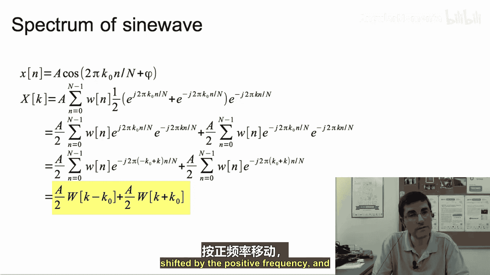

从信号 `x` 开始，它是一个实正弦波。对其加窗版本进行DFT变换。正弦波可以表示为两个复正弦波的和，再乘以我们使用的窗函数。作为两个复指数的和，我们可以将其拆分为两个对称的、独立的DFT分量。

本质上，这是窗函数变换的移位版本。第一个分量是窗函数 `W` 的DFT，其频率索引发生了偏移。另一个分量是相同的窗函数，但向正频率方向偏移，并且由相同的振幅进行缩放。

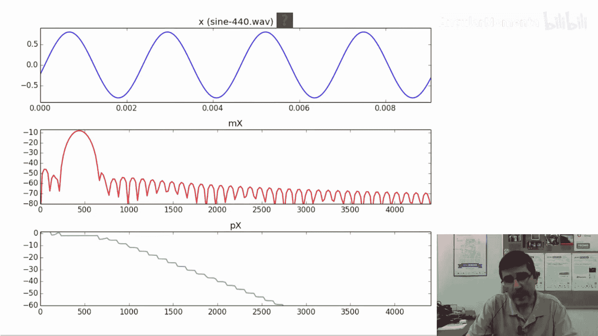

## 频谱中的正弦波示例

以下是一个正弦波及其频谱的示例。

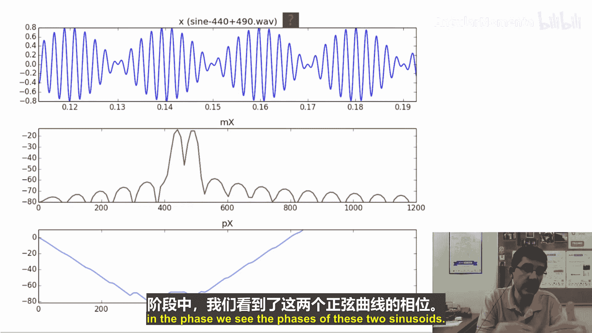

这是一个频率为440 Hz的正弦波。在频谱中，我们只绘制正频率部分。我们看到一个以440 Hz为中心的峰值，在主瓣区域的相位是平坦的，这对应于正弦波在位置0处的相位。

现在，让我们看一个更复杂的例子：由两个正弦波组成的声音。

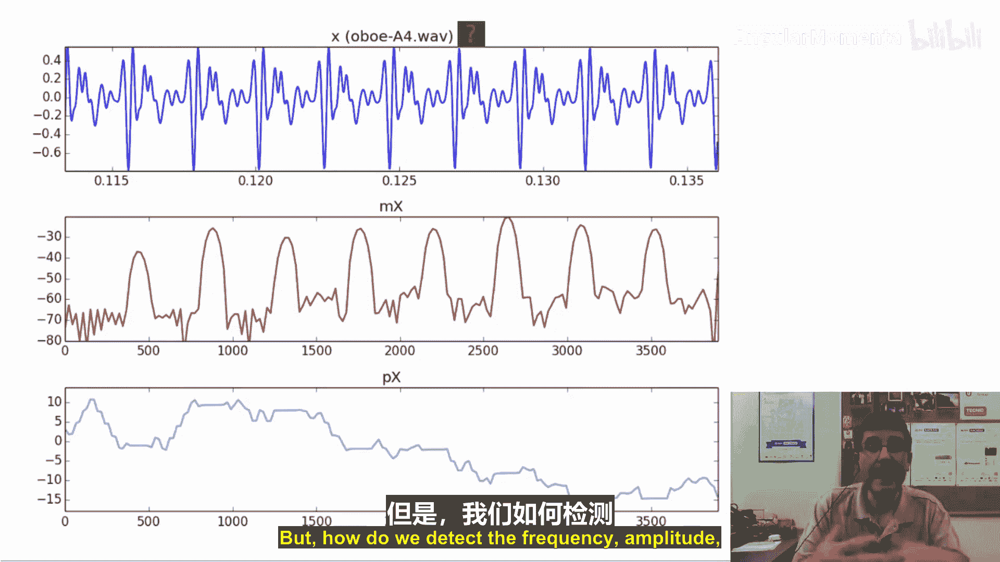

这两个正弦波频率分别为440 Hz和490 Hz。在时域中，我们可以看到调制现象。在频谱中，我们看到两个正弦波各自的贡献，即两个峰值，以及它们各自的相位。

接下来，我们看一个真实声音的例子：双簧管的声音。

这是一个演奏A4音符（基频约440 Hz）的双簧管声音。在频谱中，我们可以清晰地看到许多正弦波，它们是声音的谐波。这里我们只绘制了前4000 Hz，即前几个谐波。

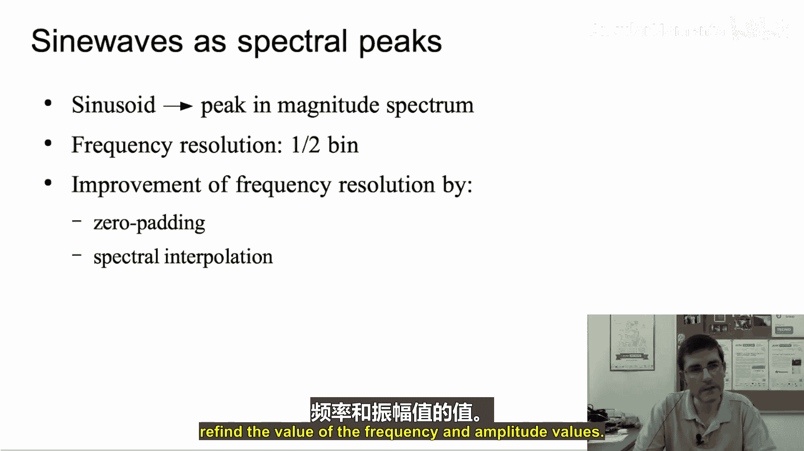

## 如何检测正弦波参数

一个在频谱中识别正弦波的简单方法是关注频谱幅度、其位置和高度。位置对应频率，高度对应正弦波的振幅。

因此，我们将正弦波视为幅度谱中的一个峰值。问题在于，幅度谱的分辨率是离散且有限的。我们能获得的最大频率分辨率是两个频率采样点（两个bin）之间距离的一半。

但我们可以做得更好。一种方法是使用**零填充**和**频谱插值**。通过零填充获得更大的FFT，从而得到更多采样点；我们也可以直接对结果采样点进行插值，以进一步细化频率和振幅的估计值。

## 频谱峰值检测与窗函数

为了检测频谱峰值，我们必须理解窗函数的影响。最重要的因素是**窗长**。

一个重要的概念是主瓣在频谱域中的**带宽** `B_F`（以赫兹为单位）。它定义为窗函数主瓣宽度（以采样点为单位 `B_S`）乘以采样率 `f_s`，再除以窗长 `M`：
`B_F = (B_S * f_s) / M`

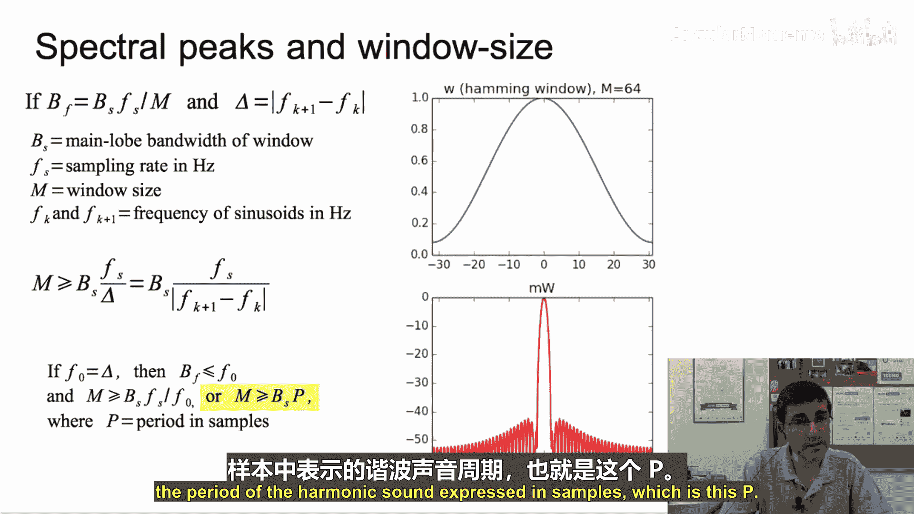

如果我们考虑两个想要分辨的频率 `f_{k+1}` 和 `f_k`，其绝对差值 `Δf` 就是我们想要分辨的频率间隔。为了使两个窗函数的主瓣在频谱中不重叠，从而将这两个频率视为独立的峰值，窗长 `M` 必须满足：
`M ≥ (B_S * f_s) / Δf`

在许多情况下，这个频率差对应于基频 `f_0`。对于谐波声音，两个连续谐波之间的距离等于基频。因此，如果我们想分辨基频，窗函数的主瓣带宽（以赫兹计）必须小于或等于这个基频。此时，窗长 `M` 需满足：
`M ≥ (B_S * f_s) / f_0`
如果用周期 `P`（以采样点为单位）表示，则为：
`M ≥ B_S * P`

## 示例分析

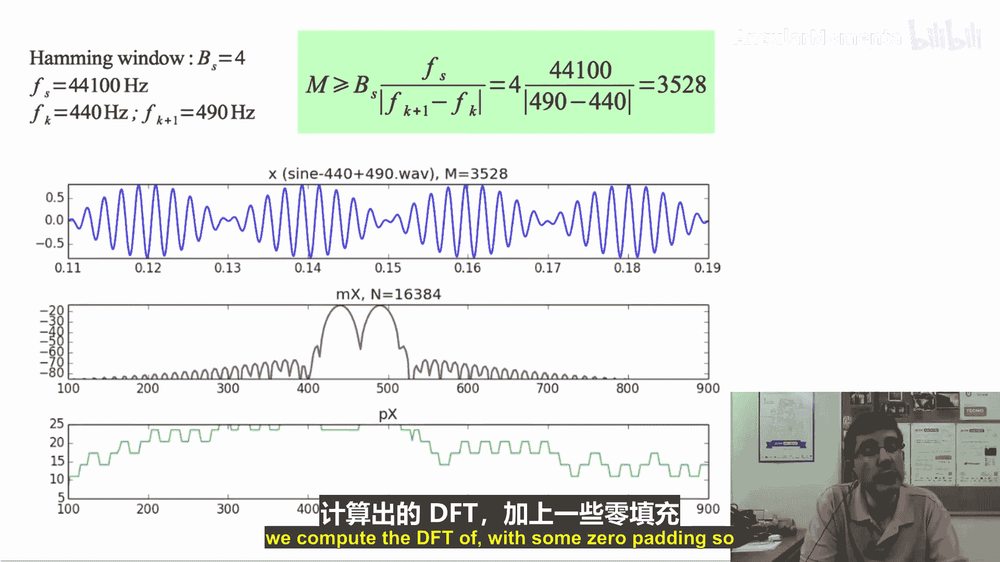

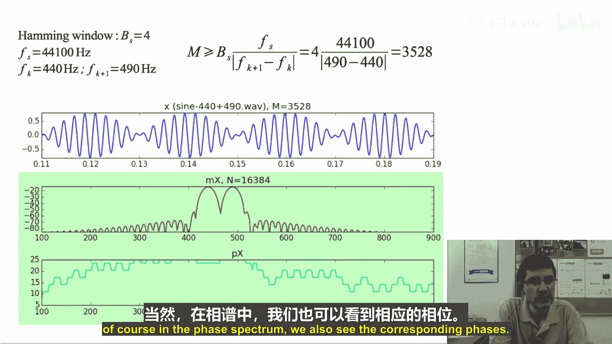

让我们看一个例子。假设使用汉明窗（`B_S = 4`），采样率为44100 Hz，我们想分辨440 Hz和490 Hz这两个频率（`Δf = 50 Hz`）。

计算所需的最小窗长：
`M ≥ (4 * 44100) / 50 = 3528` 个采样点

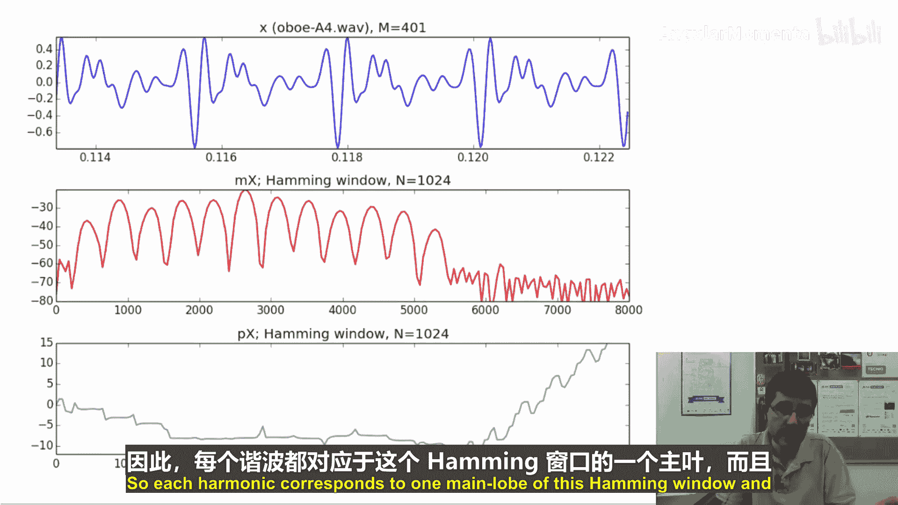

如果我们取3528个采样点，并计算其DFT（配合零填充以获得平滑频谱），可以清晰地看到两个独立的峰值，每个都对应一个汉明窗的变换。

对于双簧管声音（基频约440 Hz），如果我们取 `M = 401` 个采样点（约4个周期），并计算其加汉明窗后的DFT（零填充至N=1024），可以清晰地看到分离的谐波，每个谐波对应一个主瓣。

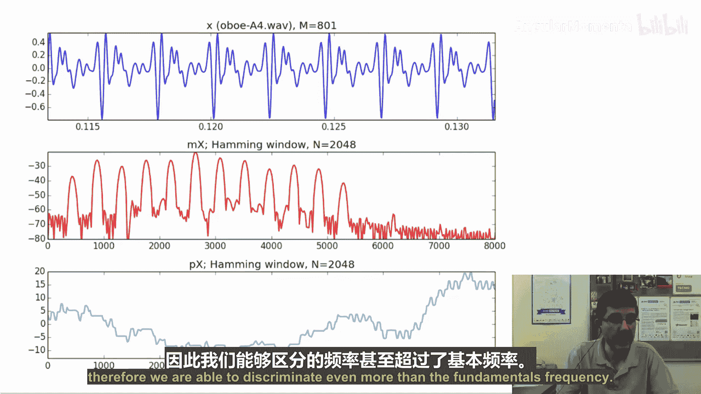

如果我们将窗长增加到 `M = 801` 个采样点，主瓣会变得更窄，我们甚至能在两个主瓣之间看到旁瓣，因为更大的窗长使我们能够分辨比基频更小的频率间隔。

## 总结

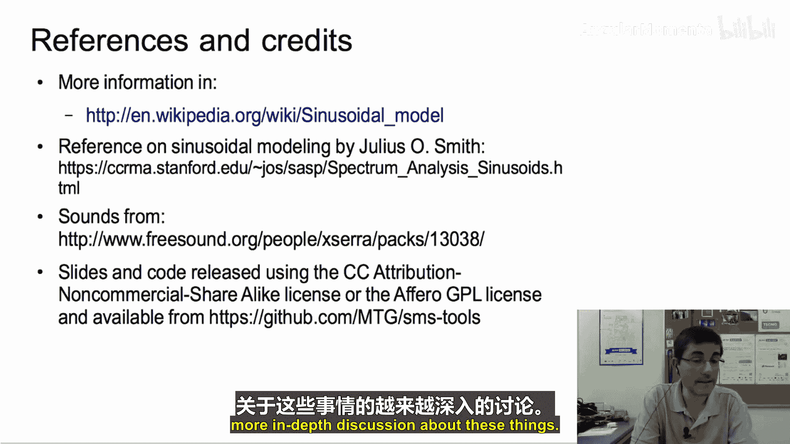

本节课我们一起学习了正弦模型的基本概念。这是一种将声音表示为多个时变正弦波之和的模型。我们探讨了如何在频域中表示这些正弦波，将其视为频谱中的峰值，并理解了窗函数（特别是窗长）对分辨这些峰值的关键影响。核心在于，为了分辨两个频率，窗长必须足够大，以确保窗函数主瓣的带宽小于待分辨的频率差。

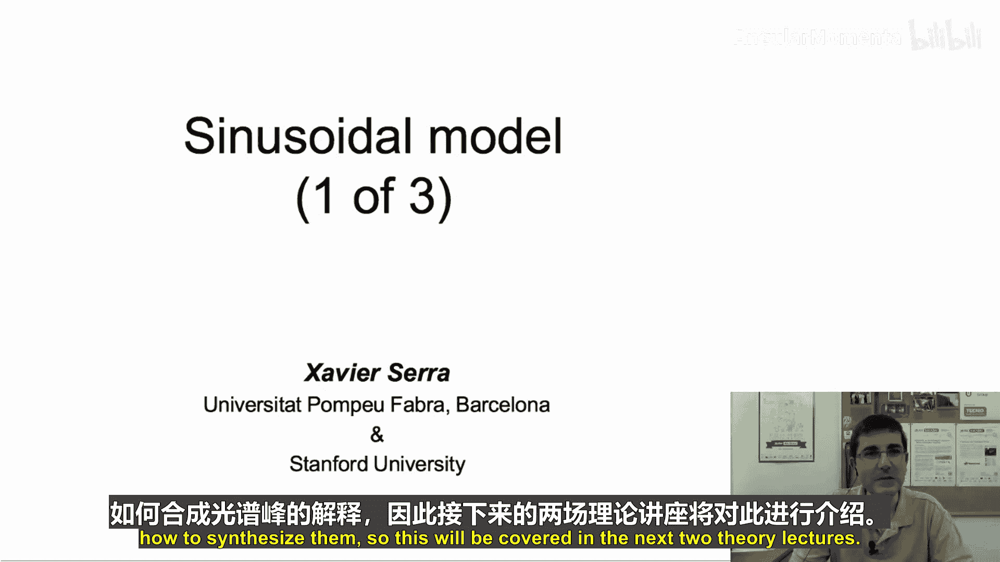

在接下来的两节理论课中，我们将完成如何识别这些频谱峰值以及如何利用它们进行合成的讲解。