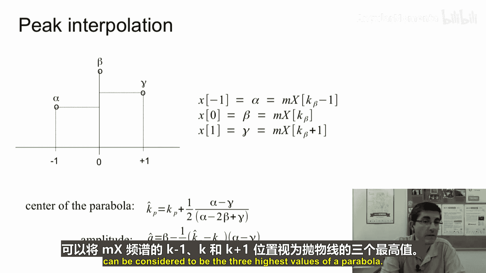
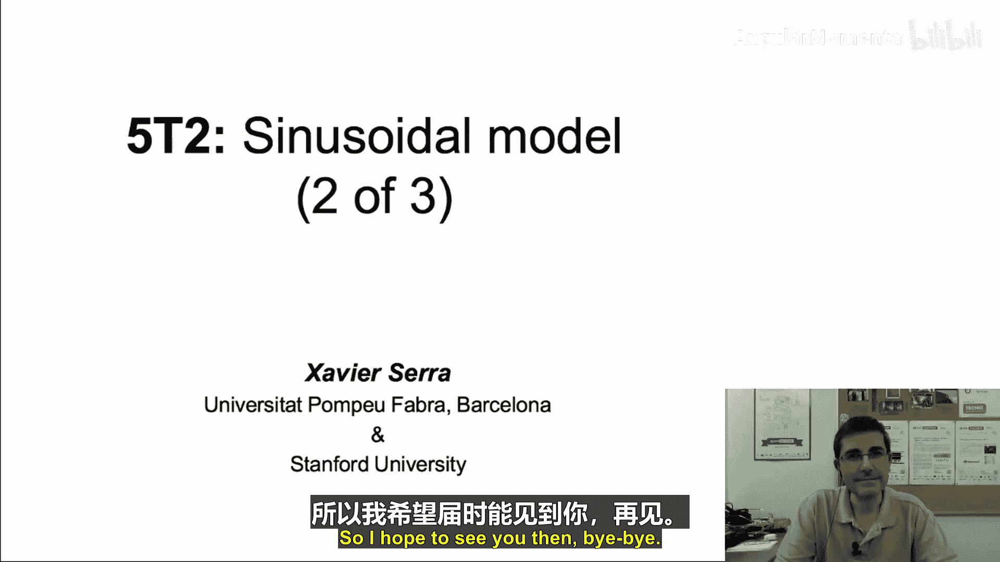

# 032：正弦模型（二）📈

## 概述

在本节课中，我们将继续学习正弦模型。上一节我们介绍了正弦模型的基本概念及其在频谱域中的可视化。本节中，我们将深入探讨如何在频谱中检测峰值（即正弦波），以及如何随时间跟踪这些变化的频率分量。

---

## 模型回顾与峰值检测

上一节我们介绍了正弦模型，它本质上是多个时变正弦波的和。我们强调了在频域中检测这些正弦波的重要性，因此需要选择合适的窗函数长度，以便在频谱中清晰地分离出各个正弦波对应的峰值。

例如，对于频率为440 Hz和490 Hz的两个正弦波，我们需要一个长度为5291个样本的窗，才能使它们的主瓣在频谱中分离开。

那么，我们如何测量频谱中这些正弦波的值呢？

---

## 峰值测量与局部最大值

如果窗长选择正确，信号中的每个正弦波都会在频谱中对应一个峰值。要测量每个正弦波的频率和幅度，我们只需找到峰值的顶点及其高度。

我们定义一个峰值为幅度谱中的一个局部最大值。具体来说，在位置 `k0` 处，如果其幅度值大于前一个位置 `k0-1` 和后一个位置 `k0+1` 的幅度值，那么 `k0` 就是一个局部最大值。

在下图中，蓝色叉号标记了这些局部最大值。

通过这个步骤，我们可以获得峰值的位置 `k0`、幅度 `Mx[k0]` 和相位 `Px[k0]`。

---

## 频谱分辨率问题与解决方案

然而，上述方法存在一个问题：频谱分辨率不足。从视觉上可以明显看出，峰值的位置可能不够精确。

解决分辨率问题的一个方法是进行**零填充**。我们使用一个远大于窗长的FFT尺寸。例如，在上例中，我们将FFT尺寸增加到原来的2倍（窗长保持不变，但在其后补零）。这会产生更平滑的频谱，此时计算出的局部最大值（蓝色叉号）位置更准确，看起来更接近峰值的中心，因此幅度和相位的测量也会更精确。

但如果想要足够好的分辨率，就需要大幅增加FFT尺寸，这在计算上会非常昂贵。那么，还有其他解决方案吗？

---

## 抛物线插值法

是的，我们可以使用一种更经济的插值方法，例如**抛物线插值**。抛物线函数的形状与分析窗频谱主瓣尖端的形状在分贝尺度上非常相似。

抛物线的方程如下：
`y = a(x - p)^2 + b`
其中 `p` 是抛物线的中心，`a` 控制曲率，`b` 是偏移量。

要对一个频谱峰值进行抛物线插值，我们可以使用该峰值幅度最高的三个点。例如，使用幅度谱在位置 `k-1`, `k`, `k+1` 的值，可以将其视为一个抛物线的三个最高点 `(x-1, y-1)`, `(x0, y0)`, `(x1, y1)`。

然后，我们可以应用抛物线方程来找到这个抛物线的中心。中心的频率位置 `kp` 可以通过以下公式计算：
`kp = k + (y[k-1] - y[k+1]) / (2 * (y[k-1] - 2*y[k] + y[k+1]))`

接着，我们可以将这个插值后的 `kp` 代入抛物线方程，得到修正后的幅度值 `A(kp)`。通过这种方式，我们可以细化峰值的位置。我们可以将抛物线插值与零填充结合使用，以获得更好的结果。

下图展示的就是结合了零填充和抛物线插值的例子。如果放大观察，你会发现它比单纯零填充或没有零填充的结果要好得多。

这样，我们就能相当准确地测量出频谱中所有正弦波的频率、幅度和相位：
*   **频率**：通过公式计算 `kp`，然后乘以 `(Fs / N)` 转换为赫兹。
*   **幅度**：使用抛物线插值公式计算。
*   **相位**：可以直接读取 `kp` 附近位置的相位值，通常不需要插值。

---

## 时变正弦波的跟踪

以上讨论的都是单帧频谱中的值。但正弦模型是针对时变声音的，即频率和幅度随时间变化的正弦波。我们该如何处理呢？

我们需要处理**频谱图**，并在其中寻找随时间变化的频率轨迹。

我们将时变正弦波定义为频谱图中一条**稳定的峰值轨迹**。这种变化是受约束的，我们定义的是那些随时间演变、但变化不大的峰值轨迹。这种稳定性可以通过连续帧之间频率和幅度的变化来衡量。在实践中，我们主要关注频率和幅度的变化，但相位的时间-频率导数也是一个非常有价值的观察指标。

一个帧中的峰值属于某条轨迹的条件由以下公式定义：
一个在帧 `l` 中频率为 `Fp(l)` 的峰值，如果其与前一帧 `l-1` 中某轨迹频率 `Ftrack(l-1)` 的绝对差值小于一个阈值，那么它就可以成为该轨迹的一部分。
`|Fp(l) - Ftrack(l-1)| < 阈值`
同时，该轨迹必须已经存在一定的时间长度。如果轨迹过短，可能只是一个短暂的瞬态，而非真正的正弦分量。

下图是一个在**Bendir**（一种北非/土耳其等地使用的鼓）声音中跟踪正弦波的例子。这是一种非谐波声音，结构复杂，但包含可以跟踪的正弦分量（部分音）。图中的黑线就对应着跟踪到的频率轨迹。

我们还可以在**相位谱**中观察这些轨迹。如果我们绘制相位谱（或相位导数谱），并将频率轨迹（黑线）叠加在上面，会得到有趣的结果。可以看到，黑线所在的区域颜色更清晰，这些正是相位变化较小、相位连续性更强的位置。这表明相位信息对于跟踪正弦波也非常重要，因为它能帮助我们判断一个分量的稳定性。

---

## 总结与下节预告

本节课我们一起学习了正弦模型的核心部分：如何在频谱中精确检测峰值，以及如何在时间维度上跟踪这些峰值以构成时变正弦波的轨迹。这是一个建立在短时傅里叶变换之上的声音表示方法，它能减少信息量并滤除非共振的频谱成分。

然而，要有效地将其用于声音分析，比使用STFT需要更深入的理解，特别是关于频谱和窗函数的知识。希望你现在已经开始掌握这些概念。

要完成对正弦模型的讲解，我们还需要描述其**合成部分**。这将是下一节课的内容。

期待下次再见！👋

