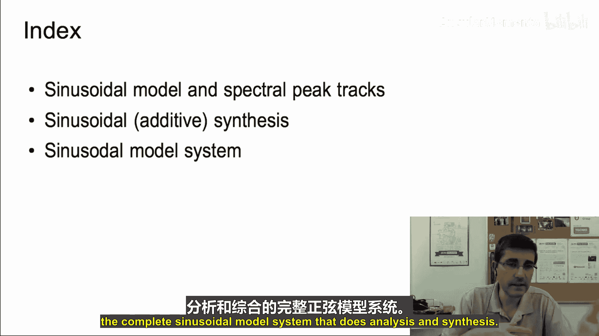
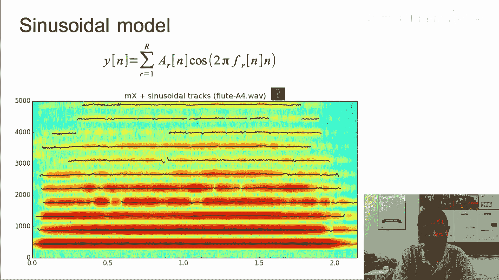
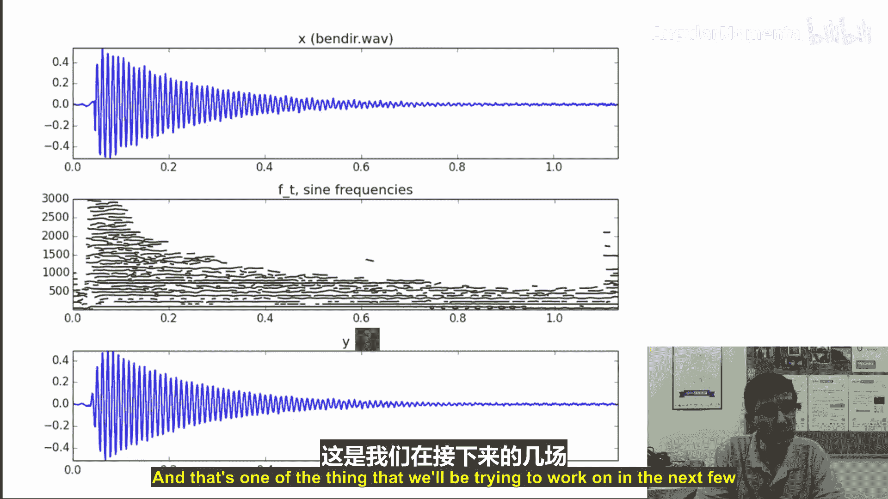
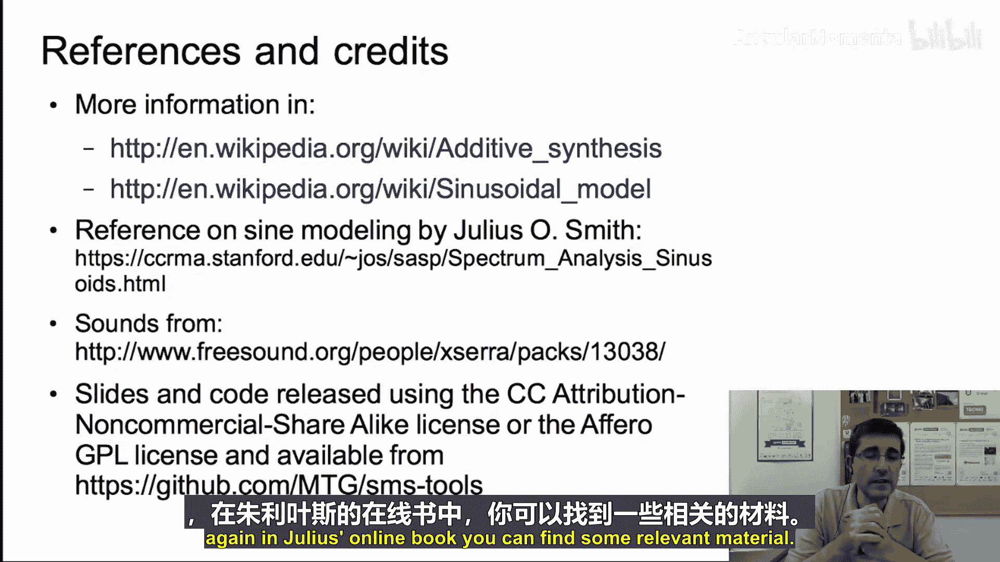
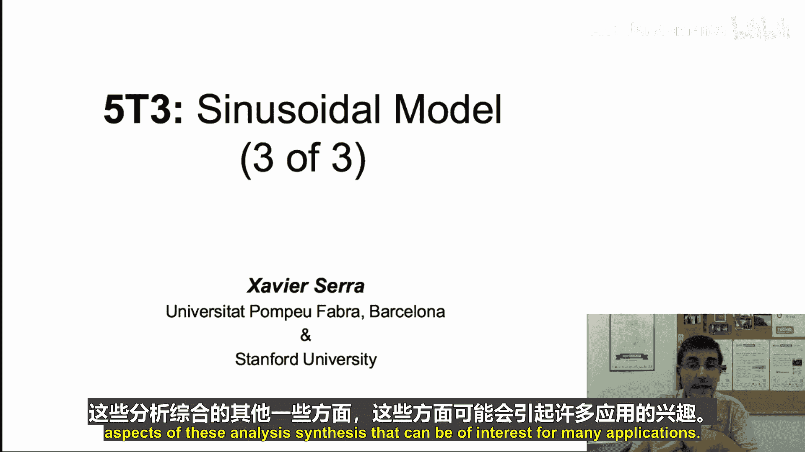

# 033：正弦模型3

在本节课中，我们将完成正弦模型的学习，重点介绍其合成部分。我们将回顾模型的核心概念，探讨如何使用加法合成生成声音，并最终构建一个完整的分析-合成系统。

上一节我们介绍了正弦模型的分析部分。本节中，我们来看看如何利用分析结果来合成声音。



## 模型回顾与频谱轨迹

正弦模型认为声音是多个时变正弦波的总和，其表达式如下：

**公式：** `x(t) = Σ A_k(t) * cos(2π * f_k(t) * t + φ_k(t))`



其中，`x(t)` 是输出信号，`A_k(t)`、`f_k(t)` 和 `φ_k(t)` 分别是第 `k` 个正弦波的时变幅度、频率和相位。

展示分析结果的一个好方法，是在声音的幅度谱图上叠加绘制这些时变正弦波的频率轨迹。下图展示了一个长笛声音的谱图及其上方的正弦波频率轨迹线。这些轨迹线直观地呈现了正弦模型对声音的分解。


## 正弦波合成（加法合成）

从分析得到的参数值出发，我们想要重新合成声音。合成正弦波的标准方法是使用加法合成。

以下是加法合成器的标准框图：它包含一系列振荡器。每个振荡器根据输入的幅度和频率参数，生成一个时变正弦波，然后将所有这些正弦波相加，得到输出信号。

那么，如何生成每个独立的正弦波呢？

### 时域直接合成

最直接的方法是直接使用正弦函数。例如，在Python中可以这样实现：

**代码：**
```python
import numpy as np

def generate_sinusoid(amplitude, frequency, phase, duration, sample_rate):
    t = np.arange(0, duration, 1/sample_rate)
    signal = amplitude * np.cos(2 * np.pi * frequency * t + phase)
    return signal
```

然而，对于复杂信号，可能需要同时合成数百个正弦波，且每个样本点都需要计算，这种方法计算开销较大。

### 频域合成（利用DFT）

我们可以利用离散傅里叶变换在频域进行更高效的合成。基本思想是：从正弦波的幅度谱和相位谱出发，对其进行逆DFT来得到时域信号。

**公式：** `x[n] = IDFT{ X[k] }`，其中 `X[k]` 是正弦波在频域的表示。

但这仅适用于频率恰好是DFT离散频率点的情况。对于任意频率的正弦波，其频谱并非单根谱线，而是取决于所使用的窗函数。

为了在频域生成一个任意频率的正弦波，我们需要生成一个窗函数的频谱，并将其移动到目标频率，同时乘以正确的幅度和相位。

**公式：** `X[k] = A * W[k - k0] * e^(jφ)`，其中 `W[k]` 是窗函数的频谱，`k0` 对应目标频率，`A` 和 `φ` 是幅度和相位。

下图展示了使用两种不同窗函数（汉宁窗和布莱克曼-哈里斯窗）时，同一正弦波的频谱及其逆DFT结果。可以看到，时域信号都受到了窗函数的影响。


频域合成的一个巨大优势是，并非所有频谱样本都具有相同的重要性。我们可以利用这一点来提高效率。

### 利用主瓣进行高效合成

窗函数频谱的能量主要集中在主瓣。对于布莱克曼-哈里斯窗，其主瓣仅包含约8个样本。如果只取这8个主瓣样本进行逆DFT，我们就能高效地生成一个正弦波。

实验表明，使用布莱克曼-哈里斯窗主瓣合成信号的信噪比非常高（约102 dB），对于音频应用来说失真可以忽略不计。因此，布莱克曼-哈里斯窗是频域正弦波合成的良好选择。

要合成多个正弦波，只需在频域叠加它们各自的主瓣即可。

**公式：** `X_total[k] = Σ A_i * W_BH[k - k_i] * e^(jφ_i)`

下图示例展示了在频域生成三个不同频率和幅度的正弦波（分别位于1000 Hz， 4000 Hz， 8000 Hz），将它们的主瓣频谱叠加后进行逆DFT，得到了这三个正弦波相加的时域信号（当然，也乘上了布莱克曼-哈里斯窗）。

## 完整的分析-合成系统

现在，我们可以将上述思想整合成一个完整的正弦模型分析-合成系统。

以下是构建该系统的步骤概述：

1.  **分析阶段**：
    *   输入原始信号 `x[n]`。
    *   乘以分析窗，计算短时傅里叶变换，得到幅度谱和相位谱。
    *   在幅度谱中检测峰值，获取其频率、幅度和相位。
    *   根据频率连续性等约束，在时间上跟踪这些峰值，形成正弦轨迹。

2.  **合成阶段**：
    *   根据每条正弦轨迹的参数（频率、幅度、相位），在频域生成对应的布莱克曼-哈里斯窗主瓣频谱。
    *   将所有主瓣频谱相加，得到合成信号的频域表示。
    *   计算逆傅里叶变换，得到加窗的时域信号。
    *   进行“去窗”操作：除以布莱克曼-哈里斯窗函数，再乘以一个三角窗函数。此操作允许我们以25%的重叠率进行叠加，从而重建完整的时域信号。

这个系统能够较好地复现原始声音中由正弦波构成的部分。让我们听一个邦戈鼓声音的分析-合成示例。

（原始邦戈鼓声）
（合成后的邦戈鼓声）

仔细聆听会发现，尤其在瞬态部分，合成音与原始音存在一些差异。这是我们后续课程中将尝试解决的问题。



## 总结与展望

本节课中，我们一起学习了正弦模型的合成部分。我们探讨了加法合成的原理，比较了时域和频域合成方法的优劣，并重点介绍了利用布莱克曼-哈里斯窗主瓣进行高效频域合成的技术。最后，我们构建了一个完整的正弦模型分析-合成系统。


通过这三讲的理论学习，我们从短时傅里叶变换出发，掌握了如何在谱图上分析正弦波，并利用这种简化的频谱表示（正弦模型）进行声音的重新合成。这种模型不仅可用于音频压缩，其本身也是一种对许多应用非常有用的高级声音表示方法。



在接下来的课程中，我们将利用声音的更多特性，在模型中施加更多约束，以期获得对各类应用更有价值的分析-合成结果。


**参考资料**：关于加法合成，可自行查阅维基百科。朱利亚的在线书籍中也包含相关材料。



