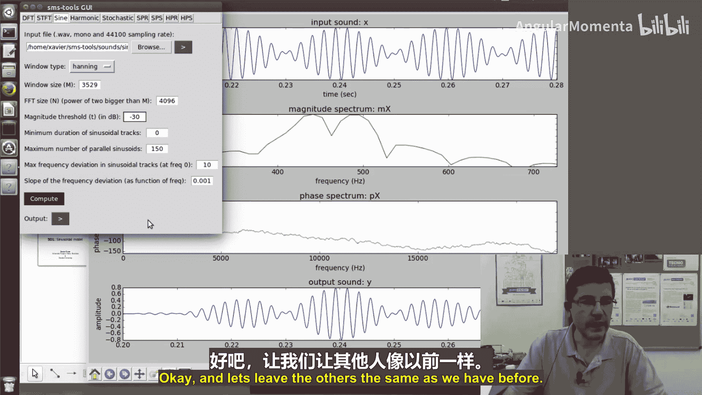
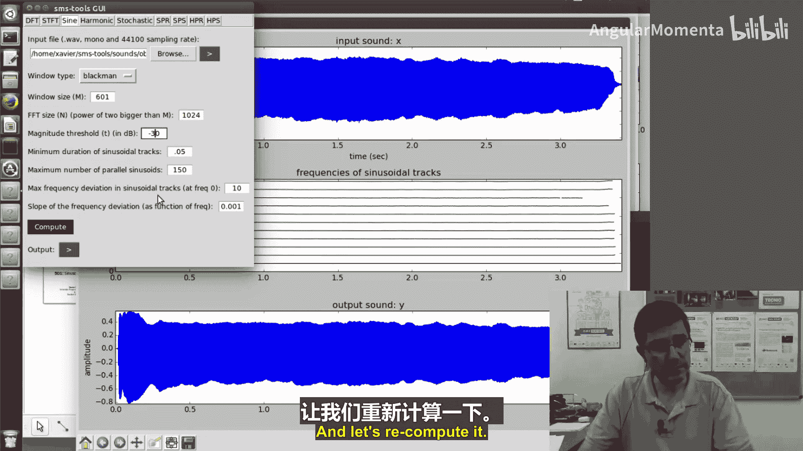
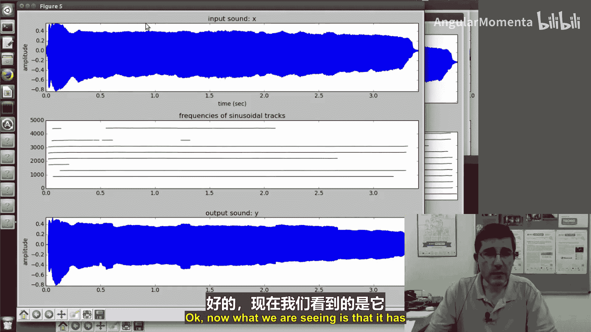
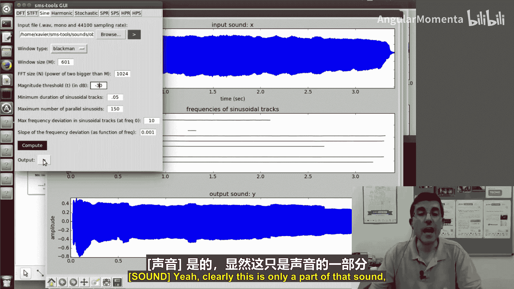
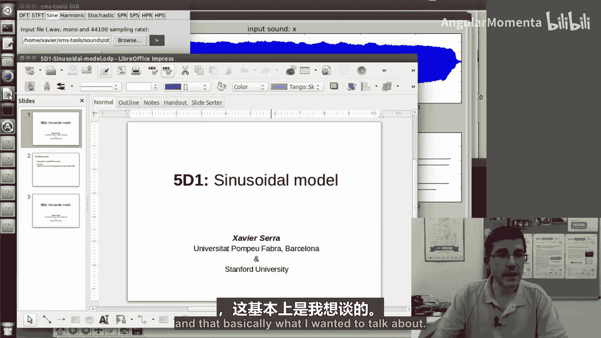

# 034：正弦模型实践指南 🎵

在本节课中，我们将从实践角度学习正弦模型。上一节我们介绍了正弦模型的理论基础，本节中我们将使用SMS工具，通过实际操作来理解如何应用正弦模型分析音频信号。

## 概述

正弦模型是一种将音频信号分解为一系列正弦波（即正弦分量）的方法。每个正弦分量由三个核心参数描述：**频率**、**幅度**和**相位**。在分析时，模型会从信号的频谱中识别出主要的峰值，并将它们作为正弦分量进行追踪和建模。

## 从DFT模型开始

首先，我们从一个简单的440Hz正弦波开始分析。使用DFT（离散傅里叶变换）模型，我们可以观察其频谱。

以下是分析步骤：
1.  打开一个440Hz的正弦波音频。
2.  使用汉宁窗（Hann window）。
3.  设置窗口大小为511，FFT大小为1024。
4.  计算并观察其幅度谱、相位谱以及从频谱重建的信号。

在频谱中，我们可以看到代表该正弦波的单一峰值。正弦模型的目标正是自动找到这个峰值的**频率**、**幅度**和**相位**。

## 应用正弦模型分析单音

现在，我们切换到正弦模型来分析同一个440Hz正弦波。

以下是正弦模型的关键参数设置：
*   **幅度阈值**：设定为-50 dB。模型将只寻找幅度在最大能量50分贝以内的峰值。
*   **最大正弦波数量**：设为150（对于单音绰绰有余）。
*   **频率追踪偏差**：设置最低频率偏差为10 Hz，并允许偏差随频率升高而增加。

计算后，我们可能会发现分析结果中出现了不止一条频率线。这是因为频谱的旁瓣也被当作峰值捕捉了进来。为了只捕捉主峰，我们需要将**幅度阈值**调整得更严格，例如设为-20 dB。调整后，分析结果将只显示一条清晰的440Hz频率线。

## 分析更复杂的信号：双正弦波

为了理解参数如何影响复杂信号的分析，我们接下来分析一个由440Hz和490Hz正弦波叠加而成的信号。

在理论课中我们学过，为了在频谱上区分两个频率相近的正弦波，需要选择合适的窗口大小。计算公式为：
`窗口大小M ≥ (窗函数主瓣宽度系数 × 采样频率) / 欲分辨的频率差`

对于汉宁窗（主瓣宽度系数为4），采样率44100 Hz，频率差50 Hz，计算得到的最小窗口大小约为3528。我们将其设为奇数值3529，并设置足够大的FFT尺寸（如4096）。将幅度阈值设为-30 dB后进行分析，可以清晰地看到两条分别代表440Hz和490Hz的稳定频率轨迹。

如果窗口大小设置得过小（例如1800），FFT尺寸也不足（2048），即使合成出的声音听起来尚可，分析得到的频率轨迹也会变得混乱和不稳定，无法清晰区分两个正弦分量。这说明了正确设置分析参数对于准确建模至关重要。

## 分析真实乐器声音

最后，我们使用正弦模型分析一个真实的乐器声音——一个440Hz（A4）的双簧管音符。

对于具有丰富谐波的乐音，我们需要调整参数：
*   **窗口类型与大小**：使用主瓣更宽的布莱克曼窗（主瓣宽度系数为6）。根据公式计算，分辨基频440Hz所需的窗口大小约为601。
*   **幅度阈值**：由于谐波能量衰减，需要设置更低的阈值（如-80 dB）以捕捉到较弱的高次谐波。
*   **最小轨迹长度**：可以设置为0.05秒，以过滤掉短暂的杂散轨迹。
*   **频率追踪偏差**：需要设置合适的偏差值，以在时间上正确追踪各谐波频率的变化。

使用这些参数进行分析，我们可以在频谱图中看到一系列水平的谐波轨迹。合成的音频与原始声音非常接近。

如果我们将幅度阈值设置得过高（如-30 dB），模型将无法捕捉到能量较弱的谐波，导致合成声音缺失高频成分，听起来与原始声音有显著差异。

## 总结

本节课中，我们一起通过SMS工具实践了正弦模型的应用。我们从简单的单音开始，逐步分析了双音和复杂的真实乐器声音，演示了**窗口大小**、**幅度阈值**、**频率追踪偏差**等关键参数对分析结果的影响。

正弦模型的核心在于从信号频谱中提取并追踪正弦分量。掌握这些参数的设置，对于准确分析不同特性的声音至关重要。建议你尝试分析更多声音，亲身体验不同参数带来的效果，这将为后续学习更复杂的音频处理技术打下坚实基础。

我们下节实践课将分析更复杂的声音，并深入探索正弦模型的更多细节。下次见！